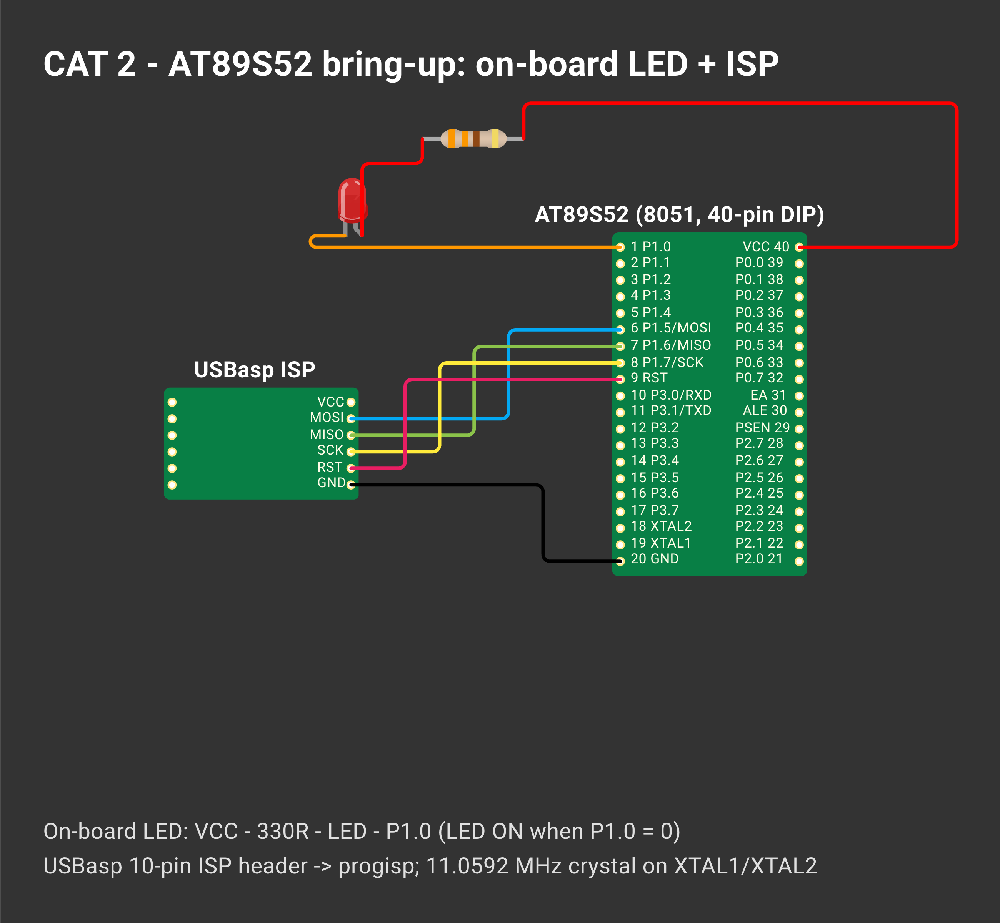

# EXPERIMENT DETAILS

**EXP:** CONTINUOUS ASSESSMENT 2

**DATE:** 20/09/2025

**NAME OF EXP:** 8051 Tool Chain Setup – Development Board – AT89S52

**HARDWARE SETUP / PLATFORM:** AT89S52 development kit (8051 core, 11.0592 MHz crystal) — Keil µVision 5 (C51), progisp + USBasp ISP programmer

---

## TASK 1 : Hardware Board Bring-Up

### 1. Circuit Diagram

| Signal | Pin | Notes |
|---|---|---|
| User LED | P1.0 | on-board, **active-LOW** (0 = ON) |
| ISP | P1.5 MOSI, P1.6 MISO, P1.7 SCK, RST | USBasp 10-pin header |
| Supply | VCC pin 40, GND pin 20 | 5 V |

*Drawn on [Wokwi](https://wokwi.com). To open and edit it: start a new project on wokwi.com, paste [`wokwi/diagram.json`](wokwi/diagram.json) into its diagram.json tab, and add the `wokwi/*.chip.json` files (if any) with **New file**. The AT89S52, USB-TTL, ULN2003, USBasp and ST-LINK boards are custom chips (pin names added as labels). The ESP-01 part stands in for the Wemos D1 mini and the BMP180 module for the BME280 (same AT firmware / same 4-pin I²C header); the Nucleo-64 graphic is labelled as the F401RE.*

### 2. Core Logic / Pseudocode / Code Base

**Working Principle:**

In this initial bring-up, we mapped the key hardware components directly from the board schematic. We verified the 5 V power rail across VCC (pin 40) and GND (pin 20) with a digital multimeter, confirmed that the user LED is wired in an active-low configuration to pin P1.0, and connected the host PC to the AT89S52 development kit using a 10-pin USBasp in-system programmer (ISP).

| Parameter | Entry |
|---|---|
| MCU | AT89S52 |
| CPU core | 8051 (MCS-51), 8-bit, 12 clocks / machine cycle |
| Operating voltage | 5 V (4.0 – 5.5 V) |
| Debug interface | none on-chip; ISP over SPI (USBasp + progisp) |
| LED GPIO port / pin | Port 1 / P1.0 |
| LED active state | LOW |
| LED frequency | ≈ 1 Hz |

**Pseudocode:**

1. Locate the AT89S52 microcontroller, ISP connector, power rails, and user LED on the board.
2. Measure the supply voltage between VCC (pin 40) and GND (pin 20) to ensure a stable 5 V supply.
3. Trace the LED connection to pin P1.0 and confirm its active-low logic.
4. Set up the USBasp programmer drivers, compile a minimal test project in Keil µVision, and flash the resulting HEX file using progisp.

**Code Base:**

- Project files: `TASK2B.uvproj` (Keil µVision), `STARTUP.A51`, firmware `Objects/TASK2B.hex`.
- No active C application logic is required here, as this step serves to validate the hardware and flashing pipeline.
- `BringUp_Sheet.md` holds the sheet with spaces for the measured values.

### 3. Inference

We confirmed that the development board powers up correctly, the supply rails are within tolerance, and the USBasp programmer reliably writes firmware from the PC. With the toolchain verified, the setup is ready for writing and deploying bare-metal C applications.

---

## TASK 2 : Bare-Metal LED Blink

### 1. Circuit Diagram

| Signal | Pin | Notes |
|---|---|---|
| User LED | P1.0 | on-board, **active-LOW** (0 = ON) |
| ISP | P1.5 MOSI, P1.6 MISO, P1.7 SCK, RST | USBasp 10-pin header |
| Supply | VCC pin 40, GND pin 20 | 5 V |

*Drawn on [Wokwi](https://wokwi.com). To open and edit it: start a new project on wokwi.com, paste [`wokwi/diagram.json`](wokwi/diagram.json) into its diagram.json tab, and add the `wokwi/*.chip.json` files (if any) with **New file**. The AT89S52, USB-TTL, ULN2003, USBasp and ST-LINK boards are custom chips (pin names added as labels). The ESP-01 part stands in for the Wemos D1 mini and the BMP180 module for the BME280 (same AT firmware / same 4-pin I²C header); the Nucleo-64 graphic is labelled as the F401RE.*

### 2. Core Logic / Pseudocode / Code Base

**Working Principle:**

We declare `sbit USER_LED = P1^0;` to bind the LED pin directly to bit 0 of Port 1's Special Function Register (address 0x90). Because the 8051 architecture uses quasi-bidirectional I/O ports without separate data direction registers (DDR), simply writing a logic state to the port pin drives the line. Since the LED is wired in active-low mode, clearing P1.0 turns the LED on, while setting it turns it off. To achieve a 0.5 s half-period delay without hardware timers, we employ a nested software loop. Declaring the inner loop variable as `volatile` prevents the Keil C51 optimizer from stripping the loop away. In simulation (uCsim at 11.0592 MHz), a single outer iteration takes approximately 2086 machine cycles (~2.26 ms), meaning 221 outer passes yield a delay very close to 0.5 seconds.

**Pseudocode:**

1. Include the 8052 register header (`reg52.h`).
2. Map pin P1.0 using `sbit` and define active-low macros (`LED_ON = 0`, `LED_OFF = 1`).
3. Construct `soft_delay()` using calibrated nested loops to generate roughly 0.5 s of delay per call.
4. Inside `main()`, drive the LED pin LOW to turn it on, call `soft_delay()`, drive it HIGH to turn it off, and call `soft_delay()` again.
5. Keep repeating the toggle sequence within an infinite loop (`while (1)`).

**Code Base:**

- `main.c` — `soft_delay(HALF_PERIOD_PASSES)` with `HALF_PERIOD_PASSES = 221`
- `TASK2B.uvproj`, `STARTUP.A51`

### 3. Inference

The on-board LED flashes at approximately 1 Hz (0.5 s ON, 0.5 s OFF). This confirms that direct SFR manipulation and calibrated software loop delays can establish basic time intervals on the AT89S52 without external drivers.
