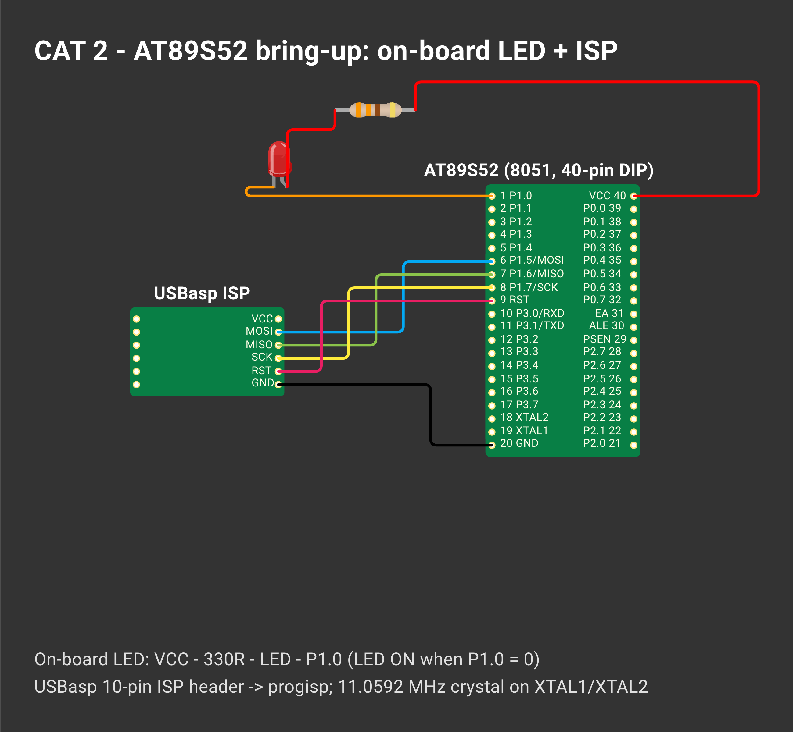

# EXPERIMENT DETAILS

**EXP:** CONTINUOUS ASSESSMENT 2

**DATE:** 20/09/2025

**NAME OF EXP:** 8051 Tool Chain Setup – Development Board – AT89S52

**HARDWARE SETUP / PLATFORM:** AT89S52 development kit (8051 core, 11.0592 MHz crystal) — Keil µVision 5 (C51), progisp + USBasp ISP programmer

---

## TASK 3 : Custom Library Function for Delay

### 1. Circuit Diagram

| Signal | Pin | Notes |
|---|---|---|
| User LED | P1.0 | on-board, **active-LOW** (0 = ON) |
| ISP | P1.5 MOSI, P1.6 MISO, P1.7 SCK, RST | USBasp 10-pin header |
| Supply | VCC pin 40, GND pin 20 | 5 V |

*Drawn on [Wokwi](https://wokwi.com). To open and edit it: start a new project on wokwi.com, paste [`wokwi/diagram.json`](wokwi/diagram.json) into its diagram.json tab, and add the `wokwi/*.chip.json` files (if any) with **New file**. The AT89S52, USB-TTL, ULN2003, USBasp and ST-LINK boards are custom chips (pin names added as labels). The ESP-01 part stands in for the Wemos D1 mini and the BMP180 module for the BME280 (same AT firmware / same 4-pin I²C header); the Nucleo-64 graphic is labelled as the F401RE.*

### 2. Core Logic / Pseudocode / Code Base

**Working Principle:**

To make delay management cleaner and reusable across upcoming labs, we packaged our delay routines into a modular library (`delay.h` and `delay.c`). The core function `delay_ms(n)` executes a calibrated 1 ms timing loop $n$ times. The 1 ms block consists of two 50-iteration loops using a `volatile` counter; at 9 machine cycles per pass plus call and loop overhead (22 + 18 × 50 = 922 cycles), this produces 999.8 µs (~1.000 ms) at our 11.0592 MHz crystal frequency (tested in uCsim simulator, though compiler optimization settings in Keil can shift this slightly). In addition, we introduced a fine-grained `delay_50us()` routine to handle microsecond delays needed by slower external peripherals, such as the HD44780 LCD module used in CAT 7.

**Pseudocode:**

1. Define the prototypes for `delay_ms()` and `delay_50us()` in `delay.h`.
2. Implement the cycle-calibrated software loops inside `delay.c`.
3. Include `delay.h` in `main.c`.
4. Inside the infinite loop, switch the LED ON, invoke `delay_ms(500)`, switch the LED OFF, and call `delay_ms(500)`.
5. Repeat indefinitely to maintain continuous 1 Hz blinking.

**Code Base:**

- Project files: `TASK2C.uvproj` (Keil µVision), `STARTUP.A51`, firmware `Objects/TASK2C.hex`.
- `delay.h` — interface and timing notes
- `delay.c` — calibrated loops
- `main.c` — 1 Hz blink with `delay_ms(BLINK_HALF_MS)`

### 3. Inference

Abstracting timing into a dedicated delay library allows application code to specify clean millisecond intervals without hardcoded loop counts. This library forms the baseline timing utility reused throughout CAT 3 to CAT 7.
