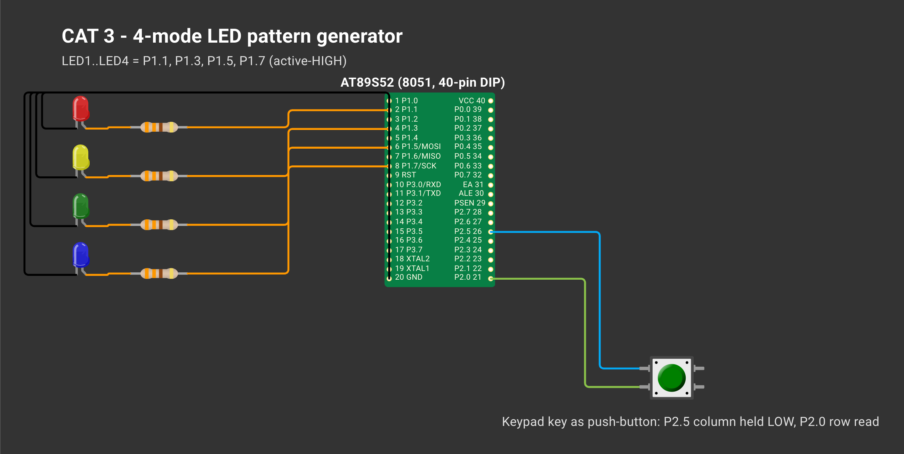

# EXPERIMENT DETAILS

**EXP:** CONTINUOUS ASSESSMENT 3

**DATE:** 27/09/2025

**NAME OF EXP:** Timer-Based LED Pattern Generator and Button Controller

**HARDWARE SETUP / PLATFORM:** AT89S52 development kit (8051 core, 11.0592 MHz crystal) + 4 LEDs + push-button — Keil µVision 5 (C51), progisp + USBasp ISP programmer

---

## ACTIVITY : Four-State LED Control System

### 1. Circuit Diagram

| Signal | Pin |
|---|---|
| LED1 / LED2 / LED3 / LED4 | P1.1 / P1.3 / P1.5 / P1.7 (active-HIGH, 330 Ω) |
| Push-button | keypad key: P2.5 held LOW, P2.0 read |

*Drawn on [Wokwi](https://wokwi.com). To open and edit it: start a new project on wokwi.com, paste [`wokwi/diagram.json`](wokwi/diagram.json) into its diagram.json tab, and add the `wokwi/*.chip.json` files (if any) with **New file**. The AT89S52, USB-TTL, ULN2003, USBasp and ST-LINK boards are custom chips (pin names added as labels). The ESP-01 part stands in for the Wemos D1 mini and the BMP180 module for the BME280 (same AT firmware / same 4-pin I²C header); the Nucleo-64 graphic is labelled as the F401RE.*

### 2. Core Logic / Pseudocode / Code Base

**Working Principle:**

The firmware is designed as a clean finite state machine governed by the variable `mode`. Instead of manually toggling individual port bits inside pattern loops, `leds_write(pattern)` maps a 4-bit nibble directly onto `led1` (P1.1), `led2` (P1.3), `led3` (P1.5), and `led4` (P1.7) (bit 3 maps to LED1 down to bit 0 for LED4), cleanly decoupling pattern calculations from pin actuation. Switch contact bounce is handled in software: `button_pressed()` executes during every 10 ms cycle and accepts a logic change only after it persists over two consecutive samples (a 20 ms validation window). The routine triggers strictly on a released-to-pressed transition (`button_row == 0`), preventing accidental rapid cycling when holding the button. LED patterns update at 300 ms intervals (counted as 30 passes through the 10 ms loop), which keeps user input immediately responsive.

| Mode | LED1 LED2 LED3 LED4 |
|---|---|
| 0 | 0000 (power-on) |
| 1 Running | 1000 → 0100 → 0010 → 0001 |
| 2 Binary | 0000 → … → 1111 |
| 3 Alternate | 1010 ↔ 0101 |
| 4 Flash | 1111 ↔ 0000 |

**Pseudocode:**

1. Configure button lines (hold keypad column `button_col = P2^5` LOW, read `button_row = P2^0` with pull-up initialized to 1), clear all LEDs with `leds_write(0x00)`, and initialize `mode = 0`.
2. In a 10 ms loop paced by `delay_ms(10)`, poll `button_pressed()`.
3. When a valid press edge arrives, increment `mode` (`(mode >= 4) ? 1 : mode + 1`), reset `step = 0`, and set `loop_count = 30` to trigger an immediate pattern update.
4. Every 30 loop iterations (300 ms), compute the current active bitmask via `get_pattern(mode, step)` and update the outputs with `leds_write()`.
5. Increment `step`, wrapping around according to the active mode's cycle length (reset at $\ge 4$ for running mode 1, $\ge 16$ for binary mode 2, alternating bit 0 for alternate mode 3 and flash mode 4).

**Code Base:**

- Project files: `TASK3A.uvproj` (Keil µVision), `STARTUP.A51`, firmware `Objects/TASK3A.hex`.
- `main.c` — `leds_write()`, `button_pressed()`, `get_pattern()`
- `delay.c/.h` — `delay_ms()` from CAT 2

### 3. Inference

The state machine advances through the four LED patterns on each consecutive button press. Filtering switch bounce across consecutive 10 ms polling intervals provided crisp edge detection while keeping the loop fast and non-blocking.
