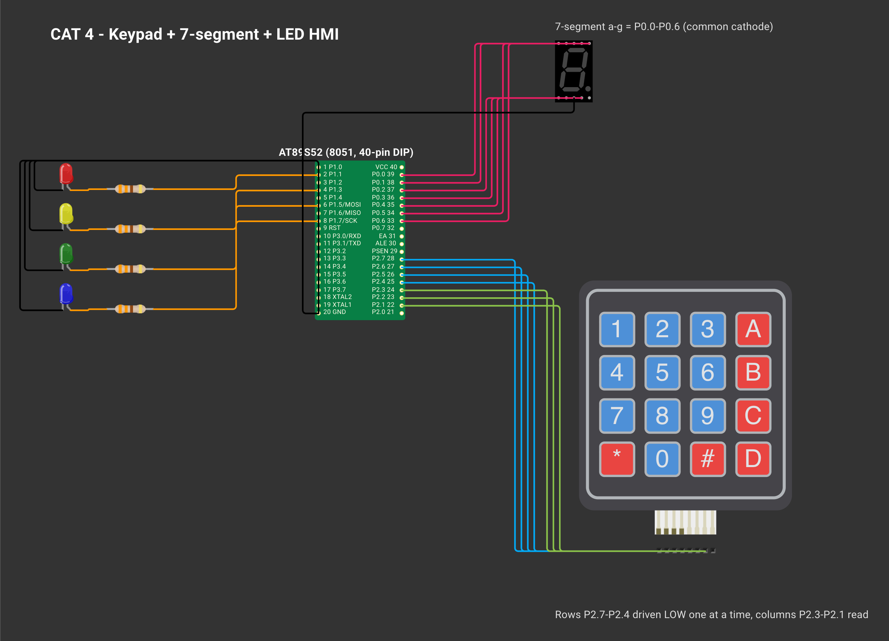

# EXPERIMENT DETAILS

**EXP:** CONTINUOUS ASSESSMENT 4

**DATE:** 03/08/2026

**NAME OF EXP:** Human-Machine Interface using Matrix Keypad, LEDs and Seven-Segment Display

**HARDWARE SETUP / PLATFORM:** AT89S52 development kit (8051 core, 11.0592 MHz crystal) + keypad + 7-segment + 4 LEDs — Keil µVision 5 (C51), progisp + USBasp ISP programmer

---

## TASK : Keypad-Controlled Display and LED Operations

### 1. Circuit Diagram

| Signal | Pins |
|---|---|
| Keypad rows R1–R4 | P2.7–P2.4 (driven) |
| Keypad columns C1–C3 | P2.3–P2.1 (read) |
| 7-segment a–g | P0.0–P0.6 (common cathode) |
| LED1–LED4 | P1.1, P1.3, P1.5, P1.7 |

*Drawn on [Wokwi](https://wokwi.com). To open and edit it: start a new project on wokwi.com, paste [`wokwi/diagram.json`](wokwi/diagram.json) into its diagram.json tab, and add the `wokwi/*.chip.json` files (if any) with **New file**. The AT89S52, USB-TTL, ULN2003, USBasp and ST-LINK boards are custom chips (pin names added as labels). The ESP-01 part stands in for the Wemos D1 mini and the BMP180 module for the BME280 (same AT firmware / same 4-pin I²C header); the Nucleo-64 graphic is labelled as the F401RE.*

### 2. Core Logic / Pseudocode / Code Base

**Working Principle:**

This experiment builds a complete interactive human-machine interface by coordinating a matrix keypad, a common-cathode 7-segment display, and an array of 4 LEDs. To multiplex the 4×3 keypad using only 7 microcontroller pins, we implement active row scanning. Each row line (P2.7–P2.4) is driven LOW one at a time via `P2 = ~(0x80 >> row)`, while column inputs (P2.3–P2.1) are read with pull-ups enabled. When a LOW bit reveals an active key contact, the code waits 15 ms to filter mechanical contact chatter and re-reads the lines. Validated keystrokes are translated via the code-memory array `KEYMAP[4][3]` and reported once per press event. The digit is shown on the 7-segment display through the pattern lookup table `SEG_CODE[10]` driven over Port 0, while the corresponding LED pattern is activated.

| Key | Display | LED operation |
|---|---|---|
| 1–4 | 1–4 | LEDn ON |
| 5 | 5 | running LED |
| 6 | 6 | alternate 1010 ↔ 0101 |
| 7 | 7 | binary counter 0–15 |
| 8 | 8 | blink all |
| 9 | 9 | all OFF |
| 0 | 0 | reset |

**Pseudocode:**

1. Initialize pins: extinguish all LEDs and clear the seven-segment display.
2. In the 10 ms scheduling loop, invoke `keypad_scan()`.
3. When a newly pressed key is detected:
   a. Call `display_digit(key)` to render the digit on the 7-segment display.
   b. Call `led_control(key)` to engage either static output or initiate an animation sequence.
4. Every 250 ms, advance any active animated mode (`running_led()`, `alternate_led()`, `binary_counter()`, or `blink_all()`).
5. Key 9 shuts all LEDs off, while key 0 resets both the display and LED states.

**Code Base:**

- Project files: `TASK4A.uvproj` (Keil µVision), `STARTUP.A51`, firmware `Objects/TASK4A.hex`.
- Modular implementation functions: `keypad_scan()`, `display_digit()`, `led_control()`, `running_led()`, `binary_counter()`, `alternate_led()`, `blink_all()`.
- `delay.c/.h`

### 3. Inference

Every keystroke is displayed immediately on the 7-segment unit and launches its dedicated LED routine. Matrix scanning cleanly accesses 12 keys using 7 pins, and modular function separation makes expanding the command set straightforward.
