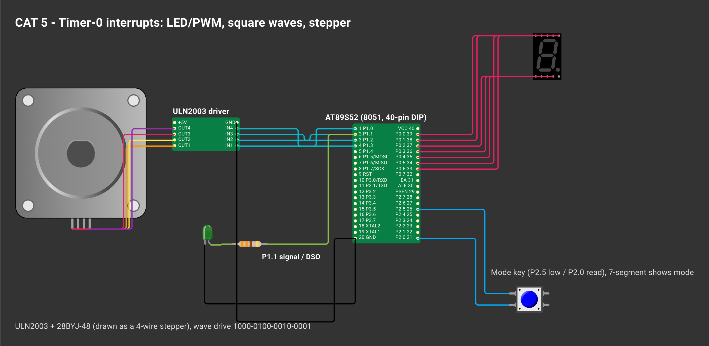

# EXPERIMENT DETAILS

**EXP:** CONTINUOUS ASSESSMENT 5

**DATE:** 10/08/2026

**NAME OF EXP:** Hardware Timer and Interrupt-Based Timing for LED Fading, Pulse Generation and Stepper Motor Control

**HARDWARE SETUP / PLATFORM:** AT89S52 development kit (8051 core, 11.0592 MHz crystal) + LED + DSO + ULN2003/28BYJ-48 — Keil µVision 5 (C51), progisp + USBasp ISP programmer, DSO

---

## TASK 1 : Timer 0 Interrupt, 1 s Software Time Base

### 1. Circuit Diagram

> **Note:** this diagram shows all CAT 5 tasks together. P1.1 drives the LED in Tasks 1 and 2 (LED, PWM, square waves) and is ULN2003 IN2 in Task 3 (stepper), so connect only one of them at a time.

Crystal 11.0592 MHz → machine cycle 1.085 µs → Timer 0 → overflow → **interrupt** → software time base → action

| Time base | Counts | Setting |
|---|---|---|
| 1 ms | 922 | Mode 1, TH0:TL0 = 0xFC66 (+12 for ISR entry → 0xFC72), reloaded in the ISR |
| 100 µs | 92 | Mode 2 auto-reload, TH0 = 0xA4 |

*Drawn on [Wokwi](https://wokwi.com). To open and edit it: start a new project on wokwi.com, paste [`wokwi/diagram.json`](wokwi/diagram.json) into its diagram.json tab, and add the `wokwi/*.chip.json` files (if any) with **New file**. The AT89S52, USB-TTL, ULN2003, USBasp and ST-LINK boards are custom chips (pin names added as labels). The ESP-01 part stands in for the Wemos D1 mini and the BMP180 module for the BME280 (same AT firmware / same 4-pin I²C header); the Nucleo-64 graphic is labelled as the F401RE.*

### 2. Core Logic / Pseudocode / Code Base

**Working Principle:**

In this task, we generate an accurate 1-second timebase entirely through hardware Timer 0 interrupts rather than blocking software delays. Operating at 11.0592 MHz, one 8051 machine cycle takes $12 / 11059200 \approx 1.085$ µs. To obtain a 1 ms tick, the timer must count 922 machine cycles. In 16-bit Mode 1, the counter overflows at 65536, requiring an initial value of $65536 - 922 = 64614$ (0xFC66). To compensate for the latency of vector branching and context switching, we offset the reload value by 12 cycles, setting `TH0:TL0 = 0xFC72` directly inside the ISR (interrupt vector 1, using register bank 1). The ISR increments `ms_ticks` on each overflow; once 1000 ms ticks elapse, it asserts `second_flag`. The foreground `main()` loop checks this flag and toggles the LED on P1.1, leaving the CPU available for background work.

**Pseudocode:**

1. Configure TMOD for Timer 0 16-bit Mode 1, load `TH0:TL0 = 0xFC72`, and enable interrupts (`ET0 = 1`, `EA = 1`) before starting the timer (`TR0 = 1`).
2. Inside `timer0_isr()`:
   a. Reload Timer 0 registers with `0xFC72`.
   b. Increment `ms_ticks`.
   c. When `ms_ticks` reaches 1000, reset `ms_ticks = 0` and set `second_flag = 1`.
3. In `main()`, poll `second_flag`. When asserted, clear it and toggle pin P1.1.

**Code Base:**

- Project files: `TASK5A.uvproj` (Keil µVision), `STARTUP.A51`, firmware `Objects/TASK5A.hex`.
- `main.c` — `timer0_isr() interrupt 1 using 1`, `timer0_init_1ms()`

### 3. Inference

The LED toggles at a precise 1-second cadence (0.5 Hz full cycle). Because timing is governed by hardware counter overflows and an ISR flag, the interval remains rock-solid without wasting CPU cycles in busy loops.
