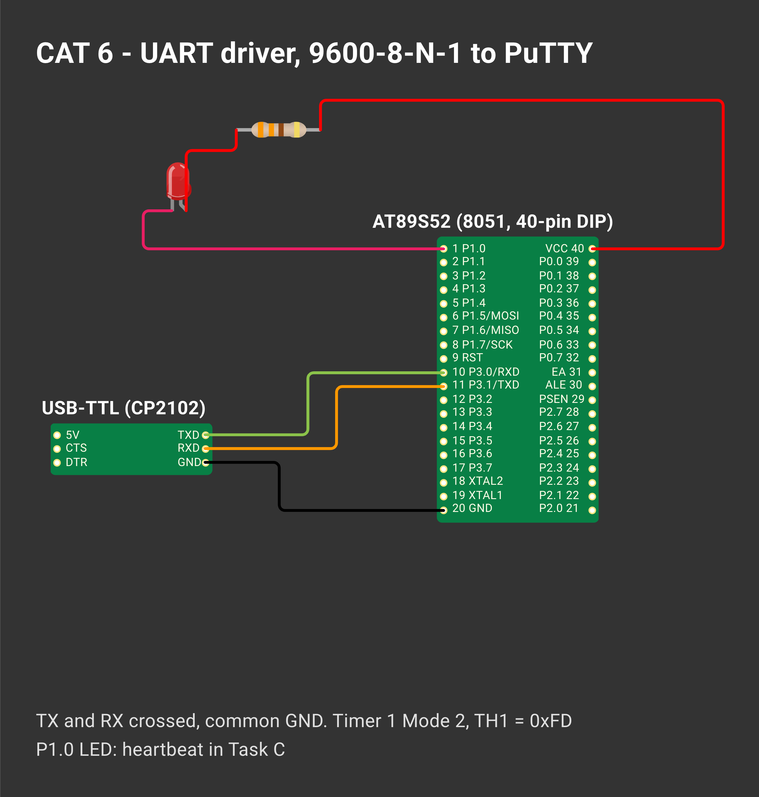

# EXPERIMENT DETAILS

**EXP:** CONTINUOUS ASSESSMENT 6

**DATE:** 17/08/2026

**NAME OF EXP:** UART Driver and Serial Debugging

**HARDWARE SETUP / PLATFORM:** AT89S52 development kit (8051 core, 11.0592 MHz crystal) + USB-to-TTL converter + PuTTY — Keil µVision 5 (C51), progisp + USBasp ISP programmer, PuTTY

---

## TASK A : UART Initialisation and Character Transmission

### 1. Circuit Diagram

| 8051 | USB-to-TTL |
|---|---|
| P3.1 TXD | RX |
| P3.0 RXD | TX |
| GND | GND |

PuTTY: 9600 baud, 8 data, no parity, 1 stop.



*Drawn on [Wokwi](https://wokwi.com). To open and edit it: start a new project on wokwi.com, paste [`wokwi/diagram.json`](wokwi/diagram.json) into its diagram.json tab, and add the `wokwi/*.chip.json` files (if any) with **New file**. The AT89S52, USB-TTL, ULN2003, USBasp and ST-LINK boards are custom chips (pin names added as labels). The ESP-01 part stands in for the Wemos D1 mini and the BMP180 module for the BME280 (same AT firmware / same 4-pin I²C header); the Nucleo-64 graphic is labelled as the F401RE.*

### 2. Core Logic / Pseudocode / Code Base

**Working Principle:**

In this task, we initialize the on-chip UART of the AT89S52 for serial transmission to a host PC running PuTTY. `uart_init()` configures the Serial Control Register (`SCON = 0x50`), selecting Mode 1 (8-bit UART with variable baud rate) and enabling the receiver (`REN = 1`). Timer 1 is set to 8-bit auto-reload mode (Mode 2, `TMOD` upper nibble = 0x20). With an 11.0592 MHz crystal, the standard 9600 baud rate formula $\text{Baud} = \frac{11059200}{384 \times (256 - \text{TH1})}$ yields an exact reload value of $\text{TH1} = 256 - 3 = 0xFD$ with 0% frequency error. To transmit a byte, `uart_putc()` loads the data into the serial buffer `SBUF` and polls the hardware Transmit Interrupt flag (`TI`) until transmission completes, after which it clears `TI` in software. At power-on, the firmware sends an ASCII 'U' (binary 0x55, generating an alternating 01010101 bit pattern useful for checking baud rate on a scope), followed by a periodic greeting string.

**Pseudocode:**

1. Call `uart_init()` to set up SCON, configure Timer 1 for 9600 baud, and start the timer (`TR1 = 1`).
2. Transmit the test character `'U'` followed by Carriage Return and Line Feed (`\r\n`).
3. Enter the main loop: transmit the string `"Hello from 8051\r\n"` using `uart_puts()`.
4. Wait 500 ms using `delay_ms(500)` and repeat continuously.

**Code Base:**

- Project files: `TASK6A.uvproj` (Keil µVision), `STARTUP.A51`, firmware `Objects/TASK6A.hex`.
- `main.c` — `uart_init()`, `uart_putc()`, `uart_puts()`
- `delay.c` / `delay.h` — software busy-wait delay library (`delay_ms()`)

**Expected Output:**

```
U
Hello from 8051
Hello from 8051
...
```

**Supporting notes:**

| Stage | Finding |
|---|---|
| Serial pins | TXD P3.1, RXD P3.0 (alternate function of Port 3) |
| Mode register | SCON; Mode 1 = 8-bit UART, variable baud; REN = 1 → `SCON = 0x50` |
| TX register | SBUF (separate TX and RX buffers at one address) |
| TX complete | TI set by hardware, cleared by software |
| Baud generator | Timer 1, Mode 2 auto-reload |
| 9600 baud | 11059200 / (384 × (256 − TH1)) → TH1 = 0xFD |
| RX complete | RI set, byte in SBUF |

### 3. Inference

We confirmed serial data transmission to PuTTY at 9600 baud (8-N-1). Setting TH1 to 0xFD with an 11.0592 MHz crystal provides exact UART clocking, and character framing was verified error-free on the terminal.
