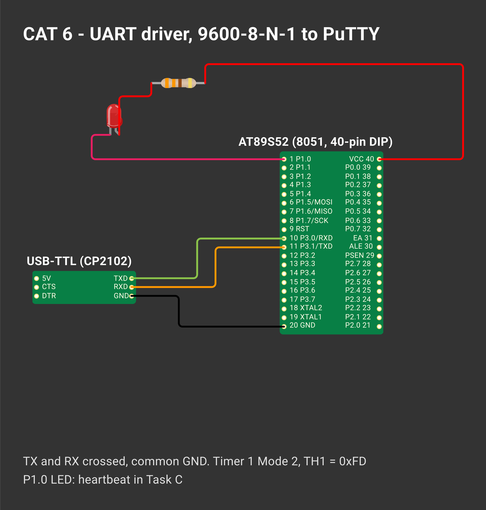

# EXPERIMENT DETAILS

**EXP:** CONTINUOUS ASSESSMENT 6

**DATE:** 17/08/2026

**NAME OF EXP:** UART Driver and Serial Debugging

**HARDWARE SETUP / PLATFORM:** AT89S52 development kit (8051 core, 11.0592 MHz crystal) + USB-to-TTL converter + PuTTY — Keil µVision 5 (C51), progisp + USBasp ISP programmer, PuTTY

---

## TASK B : UART Echo

### 1. Circuit Diagram

| 8051 | USB-to-TTL |
|---|---|
| P3.1 TXD | RX |
| P3.0 RXD | TX |
| GND | GND |

PuTTY: 9600 baud, 8 data, no parity, 1 stop.



*Drawn on [Wokwi](https://wokwi.com). To open and edit it: start a new project on wokwi.com, paste [`wokwi/diagram.json`](wokwi/diagram.json) into its diagram.json tab, and add the `wokwi/*.chip.json` files (if any) with **New file**. The AT89S52, USB-TTL, ULN2003, USBasp and ST-LINK boards are custom chips (pin names added as labels). The ESP-01 part stands in for the Wemos D1 mini and the BMP180 module for the BME280 (same AT firmware / same 4-pin I²C header); the Nucleo-64 graphic is labelled as the F401RE.*

### 2. Core Logic / Pseudocode / Code Base

**Working Principle:**

This task extends the serial interface to support bi-directional full-duplex communication by implementing a blocking character echo. The reception function `uart_getc()` polls the Receive Interrupt flag (`RI`) until the hardware signals that a full byte has shifted into `SBUF`. Once `RI` is asserted, the software extracts the byte from `SBUF` and clears `RI` to prepare the hardware for subsequent incoming frames. The received character is then transmitted back immediately to the terminal using `uart_putc()`. If the user presses Enter (Carriage Return, `\r`), the firmware sends a complementary Line Feed (`\n`) so that the terminal cursor advances cleanly to the beginning of the next line.

**Pseudocode:**

1. Initialize the serial subsystem with `uart_init()` and print an initial welcome message.
2. Inside an infinite loop, block on `uart_getc()` waiting for incoming characters.
3. Upon receiving a character, transmit it back immediately via `uart_putc()`.
4. If the received byte is Carriage Return (`\r`), automatically follow it by transmitting a Line Feed (`\n`).
5. Continue echoing all keystrokes in real time.

**Code Base:**

- Project files: `TASK6B.uvproj` (Keil µVision), `STARTUP.A51`, firmware `Objects/TASK6B.hex`.
- `main.c` — `uart_init()`, `uart_putc()`, `uart_getc()`, `uart_puts()`

**Expected Output:**

```
typed: ABC123      → shown: ABC123
typed: Hello 8051  → shown: Hello 8051
```

**Supporting notes:**

| Stage | Finding |
|---|---|
| Serial pins | TXD P3.1, RXD P3.0 (alternate function of Port 3) |
| Mode register | SCON; Mode 1 = 8-bit UART, variable baud; REN = 1 → `SCON = 0x50` |
| TX register | SBUF (separate TX and RX buffers at one address) |
| TX complete | TI set by hardware, cleared by software |
| Baud generator | Timer 1, Mode 2 auto-reload |
| 9600 baud | 11059200 / (384 × (256 − TH1)) → TH1 = 0xFD |
| RX complete | RI set, byte in SBUF |

### 3. Inference

We verified two-way serial communication between the AT89S52 and PuTTY. Keystrokes entered on the host keyboard were echoed back instantaneously, proving that both receive (RXD) and transmit (TXD) paths function properly.
