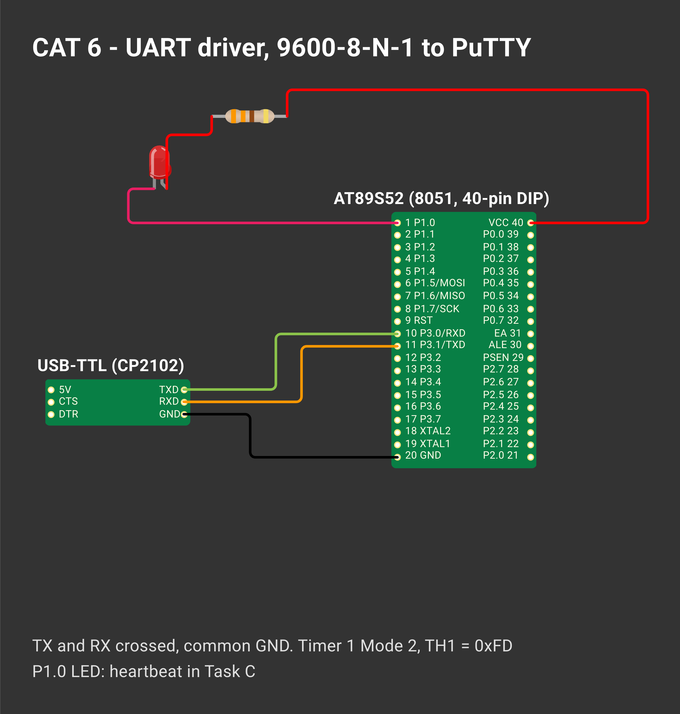

# EXPERIMENT DETAILS

**EXP:** CONTINUOUS ASSESSMENT 6

**DATE:** 17/08/2026

**NAME OF EXP:** UART Driver and Serial Debugging

**HARDWARE SETUP / PLATFORM:** AT89S52 development kit (8051 core, 11.0592 MHz crystal) + USB-to-TTL converter + PuTTY — Keil µVision 5 (C51), progisp + USBasp ISP programmer, PuTTY

---

## TASK C : Interrupt-Driven RX Ring Buffer

### 1. Circuit Diagram

| 8051 | USB-to-TTL |
|---|---|
| P3.1 TXD | RX |
| P3.0 RXD | TX |
| GND | GND |

PuTTY: 9600 baud, 8 data, no parity, 1 stop.



*Drawn on [Wokwi](https://wokwi.com). To open and edit it: start a new project on wokwi.com, paste [`wokwi/diagram.json`](wokwi/diagram.json) into its diagram.json tab, and add the `wokwi/*.chip.json` files (if any) with **New file**. The AT89S52, USB-TTL, ULN2003, USBasp and ST-LINK boards are custom chips (pin names added as labels). The ESP-01 part stands in for the Wemos D1 mini and the BMP180 module for the BME280 (same AT firmware / same 4-pin I²C header); the Nucleo-64 graphic is labelled as the F401RE.*

### 2. Core Logic / Pseudocode / Code Base

**Working Principle:**

Polling UART reception monopolizes CPU time and risks dropping bytes if the MCU is busy with another task. Here, we implement asynchronous, interrupt-driven reception using the 8051 serial interrupt (vector 4, `ES = 1`, `EA = 1`). Whenever a byte arrives, the hardware sets `RI`, triggering the ISR. The ISR immediately reads `SBUF`, clears `RI`, and writes the byte into a 16-element circular FIFO ring buffer. To distinguish unambiguously between buffer-full and buffer-empty states without an extra counter, one slot remains vacant, providing a usable capacity of 15 bytes. The ISR manages the `head` pointer while the foreground `main()` process reads from `tail`. When `TI` triggers on completed transmissions, the ISR clears `tx_busy`. Free of blocking polling, the main loop can perform background tasks—such as blinking a heartbeat LED on P1.0 (`sbit led = P1^0;`) every 30,000 idle loop passes—while assembling complete text commands up to 32 characters (`line[33]`) terminated by Enter.

**Pseudocode:**

1. Configure UART parameters and enable serial interrupts (`ES = 1`, `EA = 1`) via `uart_init()`.
2. Inside the serial ISR (`uart_isr() interrupt 4`):
   a. If `RI` is set: read `SBUF`, deposit the character into the ring buffer at `head` (advancing `head`), or flag an overflow count if full, and clear `RI`.
   b. If `TI` is set: clear `tx_busy` and clear `TI`.
3. Inside `main()`:
   a. Maintain an LED heartbeat (`led = !led` every 30,000 iterations) to demonstrate non-blocking background execution.
   b. While `uart_available()` is true, retrieve characters with `uart_getc()`, echo them back with `uart_putc()`, and append to `line[]` (up to 32 chars; if exceeded, emit `\a` bell).
   c. Upon receiving a Carriage Return or Line Feed, null-terminate `line[]`, print `Got N chars: <line>` using `uart_put_uint()`, report any buffer overflows via `uart_overflows()`, and reset `len = 0`.

**Code Base:**

- Project files: `TASK6C.uvproj` (Keil µVision), `STARTUP.A51`, firmware `Objects/TASK6C.hex`.
- `uart.c` / `uart.h` — serial ISR (interrupt vector 4), 16-byte ring buffer (`uart_init()`, `uart_available()`, `uart_getc()`, `uart_putc()`, `uart_puts()`, `uart_overflows()`)
- `main.c` — line buffering (`line[33]`), integer printing (`uart_put_uint()`), and heartbeat LED (`sbit led = P1^0;`)

**Expected Output:**

```
> hello
Got 5 chars: hello
```

**Supporting notes:**

| Stage | Finding |
|---|---|
| Serial pins | TXD P3.1, RXD P3.0 (alternate function of Port 3) |
| Mode register | SCON; Mode 1 = 8-bit UART, variable baud; REN = 1 → `SCON = 0x50` |
| TX register | SBUF (separate TX and RX buffers at one address) |
| TX complete | TI set by hardware, cleared by software |
| Baud generator | Timer 1, Mode 2 auto-reload |
| 9600 baud | 11059200 / (384 × (256 − TH1)) → TH1 = 0xFD |
| RX complete | RI set, byte in SBUF |

### 3. Inference

With interrupt-driven reception the main program can be busy for up to 15 character times (≈ 15 ms at 9600 baud) without losing data; beyond that the 16-byte buffer is full and further bytes are dropped and counted (`uart_overflows()`, printed after each line).
