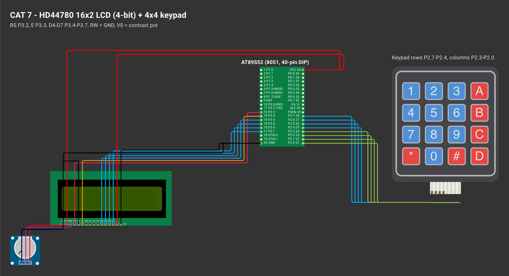

# EXPERIMENT DETAILS

**EXP:** CONTINUOUS ASSESSMENT 7

**DATE:** 24/08/2026

**NAME OF EXP:** 16×2 LCD Driver Development and Dynamic Display Control

**HARDWARE SETUP / PLATFORM:** AT89S52 development kit (8051 core, 11.0592 MHz crystal) + HD44780 16×2 LCD + 4×4 keypad — Keil µVision 5 (C51), progisp + USBasp ISP programmer, HD44780 datasheet

---

## TASK 7A : LCD Initialisation and Character / String Display

### 1. Circuit Diagram

| LCD | 8051 | Role |
|---|---|---|
| RS | P3.2 | 0 command / 1 data |
| E | P3.3 | latch on falling edge |
| D4–D7 | P3.4–P3.7 | 4-bit bus |
| RW | GND | write only |
| V0 | 10 k pot | contrast |

Keypad: rows P2.7–P2.4, columns P2.3–P2.0.



*Drawn on [Wokwi](https://wokwi.com). To open and edit it: start a new project on wokwi.com, paste [`wokwi/diagram.json`](wokwi/diagram.json) into its diagram.json tab, and add the `wokwi/*.chip.json` files (if any) with **New file**. The AT89S52, USB-TTL, ULN2003, USBasp and ST-LINK boards are custom chips (pin names added as labels). The ESP-01 part stands in for the Wemos D1 mini and the BMP180 module for the BME280 (same AT firmware / same 4-pin I²C header); the Nucleo-64 graphic is labelled as the F401RE.*

### 2. Core Logic / Pseudocode / Code Base

**Working Principle:**

This experiment implements a bare-metal driver for a standard HD44780-compatible 16×2 alphanumeric LCD using 4-bit data mode to conserve microcontroller pins. Control lines RS (Register Select, command vs data) and E (Enable pulse) are wired to P3.2 and P3.3, while high data lines D4–D7 connect to P3.4–P3.7 (R/W is tied directly to GND for write-only operation). Because the display powers up in 8-bit mode, `lcd_init()` strictly implements the manufacturer reset sequence: an initial power-on guard delay (>15 ms), followed by pulsing the raw nibble 0x3 three consecutive times, and then sending 0x2 to lock the controller into 4-bit mode. From that point, all 8-bit instructions and ASCII characters are transmitted as two successive nibbles (upper nibble first, followed by lower nibble). The display is configured with Function Set `0x28` (4-bit mode, 2 display lines, 5×8 font), Display On/Off Control `0x0C` (display on, cursor off), Entry Mode `0x06` (auto-increment cursor), and Clear Display `0x01`. Post-command execution pauses follow datasheet timing: commands like Clear require ~2 ms, while standard data and address writes settle in 50 µs.

**Pseudocode:**

1. Initialize the display hardware by calling `lcd_init()`.
2. Send command `0x80` to target line 1, position 0, and output the single test character `'A'` with `lcd_data('A')`.
3. Set cursor to line 1, column 2 using `lcd_goto(0, 2)` and print the banner `"CAT7 LCD TEST"` via `lcd_puts()`.
4. Position the cursor on line 2 with `lcd_goto(1, 0)` and print `"8051 4-BIT MODE"`.

**Code Base:**

- Project files: `TASK7A.uvproj` (Keil µVision), `STARTUP.A51`, firmware `Objects/TASK7A.hex`.
- `lcd.h` — command constants
- `lcd.c` — `lcd_init()`, `lcd_cmd()`, `lcd_data()`
- `main.c`

**Expected Output:**

```
A CAT7 LCD TEST
8051 4-BIT MODE
```

### 3. Inference

Adhering strictly to the HD44780 datasheet initialization sequence allows reliable display operation in 4-bit mode using only 6 MCU lines, with clear rendering across both lines.
