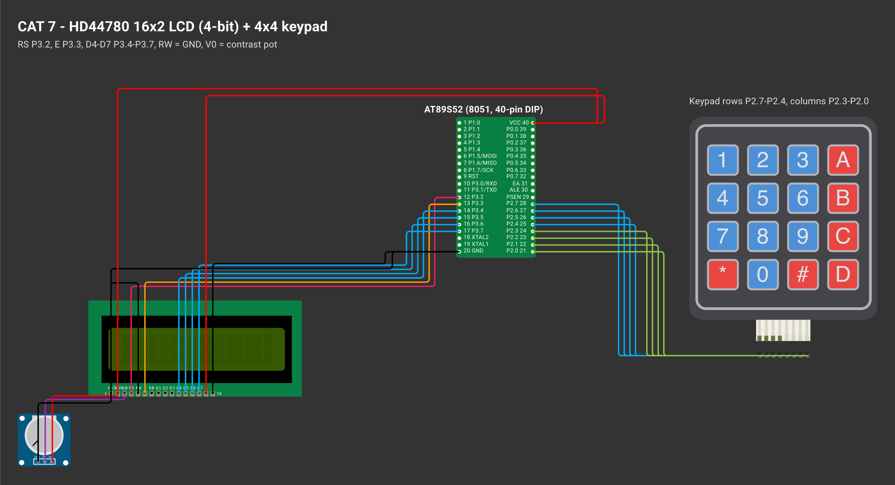

# EXPERIMENT DETAILS

**EXP:** CONTINUOUS ASSESSMENT 7

**DATE:** 24/08/2026

**NAME OF EXP:** 16×2 LCD Driver Development and Dynamic Display Control

**HARDWARE SETUP / PLATFORM:** AT89S52 development kit (8051 core, 11.0592 MHz crystal) + HD44780 16×2 LCD + 4×4 keypad — Keil µVision 5 (C51), progisp + USBasp ISP programmer, HD44780 datasheet

---

## TASK 7B : Cursor Positioning and Dynamic Value Update

### 1. Circuit Diagram

| LCD | 8051 | Role |
|---|---|---|
| RS | P3.2 | 0 command / 1 data |
| E | P3.3 | latch on falling edge |
| D4–D7 | P3.4–P3.7 | 4-bit bus |
| RW | GND | write only |
| V0 | 10 k pot | contrast |

Keypad: rows P2.7–P2.4, columns P2.3–P2.0.



*Drawn on [Wokwi](https://wokwi.com). To open and edit it: start a new project on wokwi.com, paste [`wokwi/diagram.json`](wokwi/diagram.json) into its diagram.json tab, and add the `wokwi/*.chip.json` files (if any) with **New file**. The AT89S52, USB-TTL, ULN2003, USBasp and ST-LINK boards are custom chips (pin names added as labels). The ESP-01 part stands in for the Wemos D1 mini and the BMP180 module for the BME280 (same AT firmware / same 4-pin I²C header); the Nucleo-64 graphic is labelled as the F401RE.*

### 2. Core Logic / Pseudocode / Code Base

**Working Principle:**

Dynamic displays often suffer from distracting screen flicker when the entire display is cleared for every refresh. To prevent this, we use direct DDRAM cursor positioning: `lcd_goto(row, col)` calculates the instruction byte as `0x80 + (row ? 0x40 : 0) + col`, mapping line 0 starting at address 0x00 and line 1 at 0x40. Static labels (`Counter:` on row 0 and `Up time:` on row 1) are rendered once during power-on initialization. During execution, only the numeric character slots are updated. The helper `lcd_clear_field()` writes blank spaces over old digits before `lcd_print_number()` renders the updated integer value (deconstructed via modulo-10 operations and printed from most to least significant digit). The loop updates the counter field every 500 ms and the runtime second counter every 1000 ms.

**Pseudocode:**

1. Initialize the LCD and print the static interface text (`Counter:` and `Up time:`) once.
2. In the periodic timing loop:
   a. Every 500 ms, clear the counter data field, format the updated count, and write it to row 0.
   b. Every 1000 ms, clear the uptime data field and write the elapsed seconds to row 1.
3. Keep looping without clearing the whole screen.

**Code Base:**

- Project files: `TASK7B.uvproj` (Keil µVision), `STARTUP.A51`, firmware `Objects/TASK7B.hex`.
- `lcd_goto()`, `lcd_puts()`, `lcd_print_number()`, `lcd_clear_field()`

**Expected Output:**

```
Counter:  137
Up time: 68   s
```

### 3. Inference

Direct DDRAM addressing enables localized screen overwrites. Numerical telemetry refreshes cleanly in real time without screen clearing or visible flicker.
