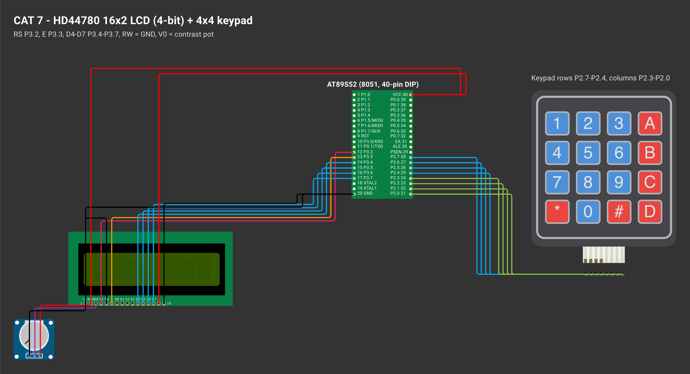

# EXPERIMENT DETAILS

**EXP:** CONTINUOUS ASSESSMENT 7

**DATE:** 24/08/2026

**NAME OF EXP:** 16×2 LCD Driver Development and Dynamic Display Control

**HARDWARE SETUP / PLATFORM:** AT89S52 development kit (8051 core, 11.0592 MHz crystal) + HD44780 16×2 LCD + 4×4 keypad — Keil µVision 5 (C51), progisp + USBasp ISP programmer, HD44780 datasheet

---

## TASK 7C : 4×4 Keypad Character Movement

### 1. Circuit Diagram

| LCD | 8051 | Role |
|---|---|---|
| RS | P3.2 | 0 command / 1 data |
| E | P3.3 | latch on falling edge |
| D4–D7 | P3.4–P3.7 | 4-bit bus |
| RW | GND | write only |
| V0 | 10 k pot | contrast |

Keypad: rows P2.7–P2.4, columns P2.3–P2.0.

*Drawn on [Wokwi](https://wokwi.com). To open and edit it: start a new project on wokwi.com, paste [`wokwi/diagram.json`](wokwi/diagram.json) into its diagram.json tab, and add the `wokwi/*.chip.json` files (if any) with **New file**. The AT89S52, USB-TTL, ULN2003, USBasp and ST-LINK boards are custom chips (pin names added as labels). The ESP-01 part stands in for the Wemos D1 mini and the BMP180 module for the BME280 (same AT firmware / same 4-pin I²C header); the Nucleo-64 graphic is labelled as the F401RE.*

### 2. Core Logic / Pseudocode / Code Base

**Working Principle:**

This task combines 4×4 keypad scanning with random-access LCD cursor positioning to implement an interactive 2D navigation control. An asterisk character (`*`) serves as a movable cursor on the 16×2 character grid (rows 0–1, columns 0–15), initially placed at coordinates (0, 0). The keypad layout assigns directional controls: Key 2 moves UP, Key 8 moves DOWN, Key 4 moves LEFT, Key 6 moves RIGHT, and Key 5 returns the cursor back home to (0, 0). When a directional input is registered, the routine erases the existing position by overwriting it with a blank space, calculates new coordinates while clamping them strictly within boundary limits (0 $\le$ row $\le$ 1, 0 $\le$ col $\le$ 15), repositions the DDRAM address, and prints `*`. A release check blocks repeated movement until the key is released, ensuring one clean step per press.

**Pseudocode:**

1. Initialize the display and print `'*'` at the home location `(row = 0, col = 0)`.
2. Continuously scan the keypad using `keypad_scan()`.
3. If an input is detected:
   a. Overwrite the current `(row, col)` location with a blank space `' '`.
   b. Modify the coordinate variables based on the pressed key (Key 2: row = 0; Key 8: row = 1; Key 4: col--; Key 6: col++; Key 5: reset to row = 0, col = 0).
   c. Clamp coordinates within boundaries: rows 0–1, columns 0–15.
   d. Move to the new coordinate and render `'*'`.
   e. Wait for the key to be released before scanning for the next movement.

**Code Base:**

- Project files: `TASK7C.uvproj` (Keil µVision), `STARTUP.A51`, firmware `Objects/TASK7C.hex`.
- `keypad_scan()` — 4×4 scan with `KEYMAP[4][4]`
- LCD driver from 7A

### 3. Inference

Combining matrix keypad scanning with targeted cursor addressing enables a responsive user-navigated cursor across the 16×2 character grid without full screen repaints.
