# 25011102085_FIoT_LAB — 8051 and STM32 Embedded / IoT Experiments

[](https://github.com/nigamanthh/25011102085_FIoT_LAB/actions/workflows/build.yml) 

**Student Name:** S Nigamanth | **Register Number:** 25011102085

This repository documents my lab coursework for **25CS2741 Fundamentals of Internet of Things + Lab** during Semester 3 of the B.Tech CSE (IoT) program at Shiv Nadar University Chennai.

The lab experiments chart our progression through embedded development: starting from bare-metal C and direct register manipulation on the classic **8051 (AT89S52)**, advancing to 32-bit ARM Cortex-M microcontrollers on the **STM32** platform using STM32CubeMX and the HAL, and culminating in full IoT systems. In the final stages, an STM32 reads ambient environmental metrics from a **BME280** sensor over I²C and shares the data over Wi-Fi via an **ESP8266** module—initially as a local **HTTP/JSON** web service, and then as an **MQTT** telemetry node publishing directly to interactive **Node-RED** dashboards.

Every task directory includes its own `README.md` detailing the experiment setup, a **circuit diagram created on Wokwi**, working principles, pseudocode, source files, and experimental findings.

## 8051 (AT89S52) — Keil µVision, bare-metal C

| CAT | Experiment | Concepts | Folder |
|---|---|---|---|
| [CAT 2](8051/CAT2/) | Tool chain, bare-metal blink, delay library | `sbit` SFR access, calibrated loops, `delay_ms()` | [TASK2B](8051/CAT2/TASK2B/), [TASK2C](8051/CAT2/TASK2C/) |
| [CAT 3](8051/CAT3/) | Four-state LED pattern generator | state machine, debouncing, edge detection | [TASK3A](8051/CAT3/TASK3A/) |
| [CAT 4](8051/CAT4/) | Keypad + seven-segment + LED HMI | row scanning, look-up tables, required function split | [TASK4A](8051/CAT4/TASK4A/) |
| [CAT 5](8051/CAT5/) | Timer interrupts: 1 s base, PWM fade, square waves, signal patterns, stepper | Timer 0 Mode 1/2, ISR time base, software PWM | [TASK5A](8051/CAT5/TASK5A/), [TASK5B.1](8051/CAT5/TASK5B/TASK5B.1/), [TASK5B.2](8051/CAT5/TASK5B/TASK5B.2/), [TASK5B.3](8051/CAT5/TASK5B/TASK5B.3/), [TASK5C](8051/CAT5/TASK5C/) |
| [CAT 6](8051/CAT6/) | UART driver, echo, interrupt RX ring buffer | SCON, Timer-1 baud, TI/RI, serial ISR | [TASK6A](8051/CAT6/TASK6A/), [TASK6B](8051/CAT6/TASK6B/), [TASK6C](8051/CAT6/TASK6C/) |
| [CAT 7](8051/CAT7/) | 16×2 LCD driver, live values, keypad-moved cursor | HD44780 4-bit init, DDRAM addressing | [TASK7A](8051/CAT7/TASK7A/), [TASK7B](8051/CAT7/TASK7B/), [TASK7C](8051/CAT7/TASK7C/) |

## STM32 — STM32CubeMX + STM32CubeIDE, HAL

| CAT | Experiment | Board | Concepts | Folder |
|---|---|---|---|---|
| [CAT 8](STM32/CAT8/) | GPIO bring-up, debounce, short/long press | Blue Pill F103C6 | pull-ups, `HAL_GetTick()` time stamps | [TASK8A](STM32/CAT8/TASK8A/), [TASK8B](STM32/CAT8/TASK8B/), [TASK8C](STM32/CAT8/TASK8C/) |
| [CAT 9](STM32/CAT9/) | UART echo and text commands | Blue Pill F103C6 | USART2, line parsing, CR/LF | [TASK9A](STM32/CAT9/TASK9A/), [TASK9B](STM32/CAT9/TASK9B/) |
| [CAT 10](STM32/CAT10/) | ESP8266 UART link and AT command explorer | Blue Pill F103C8 + Wemos | two UARTs, AT protocol, ring buffer bridge | [TASK10A](STM32/CAT10/TASK10A/), [TASK10B](STM32/CAT10/TASK10B/) |
| [CAT 11](STM32/CAT11/) | ESP8266 Wi-Fi station and embedded HTTP web server | Blue Pill F103C8 + Wemos | `AT+CWJAP`, `AT+CIPSERVER`, `+IPD` parsing, CIPSEND | [TASK11A](STM32/CAT11/TASK11A/), [TASK11B](STM32/CAT11/TASK11B/) |
| [CAT 12](STM32/CAT12/) | Cortex-M4 GPIO, clock verification, press duration classifier | NUCLEO-F401RE | HSE bypass, PLL 84 MHz, debounce, `HAL_GetTick()` | [TASK12A](STM32/CAT12/TASK12A/), [TASK12B](STM32/CAT12/TASK12B/), [TASK12C](STM32/CAT12/TASK12C/) |
| [CAT 13](STM32/CAT13/) | BME280 I²C Bosch API and ESP8266 HTTP JSON server | NUCLEO-F401RE | I²C, Bosch API, JSON, Content-Length, Node-RED HTTP | [TASK13A](STM32/CAT13/TASK13A/), [TASK13B](STM32/CAT13/TASK13B/) |
| [CAT 14](STM32/CAT14/) | BME280 MQTT telemetry and Node-RED dashboard | NUCLEO-F401RE | MQTT CONNECT/PUBLISH/SUBSCRIBE, broker.emqx.io | [TASK14A](STM32/CAT14/TASK14A/), [TASK14B](STM32/CAT14/TASK14B/), [TASK14C](STM32/CAT14/TASK14C/) |
| [CAT 15](STM32/CAT15/) | Smart Cloth Drying System | NUCLEO-F401RE | Multi-source data fusion (BME280 + OpenWeatherMap), VPD, drying index, fabric estimation | [CAT15](STM32/CAT15/) |

## Circuit diagrams

Wiring schematics for every experiment, designed and tested on [Wokwi](https://wokwi.com). Each individual CAT folder contains its corresponding schematic along with the complete write-up; opening the local `wokwi/diagram.json` inside Wokwi restores the exact interactive simulation setup.

### CAT 2 — LED Blink and Delay Library

[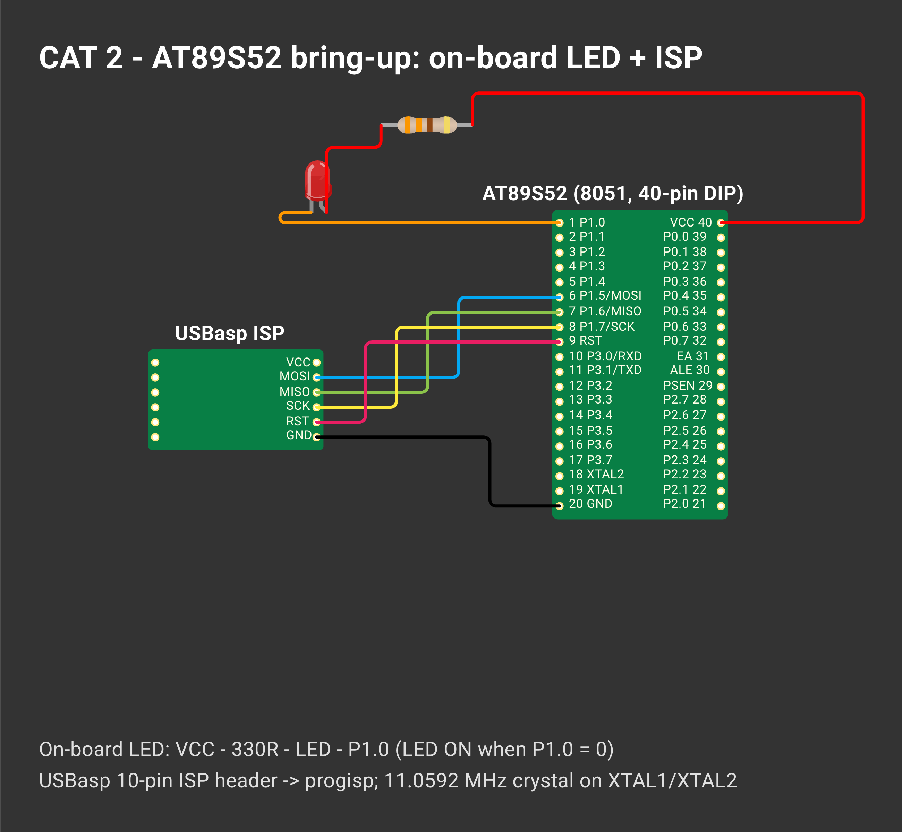](8051/CAT2/)

### CAT 3 — Button LED Pattern Generator

[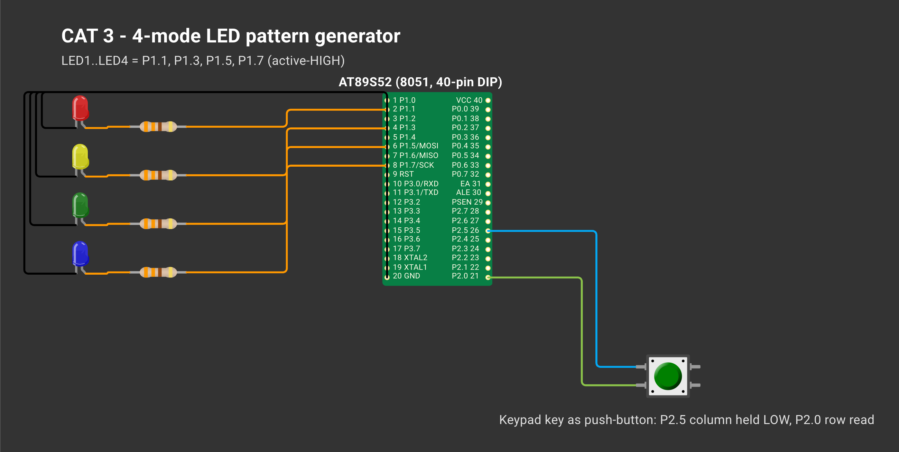](8051/CAT3/)

### CAT 4 — Keypad 7Segment HMI

[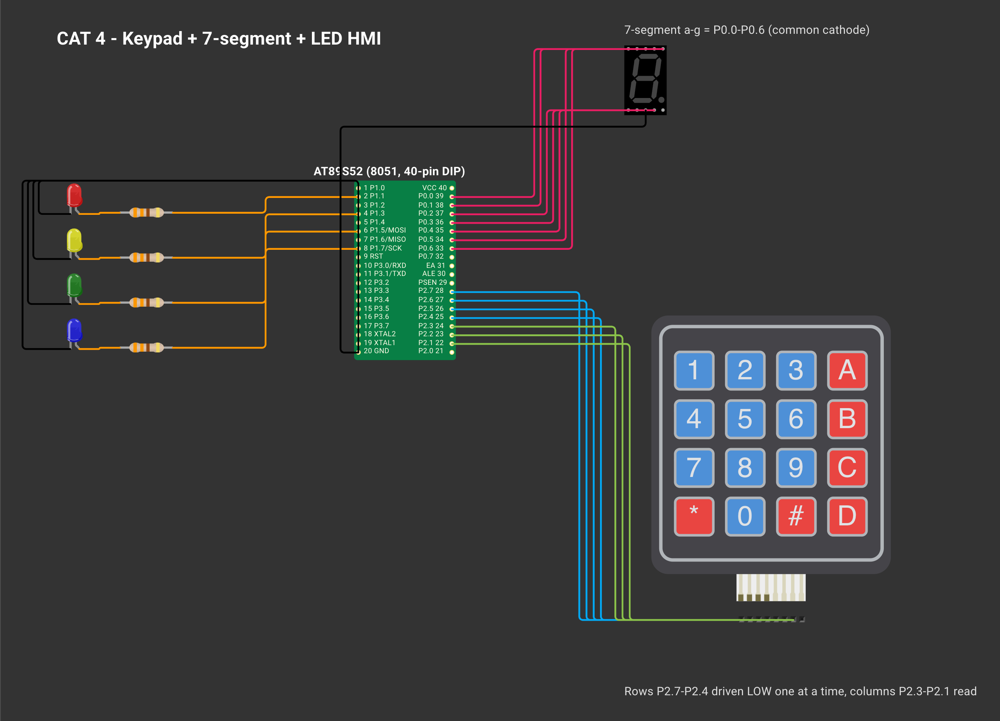](8051/CAT4/)

### CAT 5 — Timer Interrupts PWM Stepper

[](8051/CAT5/)

### CAT 6 — UART Driver Serial Debugging

[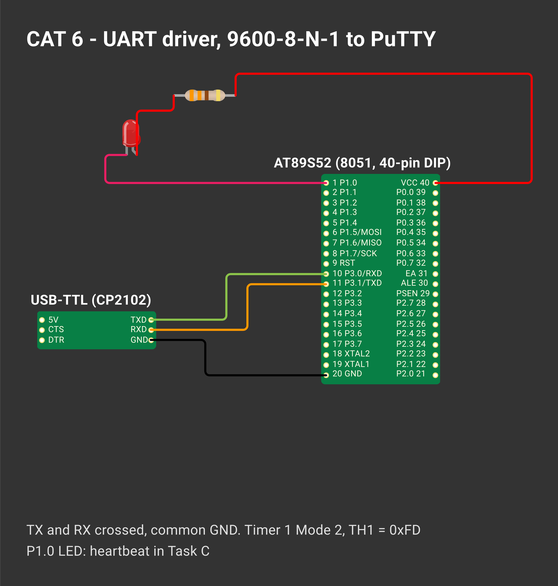](8051/CAT6/)

### CAT 7 — LCD 16x2 Driver

[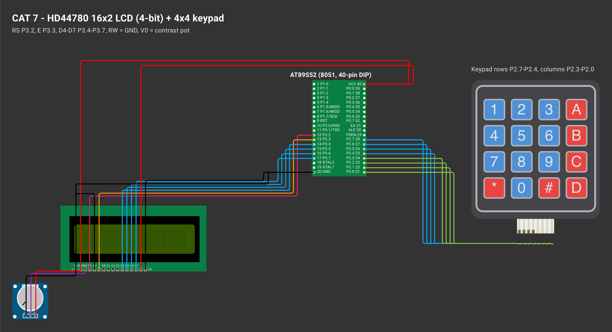](8051/CAT7/)

### CAT 8 — GPIO Button LED

[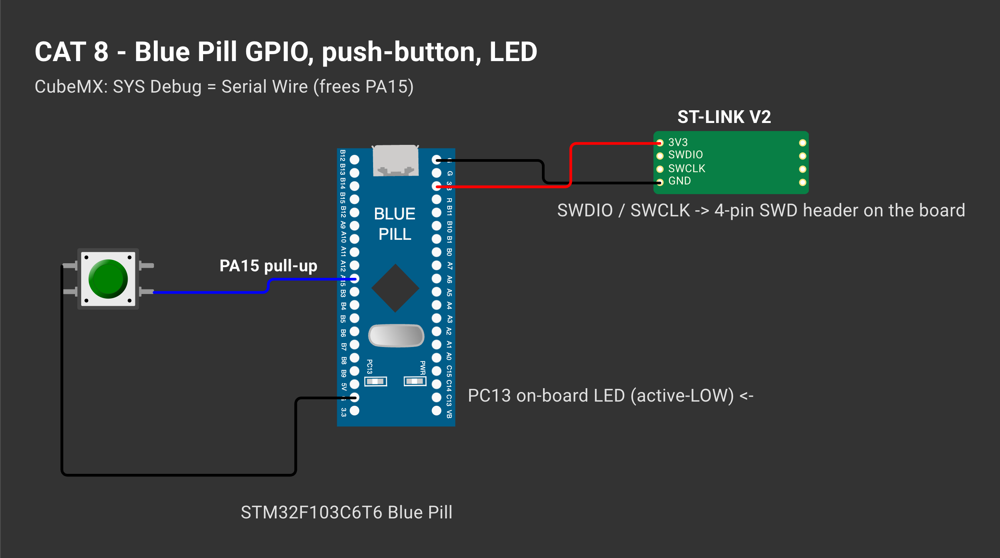](STM32/CAT8/)

### CAT 9 — UART Command LED

[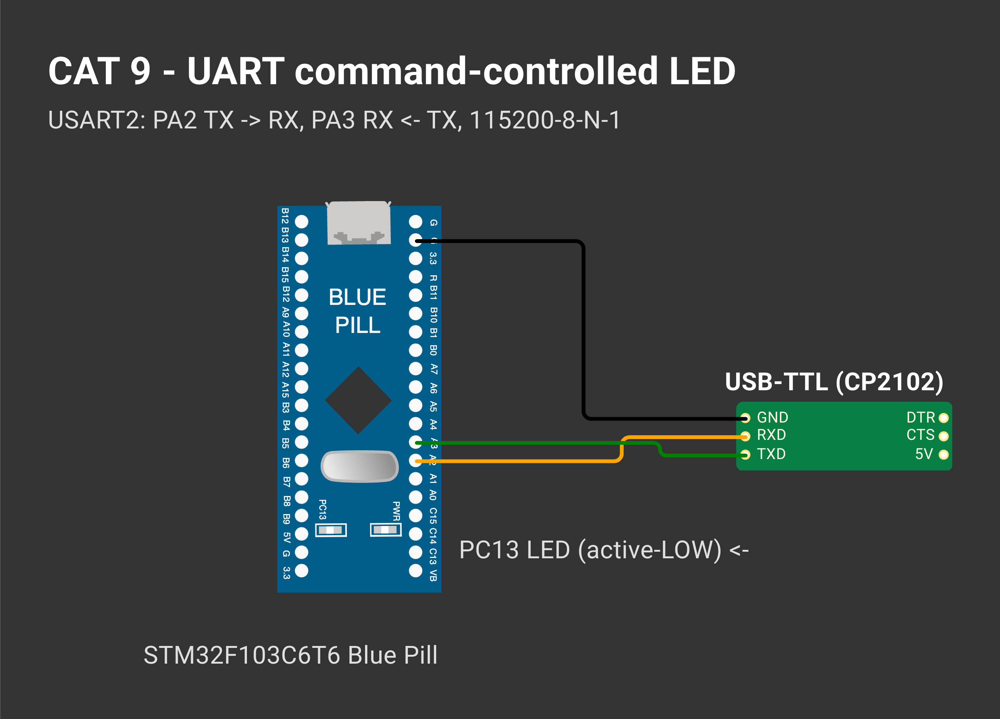](STM32/CAT9/)

### CAT 10 — Wemos WiFi AT Commands

[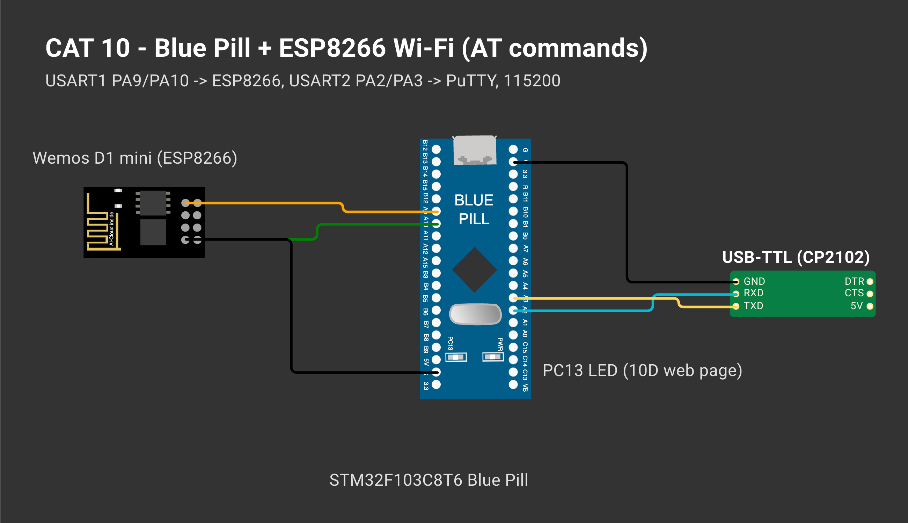](STM32/CAT10/)

### CAT 11 — ESP8266 Wi-Fi and HTTP Server

[](STM32/CAT11/)

### CAT 12 — Cortex-M4 GPIO and User Input

[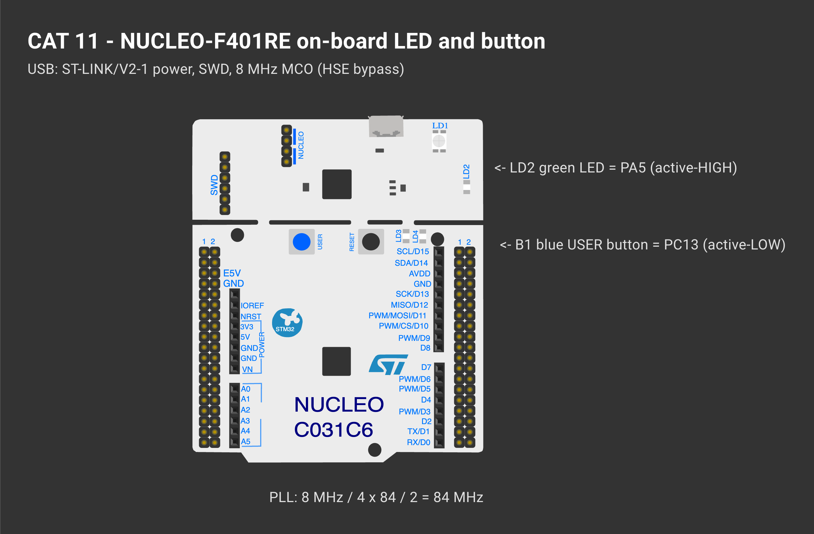](STM32/CAT12/)

### CAT 13 — BME280 I2C HTTP NodeRED

[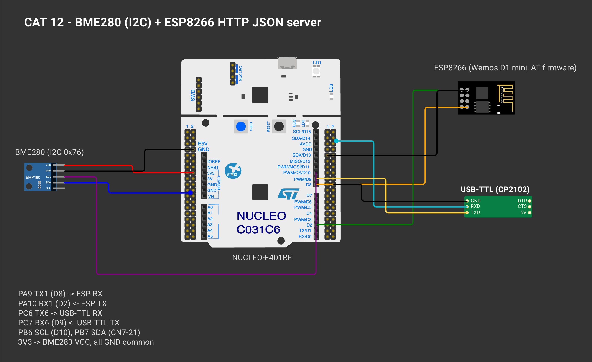](STM32/CAT13/)

### CAT 14 — BME280 MQTT NodeRED Dashboard

[](STM32/CAT14/)

### CAT 15 — Smart Cloth Drying System

[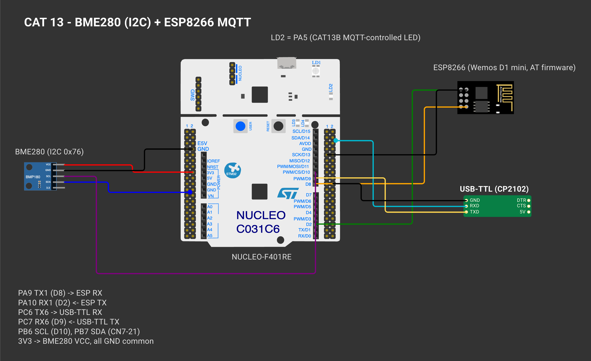](STM32/CAT15/)

## System architecture (final experiments)

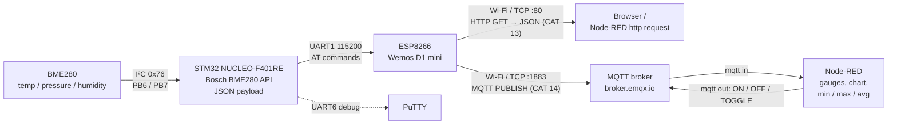

## Skills demonstrated

| Area | Where |
|---|---|
| Bare-metal register programming (SFRs, `sbit`, no libraries) | CAT 2 – 4 |
| Hardware timers and interrupt service routines, software PWM | CAT 5, 6 |
| Device drivers written from datasheets (UART, HD44780 LCD) | CAT 6, 7 |
| Debouncing and non-blocking state machines | CAT 3, 8, 12 |
| STM32CubeMX configuration, clock trees, HAL | CAT 8 – 14 |
| UART protocols, ring buffers, interrupt-driven receive | CAT 6C, 11B, 13B |
| I²C sensor integration with a vendor API | CAT 13, 14 |
| ESP8266 AT command interface, TCP server, raw HTTP | CAT 10, 11, 13 |
| MQTT CONNECT / PUBLISH / SUBSCRIBE packets | CAT 14 |
| Node-RED flows, dashboards and statistics | CAT 13, 14 |
| Build automation and CI | `tools/build_all.sh`, GitHub Actions |

## Verification status

| What | How it was checked | Result |
|---|---|---|
| All 20 STM32 projects | compiled and linked with `arm-none-eabi-gcc` (`tools/build_all.sh`, GitHub Actions) | 0 errors; 0 warnings with `-Wall -Wextra` in the application code (`Core/`). Vendor HAL drivers are compiled with warnings off (`-w`), as is usual for vendor code — see [`docs/build-log.txt`](docs/build-log.txt) |
| All 15 8051 projects | compiled with SDCC from the Keil sources (keywords mapped on a temporary copy) | 0 errors; committed HEX files match the sources. SDCC is not Keil C51 — Keil output is not verified here |
| MQTT client (CAT 14) | host-side unit tests (`make -C tests`, ASan + UBSan, run in CI) | 54 packet checks + 56 ESPLib checks + 26 AT-driver checks against a simulated ESP8266 and broker, including fault injection (refused UART re-arm, malformed `+IPD` frames, RX overflow), plus a CI check that every project copy of a shared library matches its master: both CIPSEND reply styles, PINGRESP timeout, UNSUBACK, QoS-0-only rules, malformed and non-canonical packets, packets split across or combined in TCP chunks, wrong ACK ids, RX overflow mid-packet with clean TCP + MQTT reconnect, CONNACK Session Present rules, wildcard topics, NULL arguments, discarded over-long AT lines, link closing during CIPSEND |
| 8051 timing | measured in the uCsim 8051 simulator at 11.0592 MHz (SDCC code) | CAT 2 blink 1.000 s, `delay_ms()` 1.000 ms, CAT 5 timer toggle 0.999 s, 100 Hz mode 100.2 Hz |
| Node-RED flows | JSON structure and wiring validated, function code syntax-checked | valid |
| Memory use | linker output | largest Blue Pill build 7.9 KB of 32 KB flash; largest Nucleo build 33 KB of 512 KB |
| Behaviour on the physical boards | demonstrated in the lab evaluation sessions (CAT 2 – 13) | not logged in this repository — the checks above cover build, logic and timing, not the boards; use the checklist below to reproduce the experiments |

### Hardware checklist — what each experiment should show

| CAT | Board | Expected result |
|---|---|---|
| 2 | AT89S52 | P1.0 LED blinks at ≈ 1 Hz (0.5 s on / 0.5 s off) |
| 3 | AT89S52 | each key press steps the 4 LEDs through running → binary → alternate → flash |
| 4 | AT89S52 | the key pressed appears on the 7-segment display and starts its LED pattern |
| 5 | AT89S52 | LED toggles every 1 s; PWM fade; 100 Hz – 5 kHz square wave on P1.1 (DSO); stepper speed/direction from the keypad |
| 6 | AT89S52 | PuTTY 9600-8-N-1 shows `Hello from 8051`; typed text is echoed |
| 7 | AT89S52 | text on both LCD rows; live counter; `*` moves with keys 2/4/6/8 |
| 8 | Blue Pill | PC13 LED follows / toggles with PA15; long press (≥ 1 s) starts blinking |
| 9 | Blue Pill | PuTTY 115200: echo; `LED ON` / `LED OFF` / `LED TOGGLE` control PC13 |
| 10 | Blue Pill + Wemos | `>> AT` / `<< OK`; IP and MAC printed after joining Wi-Fi |
| 11 | Blue Pill + Wemos | browser at `http://<IP>/` shows the STM32 page |
| 12 | Nucleo-F401RE | LD2 blinks at 1 Hz (84 MHz clock confirmed); B1 short / long press behaviour |
| 13 | Nucleo + BME280 + Wemos | UART shows chip ID `0x60` and T / P / H; browser and Node-RED receive the JSON |
| 14 | Nucleo + BME280 + Wemos | debug UART shows `CONNACK accepted`; MQTT client / Node-RED receives the JSON on `snigamanth/stm32/bme280`; CAT14B LED follows `ON` / `OFF` / `TOGGLE` |

## Hardware

| Part | Used in | Notes |
|---|---|---|
| AT89S52 development kit | CAT 2–7 | 11.0592 MHz, on-board LED P1.0 (active-low), keypad, 7-segment, 16×2 LCD, USBasp ISP |
| STM32 Blue Pill (F103C6 / F103C8) | CAT 8–11 | 8 MHz crystal → 72 MHz, LED PC13 (active-low), ST-LINK V2 over SWD |
| NUCLEO-F401RE | CAT 12–15 | 8 MHz from ST-LINK (HSE bypass) → 84 MHz, LD2 PA5, B1 PC13 |
| Wemos D1 mini (ESP8266) | CAT 11, 13, 14 | Espressif AT firmware, 115200 baud |
| Bosch BME280 | CAT 13, 14 | I²C address 0x76 |
| USB-to-TTL converter | CAT 6, 9, 10, 11, 13, 14 | PuTTY terminal |
| ULN2003 + 28BYJ-48 | CAT 5 (optional task) | stepper motor |

## Tools

| Tool | Purpose |
|---|---|
| Keil µVision 5 (C51) | 8051 projects (`.uvproj`) |
| progisp + USBasp | flashing the AT89S52 |
| STM32CubeIDE / CubeMX | STM32 projects (`.ioc`, `.project`, `.cproject`) |
| Bosch BME280 Sensor API v3.5.1 | sensor driver (CAT 13, 14) |
| ESPLib API (reimplemented, MIT) | ESP8266 + MQTT client (CAT 14) |
| PuTTY, Node-RED | terminal, dashboards / analytics |

## Repository layout

The project follows the standard course structure: organized by target microcontroller, CAT lab unit, and individual task:

```
8051/CATn/TASKnX/            one Keil project per task
├── README.md, circuit.png   experiment write-up + Wokwi circuit diagram (wokwi/ reopens it)
├── *.uvproj, STARTUP.A51    Keil µVision project
├── *.c / *.h                source
└── Objects/*.hex            built firmware
STM32/CATn/TASKnX/           one CubeMX project per task
├── README.md, circuit.png
├── *.ioc, .mxproject        STM32CubeMX configuration
├── Core/, Drivers/          application code + HAL
├── MDK-ARM/*.uvprojx        Keil MDK project, MDK-ARM/startup_*.s
└── .project, .cproject      same project for STM32CubeIDE
Common_Libraries/            master copies of the shared libraries (BME280 API, ESP8266 AT driver, ESPLib MQTT client, helpers)
tools/, tests/, docs/        build script, library-copy check, host-side tests, build log
```

Note on numbering: CAT 5 Task 2 has three separate sub-parts, organized under `8051/CAT5/TASK5B/TASK5B.1` through `TASK5B.3`.

## Building

**8051:** Flash the pre-built `Objects/*.hex` onto the board via progisp and USBasp, or open the `.uvproj` file in Keil µVision and press **Build (F7)** to recompile. (The included HEX files were compiled using SDCC 4.6 and cycle-tested in the uCsim simulator; see `8051/README.md`.)

**STM32 (Keil MDK):** Open the project file `MDK-ARM/*.uvprojx` inside the task folder, hit **Build (F7)**, and flash the MCU with **Download (F8)** via the connected ST-LINK.

**STM32 (STM32CubeIDE):** Choose **File → Import → General → Existing Projects into Workspace**, select the target task folder, run **Build**, and flash using **Run → Debug As → STM32 C/C++ Application**. The Wi-Fi tasks (CAT 11A, 11B, 13B, and 14) look for access point credentials in `Core/Inc/wifi_secrets.h`. This file is git-ignored to prevent pushing real passwords. Create it alongside `wifi_config.h` using `#define WIFI_SSID "..."` and `#define WIFI_PASSWORD "..."`; if omitted, the project compiles using fallback placeholders.

**Node-RED:** In the Node-RED interface, go to Menu → Import, select the corresponding `NodeRED_*.json` file, and click Deploy.
