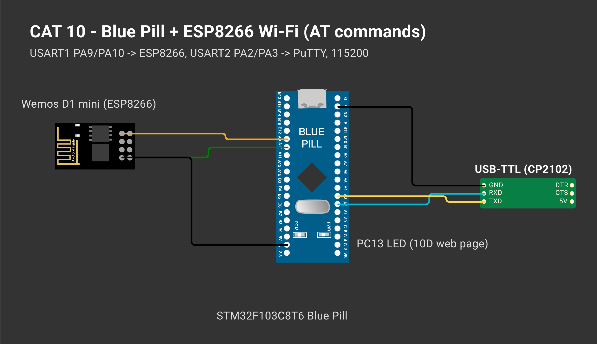

# EXPERIMENT DETAILS

**EXP:** CONTINUOUS ASSESSMENT 10

**DATE:** 05/10/2026

**NAME OF EXP:** STM32–Wemos Wi-Fi Modem Interface Using AT Commands + HTTP Server

**HARDWARE SETUP / PLATFORM:** Blue Pill STM32F103C8T6 (Cortex-M3, 72 MHz) + Wemos D1 mini (ESP8266 AT firmware) + USB-to-TTL — STM32CubeMX + Keil MDK-ARM (STM32CubeIDE project also included), STM32 HAL, PuTTY

---

## TASK 9A : Establish STM32 ↔ Wemos UART Communication

> The CAT 10 lab sheet numbers this task **9A**; it is stored in folder `TASK10A`.

### 1. Circuit Diagram

| STM32 | Connected to | Purpose |
|---|---|---|
| PA9 USART1_TX | Wemos RX | AT commands |
| PA10 USART1_RX | Wemos TX | responses |
| PA2 USART2_TX / PA3 USART2_RX | USB-to-TTL RX / TX | PC terminal |
| GND | all GNDs | common ground |

Both UARTs 115200-8-N-1. Wi-Fi credentials go in `Core/Inc/wifi_secrets.h` (git-ignored; see `wifi_config.h` for the format).



*Drawn on [Wokwi](https://wokwi.com). To open and edit it: start a new project on wokwi.com, paste [`wokwi/diagram.json`](wokwi/diagram.json) into its diagram.json tab, and add the `wokwi/*.chip.json` files (if any) with **New file**. The AT89S52, USB-TTL, ULN2003, USBasp and ST-LINK boards are custom chips (pin names added as labels). The ESP-01 part stands in for the Wemos D1 mini and the BMP180 module for the BME280 (same AT firmware / same 4-pin I²C header); the Nucleo-64 graphic is labelled as the F401RE.*


### 2. Core Logic / Pseudocode / Code Base

**Working Principle:**

This lab establishes a dual-UART bridge architecture on the STM32F103 Blue Pill to interface with an ESP8266 (Wemos D1 mini) running official AT firmware. USART1 (PA9/PA10) is dedicated to exchanging AT commands with the ESP8266 modem at 115200 baud, while USART2 (PA2/PA3) connects to our PC terminal via USB-to-TTL at 115200 baud for debugging and manual control. Having separate serial ports prevents debug logs from corrupting AT command framing. On startup, the MCU waits 2 seconds for the ESP8266 power-on bootloader to settle, issues `AT` (retrying up to 3 times), and sends `ATE0` to disable command echo. After validating basic modem response (`>> AT` -> `<< OK`), the firmware activates `at_bridge_start()`, configuring interrupt-driven circular buffers in both directions. Receiving is managed by 256-slot ring buffers, while transmitting uses 512-slot queues serviced non-blockingly via `HAL_UART_Transmit_IT`. In the bridge loop, `at_bridge_poll()` translates keyboard inputs (mapping Carriage Return to CR LF for the ESP) and forwards incoming modem replies to PuTTY in real time without dropping characters.

**Pseudocode:**

1. Print the startup banner over USART2 to the PC terminal.
2. Run `esp_startup()`: pause 2 s for boot stabilization, test communication with `AT` (up to 3 retries), and suppress modem echo with `ATE0`.
3. Execute `at_show("AT")`, displaying `>> AT` and logging the modem's `<< OK` reply.
4. Call `at_bridge_start()`: engage interrupt-driven reception on both USART1 and USART2 into dedicated ring buffers (256 entries), with automatic re-arm recovery in case of overrun.
5. Engage non-blocking transmission queues (512 entries) using `HAL_UART_Transmit_IT`.
6. Continuously call `at_bridge_poll()` in `main()` to stream characters bidirectionally between the host terminal and the Wi-Fi modem, reporting any buffer overflow events.

**Code Base:**

- Project files: `CAT10A_STM32_Wemos_UART_Link.ioc` (CubeMX configuration), `MDK-ARM/CAT10A_STM32_Wemos_UART_Link.uvprojx` (Keil MDK), `.project` / `.cproject` (STM32CubeIDE); application code in `Core/Src/main.c`.
- `esp_read_line()` — line reader with timeout
- `at_command()` — sends AT command and collects response lines (0 = OK, 1 = ERROR/FAIL, 2 = TIMEOUT)
- `at_show()` — logs `>> command` and `<< response` lines to PC terminal
- `esp_startup()` — waits 2 s for bootloader, validates AT link with up to 3 retries, issues `ATE0`
- `at_bridge_start()` / `at_bridge_poll()` — interrupt-driven bidirectional UART bridge (256-byte RX circular buffers `from_esp`/`from_pc`, 512-byte TX queues `to_esp`/`to_pc`)
- Interrupt callbacks: `HAL_UART_RxCpltCallback()` (re-arming single-byte IT RX), `HAL_UART_TxCpltCallback()` (advancing non-blocking TX ring), and `HAL_UART_ErrorCallback()` (clearing ORE flag and re-arming RX)

**Expected Output:**

```
STM32-WiFi MODEM TEST  (CAT10A)
ESP8266 answered, echo off
>> AT
<< OK
```

### 3. Inference

The Wemos module responds reliably with OK to AT commands. Splitting serial traffic across two separate hardware UARTs cleanly isolates application debug messages from high-speed modem communication.
