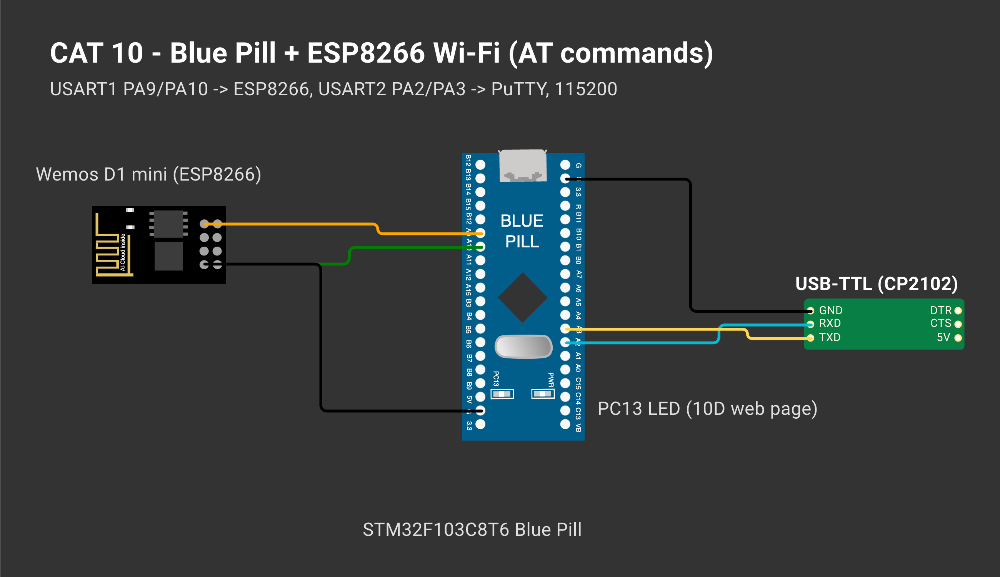

# EXPERIMENT DETAILS

**EXP:** CONTINUOUS ASSESSMENT 11

**DATE:** 12/10/2026

**NAME OF EXP:** STM32–Wemos Wi-Fi Modem Interface Using AT Commands + HTTP Server

**HARDWARE SETUP / PLATFORM:** Blue Pill STM32F103C8T6 (Cortex-M3, 72 MHz) + Wemos D1 mini (ESP8266 AT firmware) + USB-to-TTL — STM32CubeMX + Keil MDK-ARM (STM32CubeIDE project also included), STM32 HAL, PuTTY

---

## TASK 1 : Connect ESP8266 to Wi-Fi Access Point

> The CAT 10 lab sheet numbers this task **9C**; it is stored in folder `TASK10C`.

### 1. Circuit Diagram

| STM32 | Connected to | Purpose |
|---|---|---|
| PA9 USART1_TX | Wemos RX | AT commands |
| PA10 USART1_RX | Wemos TX | responses |
| PA2 USART2_TX / PA3 USART2_RX | USB-to-TTL RX / TX | PC terminal |
| GND | all GNDs | common ground |

Both UARTs 115200-8-N-1. Wi-Fi credentials go in `Core/Inc/wifi_secrets.h` (git-ignored; see `wifi_config.h` for the format).



*Drawn on [Wokwi](https://wokwi.com). To open and edit it: start a new project on wokwi.com, paste [`wokwi/diagram.json`](wokwi/diagram.json) into its diagram.json tab, and add the `wokwi/*.chip.json` files (if any) with **New file**. The AT89S52, USB-TTL, ULN2003, USBasp and ST-LINK boards are custom chips (pin names added as labels). The ESP-01 part stands in for the Wemos D1 mini and the BMP180 module for the BME280 (same AT firmware / same 4-pin I²C header); the Nucleo-64 graphic is labelled as the F401RE.*


### 2. Core Logic / Pseudocode / Code Base

**Working Principle:**

This experiment connects the ESP8266 modem to an active Wi-Fi access point and demonstrates an outgoing TCP client connection under STM32 control. After configuring Station Mode (`AT+CWMODE=1`), the MCU commands the modem to associate with the local Wi-Fi router using `AT+CWJAP="<SSID>","<PASSWORD>"`. Because network association, DHCP negotiation, and security handshakes can take several seconds, a generous 20-second timeout is assigned. Once connected (`WIFI CONNECTED` and `WIFI GOT IP`), the STM32 queries IP configuration with `AT+CIFSR`. String parsing routines locate and extract the assigned station IP address (`STAIP`) and hardware MAC address (`STAMAC`) from the response text. To verify end-to-end internet connectivity, a TCP client demo (`tcp_demo()`) is executed: the STM32 opens a socket to port 80 of `example.com` via `AT+CIPSTART`, issues `AT+CIPSEND`, waits for the `>` transmission prompt, transmits an HTTP GET request, and parses the returned `HTTP/1.1 200 OK` status line.

**Pseudocode:**

1. Initialize the ESP8266 module and verify AT responsiveness.
2. Put the modem into station mode with `AT+CWMODE=1`.
3. Read Wi-Fi credentials from `wifi_secrets.h` and initiate network association using `AT+CWJAP` (with a 20-second timeout).
4. Upon successful association, execute `AT+CIFSR` and extract the IP and MAC addresses using `extract_after()`.
5. Run the TCP demo:
   a. Issue `AT+CIPSTART="TCP","example.com",80`.
   b. Issue `AT+CIPSEND=<payload_len>` and await the `>` input prompt via `esp_wait_prompt()`.
   c. Transmit `GET / HTTP/1.1\r\nHost: example.com\r\n\r\n`.
   d. Read the incoming response and display the HTTP status line.

**Code Base:**

- Project files: `CAT11A_Connect_Wemos_to_WiFi.ioc` (CubeMX configuration), `MDK-ARM/CAT11A_Connect_Wemos_to_WiFi.uvprojx` (Keil MDK), `.project` / `.cproject` (STM32CubeIDE); application code in `Core/Src/main.c`.
- `extract_after()`
- `esp_wait_prompt()`, `tcp_demo()`

**Expected Output:**

```
Connected to Wifi Successfully
IP Address : 192.168.x.x
MAC Address: xx:xx:xx:xx:xx:xx
Server replied: HTTP/1.1 200 OK
```

### 3. Inference

Under complete STM32 supervision, the ESP8266 associated with the local Wi-Fi network, retrieved DHCP settings, and performed an end-to-end HTTP GET transaction over TCP.
