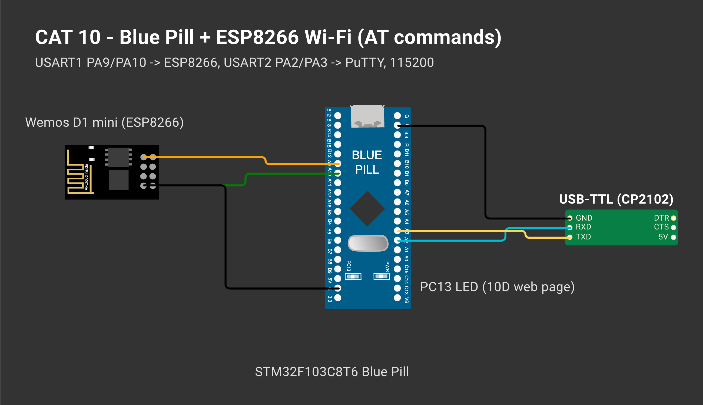

# EXPERIMENT DETAILS

**EXP:** CONTINUOUS ASSESSMENT 11

**DATE:** 12/10/2026

**NAME OF EXP:** STM32–Wemos Wi-Fi Modem Interface Using AT Commands + HTTP Server

**HARDWARE SETUP / PLATFORM:** Blue Pill STM32F103C8T6 (Cortex-M3, 72 MHz) + Wemos D1 mini (ESP8266 AT firmware) + USB-to-TTL — STM32CubeMX + Keil MDK-ARM (STM32CubeIDE project also included), STM32 HAL, PuTTY

---

## TASK 2 : Embedded HTTP Web Server with Static Page Response

### 1. Circuit Diagram

| STM32 | Connected to | Purpose |
|---|---|---|
| PA9 USART1_TX | Wemos RX | AT commands |
| PA10 USART1_RX | Wemos TX | responses |
| PA2 USART2_TX / PA3 USART2_RX | USB-to-TTL RX / TX | PC terminal |
| GND | all GNDs | common ground |

Both UARTs 115200-8-N-1. Wi-Fi credentials go in `Core/Inc/wifi_secrets.h` (git-ignored; see `wifi_config.h` for the format).



*Drawn on [Wokwi](https://wokwi.com). To open and edit it: start a new project on wokwi.com, paste [`wokwi/diagram.json`](wokwi/diagram.json) into its diagram.json tab, and add the `wokwi/*.chip.json` files (if any) with **New file**. The AT89S52, USB-TTL, ULN2003, USBasp and ST-LINK boards are custom chips (pin names added as labels). The ESP-01 part stands in for the Wemos D1 mini and the BMP180 module for the BME280 (same AT firmware / same 4-pin I²C header); the Nucleo-64 graphic is labelled as the F401RE.*


### 2. Core Logic / Pseudocode / Code Base

**Working Principle:**

In this experiment, the STM32 configures the ESP8266 as a multi-connection TCP server listening on standard HTTP port 80. By issuing `AT+CIPMUX=1` (enabling multiple connections) followed by `AT+CIPSERVER=1,80`, the modem opens a listening socket. When a web browser connects and issues an HTTP GET request, the ESP8266 forwards it to the STM32 via USART1 as an unsolicited result code (URC) formatted as `+IPD,<link_id>,<len>:GET /path HTTP/1.1`. The dedicated driver module (`esp_at.c`) captures all incoming bytes via an interrupt-driven ring buffer. When line parsing detects an incoming `+IPD` frame, `on_esp_event()` extracts the connection identifier and requested URI path. In the main scheduling loop, `handle_request()` parses the path: requesting `/` serves an interactive HTML webpage; requesting `/led/on` or `/led/off` alters the active state of the PC13 user LED and responds with a status message; unknown endpoints return an `HTTP/1.1 404 Not Found`. Responses are constructed with an exact calculated `Content-Length` header and dispatched via `AT+CIPSEND=<link_id>,<total_len>`, followed by waiting for the `>` prompt, transmitting the HTTP header and payload, and closing the connection cleanly with `AT+CIPCLOSE=<link_id>`.

```
HTTP/1.1 200 OK
Content-Type: text/html
Content-Length: <strlen(body)>
Connection: close

<html><body><h1>STM32 IoT Node</h1>...</body></html>
```

**Pseudocode:**

1. Boot the ESP8266, connect to the local Wi-Fi router, enable multi-connection mode (`AT+CIPMUX=1`), and launch the TCP server on port 80 (`AT+CIPSERVER=1,80`). Print the web server URL to PuTTY.
2. In the main execution loop, process incoming modem data streams and route URC lines into `on_esp_event()`.
3. When a pending client link with an active request is found:
   a. Check requested route: `/`, `/led/on`, `/led/off`, or invalid route.
   b. Actuate PC13 if an LED route was targeted.
   c. Build the HTTP response text (header with exact Content-Length + HTML body).
   d. Transmit the packet via `http_send()` using `AT+CIPSEND` and close the connection using `AT+CIPCLOSE`.
4. If an unexpected `WIFI DISCONNECT` event occurs, wait for auto-reconnection and re-initialize the server listener.

**Code Base:**

- Project files: `CAT11B_HTTP_Server_Static_Page.ioc` (CubeMX configuration), `MDK-ARM/CAT11B_HTTP_Server_Static_Page.uvprojx` (Keil MDK), `.project` / `.cproject` (STM32CubeIDE); application code in `Core/Src/main.c`.
- `esp_at.c/.h` — interrupt ring buffer, timeouts, `esp_at_send()`
- USART1 global interrupt enabled (`stm32f1xx_it.c`, `stm32f1xx_hal_msp.c`, `.ioc`)
- `handle_request()`, `http_send()`

**Expected Output:**

```
Server running: http://192.168.x.x/
[HTTP] link 0  GET /
[HTTP] link 1  GET /favicon.ico
```

### 3. Inference

The STM32 functions directly as an embedded web server, parsing incoming HTTP GET requests from raw `+IPD` data streams and serving dynamically generated HTML pages to standard desktop and mobile web browsers.
