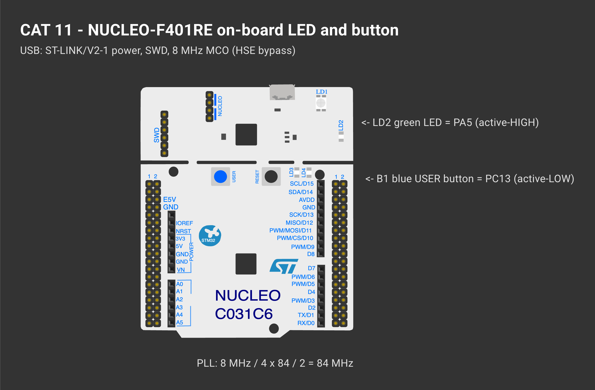

# EXPERIMENT DETAILS

**EXP:** CONTINUOUS ASSESSMENT 12

**DATE:** 14/10/2026

**NAME OF EXP:** STM32F401RE Cortex-M4: GPIO and User Input Programming

**HARDWARE SETUP / PLATFORM:** NUCLEO-F401RE (STM32F401RET6, Cortex-M4F, 84 MHz) — STM32CubeMX + Keil MDK-ARM (STM32CubeIDE project also included), STM32 HAL

---

## TASK 1 : On-board LED Bring-Up

### 1. Circuit Diagram

| Item | Detail |
|---|---|
| Oscillator | no MCU crystal fitted; 8 MHz from the ST-LINK MCO → **HSE bypass** |
| Controller | STM32F401RET6, max 84 MHz, 512 KB flash, 96 KB SRAM |
| GPIO / UART / I²C / SPI | GPIOA-D, H / 3 USART (1, 2, 6) / 3 / 4 |
| CubeMX clock | 8 MHz ÷ 4 × 84 ÷ 2 = 84 MHz, APB1 42 MHz |
| LD2 | PA5, active-HIGH |
| B1 | PC13, active-LOW |

*Drawn on [Wokwi](https://wokwi.com). To open and edit it: start a new project on wokwi.com, paste [`wokwi/diagram.json`](wokwi/diagram.json) into its diagram.json tab, and add the `wokwi/*.chip.json` files (if any) with **New file**. The AT89S52, USB-TTL, ULN2003, USBasp and ST-LINK boards are custom chips (pin names added as labels). The ESP-01 part stands in for the Wemos D1 mini and the BMP180 module for the BME280 (same AT firmware / same 4-pin I²C header); the Nucleo-64 graphic is labelled as the F401RE.*

### 2. Core Logic / Pseudocode / Code Base

**Working Principle:**

This experiment introduces the NUCLEO-F401RE development platform featuring an ARM Cortex-M4F processor capable of running up to 84 MHz. On this board, no standalone crystal is soldered directly to the MCU; instead, an 8 MHz reference clock is supplied from the integrated ST-LINK MCO output, requiring the High-Speed External oscillator to be configured in **HSE bypass** mode. The Phase-Locked Loop (PLL) multiplies this input clock ($8 \text{ MHz} / 4 \times 84 / 2 = 84 \text{ MHz}$) to achieve the maximum system frequency, with APB1 prescaled to 42 MHz. The green user LED (LD2) is connected to PA5 in active-high logic (unlike the active-low LED on the Blue Pill). On boot, the application calls `HAL_RCC_GetSysClockFreq()` to confirm that the system clock is running at 84 MHz. If the frequency is verified, LD2 toggles every 500 ms (1 Hz cycle); if the clock tree is misconfigured, the firmware blinks the LED rapidly every 100 ms as an error alert. All blinking intervals are timed using non-blocking timestamps from `HAL_GetTick()`.

**Pseudocode:**

1. Initialize the HAL environment and configure the clock tree to 84 MHz via HSE bypass and the PLL.
2. Call `HAL_RCC_GetSysClockFreq()`. If the result equals 84,000,000 Hz, set `blink_ms = 500`; otherwise, set `blink_ms = 100` as an error indicator.
3. In the infinite loop, inspect `HAL_GetTick()`.
4. Once `blink_ms` has elapsed since the last toggle, invert pin PA5 with `HAL_GPIO_TogglePin()` and store the new timestamp.

**Code Base:**

- Project files: `CAT12_Task1_LED_BringUp.ioc` (CubeMX configuration), `MDK-ARM/CAT12_Task1_LED_BringUp.uvprojx` (Keil MDK), `.project` / `.cproject` (STM32CubeIDE); application code in `Core/Src/main.c`.
- `sysclk_hz` (Live Expressions), `blink_ms`

### 3. Inference

LD2 blinks cleanly at 1 Hz, confirming that the board, GPIO output on PA5, and the 84 MHz HSE-bypass clock tree are properly configured.
