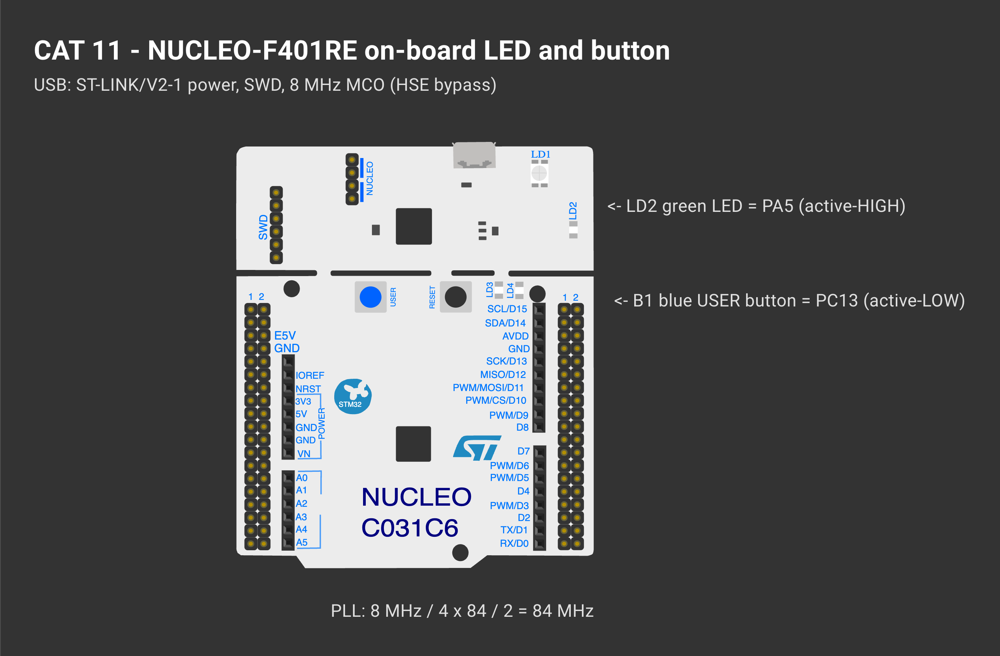

# EXPERIMENT DETAILS

**EXP:** CONTINUOUS ASSESSMENT 12

**DATE:** 14/10/2026

**NAME OF EXP:** STM32F401RE Cortex-M4: GPIO and User Input Programming

**HARDWARE SETUP / PLATFORM:** NUCLEO-F401RE (STM32F401RET6, Cortex-M4F, 84 MHz) — STM32CubeMX + Keil MDK-ARM (STM32CubeIDE project also included), STM32 HAL

---

## TASK 2 : On-board Switch Control with State Remembrance

### 1. Circuit Diagram

| Item | Detail |
|---|---|
| Oscillator | no MCU crystal fitted; 8 MHz from the ST-LINK MCO → **HSE bypass** |
| Controller | STM32F401RET6, max 84 MHz, 512 KB flash, 96 KB SRAM |
| GPIO / UART / I²C / SPI | GPIOA-D, H / 3 USART (1, 2, 6) / 3 / 4 |
| CubeMX clock | 8 MHz ÷ 4 × 84 ÷ 2 = 84 MHz, APB1 42 MHz |
| LD2 | PA5, active-HIGH |
| B1 | PC13, active-LOW |

*Drawn on [Wokwi](https://wokwi.com). To open and edit it: start a new project on wokwi.com, paste [`wokwi/diagram.json`](wokwi/diagram.json) into its diagram.json tab, and add the `wokwi/*.chip.json` files (if any) with **New file**. The AT89S52, USB-TTL, ULN2003, USBasp and ST-LINK boards are custom chips (pin names added as labels). The ESP-01 part stands in for the Wemos D1 mini and the BMP180 module for the BME280 (same AT firmware / same 4-pin I²C header); the Nucleo-64 graphic is labelled as the F401RE.*

### 2. Core Logic / Pseudocode / Code Base

**Working Principle:**

This task interfaces the user push-button (B1, wired to PC13 in active-low logic) with the on-board LED (LD2, wired to PA5 in active-high logic) to implement a bistable latching toggle switch with state memory. Mechanical contact bounce on B1 is handled through non-blocking software filtering with a 30 ms stability threshold (`debounce_update()`). When a stable falling edge (`BTN_PRESS_EDGE`) is detected, the boolean variable `led_state` is inverted, `press_count` is incremented, and the new state is driven to LD2 via `ld2_write()`. Releasing the button triggers no change, so the LED maintains its illuminated or extinguished state indefinitely until the next button press.

**Pseudocode:**

1. In the main scheduling loop, poll the debounced state of button B1 using `debounce_update()`.
2. When a valid press edge is registered:
   a. Invert the state flag: `led_state = !led_state`.
   b. Write the updated state to LD2 with `ld2_write(led_state)`.
   c. Increment `press_count`.
3. Continue polling continuously without blocking the processor.

**Code Base:**

- Project files: `CAT12_Task2_Button_Toggle_State_Memory.ioc` (CubeMX configuration), `MDK-ARM/CAT12_Task2_Button_Toggle_State_Memory.uvprojx` (Keil MDK), `.project` / `.cproject` (STM32CubeIDE); application code in `Core/Src/main.c`.
- `debounce_update()`, `ld2_write()`, `led_state`, `press_count`

### 3. Inference

The LED toggles once per valid press and reliably remembers its state across button releases, verifying non-blocking software debouncing and latching state control.
