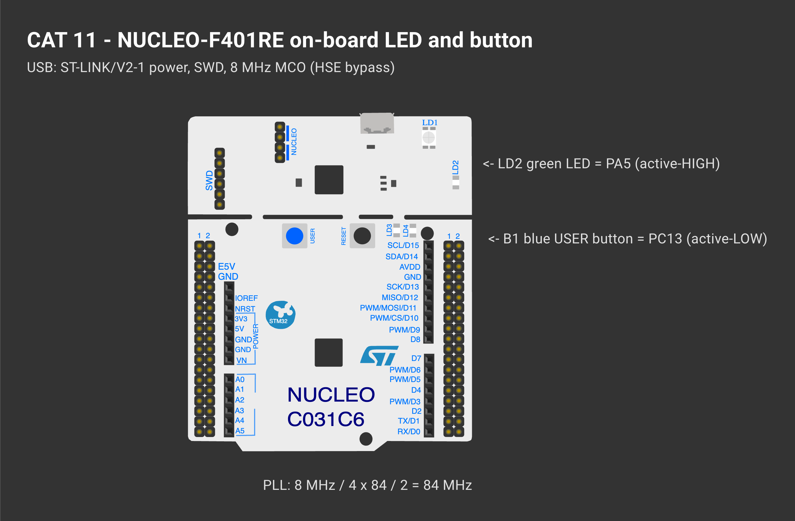

# EXPERIMENT DETAILS

**EXP:** CONTINUOUS ASSESSMENT 12

**DATE:** 14/10/2026

**NAME OF EXP:** STM32F401RE Cortex-M4: GPIO and User Input Programming

**HARDWARE SETUP / PLATFORM:** NUCLEO-F401RE (STM32F401RET6, Cortex-M4F, 84 MHz) — STM32CubeMX + Keil MDK-ARM (STM32CubeIDE project also included), STM32 HAL

---

## TASK 3 : Short-Press and Long-Press Detection

### 1. Circuit Diagram

| Item | Detail |
|---|---|
| Oscillator | no MCU crystal fitted; 8 MHz from the ST-LINK MCO → **HSE bypass** |
| Controller | STM32F401RET6, max 84 MHz, 512 KB flash, 96 KB SRAM |
| GPIO / UART / I²C / SPI | GPIOA-D, H / 3 USART (1, 2, 6) / 3 / 4 |
| CubeMX clock | 8 MHz ÷ 4 × 84 ÷ 2 = 84 MHz, APB1 42 MHz |
| LD2 | PA5, active-HIGH |
| B1 | PC13, active-LOW |

*Drawn on [Wokwi](https://wokwi.com). To open and edit it: start a new project on wokwi.com, paste [`wokwi/diagram.json`](wokwi/diagram.json) into its diagram.json tab, and add the `wokwi/*.chip.json` files (if any) with **New file**. The AT89S52, USB-TTL, ULN2003, USBasp and ST-LINK boards are custom chips (pin names added as labels). The ESP-01 part stands in for the Wemos D1 mini and the BMP180 module for the BME280 (same AT firmware / same 4-pin I²C header); the Nucleo-64 graphic is labelled as the F401RE.*

### 2. Core Logic / Pseudocode / Code Base

**Working Principle:**

This task develops an advanced multi-tier input classifier for push-button B1, differentiating between three distinct press durations to trigger dedicated operational states. Timing calculations use unsigned subtraction ($\Delta t = \text{now} - \text{press\_start}$), which handles 32-bit SysTick timestamp roll-over without arithmetic glitches. Duration evaluation is triggered strictly upon **button release** (`BTN_RELEASE_EDGE`), ensuring that actions execute cleanly once the user concludes their input. A press under 30 ms is rejected as mechanical contact noise. If the contact duration is between 30 ms and 600 ms, `classify()` marks it as a Short Press and toggles LD2. If held between 600 ms and 3000 ms, it is classified as a Long Press, toggling continuous 150 ms flashing mode. If held for $\ge 3000$ ms, it triggers a Very Long Press, which serves as a global reset—extinguishing LD2 and halting blinking. When blink mode is active, the LED toggles every 150 ms via `HAL_GetTick()`, entirely independent of button polling.

| Duration | Type | Action |
|---|---|---|
| < 30 ms | bounce | ignored |
| < 0.6 s | short | toggle LD2 |
| 0.6 – 3 s | long | blink mode ON/OFF |
| ≥ 3 s | very long | reset (LED off, blink off) |

**Pseudocode:**

1. Capture the start time on a verified press edge (`press_start = HAL_GetTick()`).
2. When the release edge arrives, evaluate the elapsed interval: `duration = HAL_GetTick() - press_start`.
3. Pass `duration` to `classify()`:
   a. $< 30$ ms: discard as noise bounce.
   b. $30 \text{ ms} \le \Delta t < 600 \text{ ms}$ (Short Press): toggle LD2.
   c. $600 \text{ ms} \le \Delta t < 3000 \text{ ms}$ (Long Press): toggle blink mode ON or OFF.
   d. $\ge 3000 \text{ ms}$ (Very Long Press): perform reset (turn LD2 OFF and disable blink mode).
4. If blink mode is active, toggle PA5 every 150 ms using non-blocking timestamp comparisons.

**Code Base:**

- Project files: `CAT12_Task3_Short_Long_Press.ioc` (CubeMX configuration), `MDK-ARM/CAT12_Task3_Short_Long_Press.uvprojx` (Keil MDK), `.project` / `.cproject` (STM32CubeIDE); application code in `Core/Src/main.c`.
- `classify()`, `last_duration` (Live Expressions)

### 3. Inference

The STM32 reliably decodes three press durations using a single push-button without blocking loops, allowing real-time 150 ms LED blinking and switch sampling to run concurrently.
