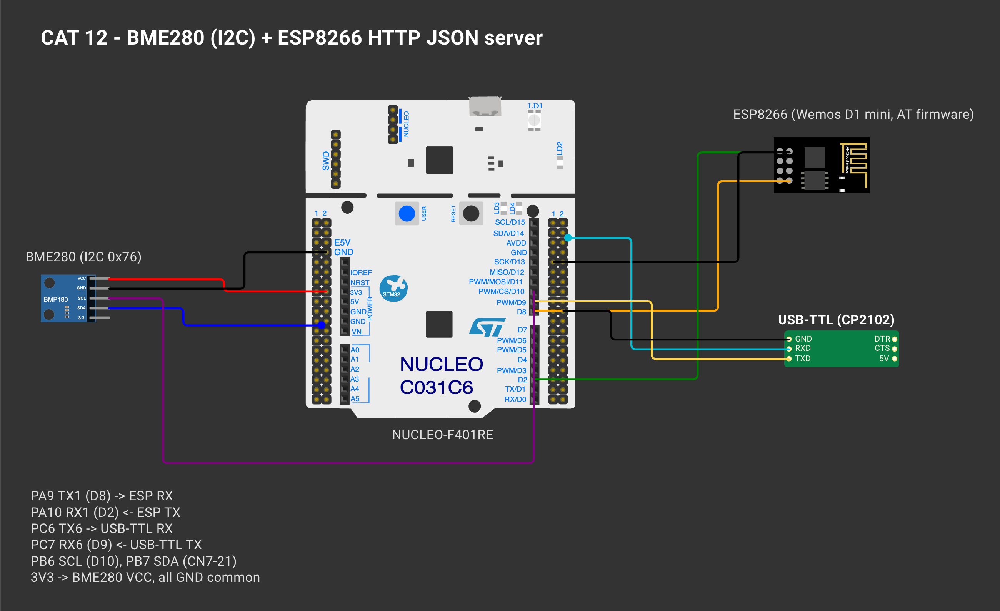

# EXPERIMENT DETAILS

**EXP:** CONTINUOUS ASSESSMENT 13

**DATE:** 23/10/2026

**NAME OF EXP:** BME280 Sensor Interfacing Using I²C and Bosch Sensor API, ESP8266 HTTP, Node Analytics

**HARDWARE SETUP / PLATFORM:** NUCLEO-F401RE (STM32F401RET6, Cortex-M4F, 84 MHz) + BME280 + Wemos D1 mini + USB-to-TTL — STM32CubeMX + Keil MDK-ARM (STM32CubeIDE project also included), STM32 HAL, Bosch BME280 Sensor API v3.5.1, Node-RED

---

## TASK 1 : BME280 Interfacing with the Bosch Sensor API

### 1. Circuit Diagram

| Nucleo | Connected to |
|---|---|
| PB6 I2C1_SCL / PB7 I2C1_SDA | BME280 SCL / SDA (100 kHz) |
| 3V3 / GND | BME280 VCC / GND, SDO → GND (address 0x76) |
| PA9 USART1_TX / PA10 USART1_RX | Wemos RX / TX (115200, RX interrupt) |
| PC6 USART6_TX / PC7 USART6_RX | USB-to-TTL (debug, 115200) |



*Drawn on [Wokwi](https://wokwi.com). To open and edit it: start a new project on wokwi.com, paste [`wokwi/diagram.json`](wokwi/diagram.json) into its diagram.json tab, and add the `wokwi/*.chip.json` files (if any) with **New file**. The AT89S52, USB-TTL, ULN2003, USBasp and ST-LINK boards are custom chips (pin names added as labels). The ESP-01 part stands in for the Wemos D1 mini and the BMP180 module for the BME280 (same AT firmware / same 4-pin I²C header); the Nucleo-64 graphic is labelled as the F401RE.*


### 2. Core Logic / Pseudocode / Code Base

**Working Principle:**

In this experiment, we interface a Bosch BME280 digital environmental sensor to the NUCLEO-F401RE over I²C1 (PB6 for SCL, PB7 for SDA, running at standard 100 kHz). Pulling the sensor's SDO line to GND selects the 7-bit slave address `0x76`. Rather than writing raw register bit-math from scratch, we integrate the official Bosch Sensortec BME280 Sensor API (v3.5.1). We place `bme280.c` in `Core/Src` and its header files in `Core/Inc`. The API defines a hardware abstraction structure `struct bme280_dev`, which requires the application to provide three callback functions:

| API needs | Implemented as | HAL |
|---|---|---|
| read_register() | `user_i2c_read()` | `HAL_I2C_Mem_Read()` |
| write_register() | `user_i2c_write()` | `HAL_I2C_Mem_Write()` |
| delay_function() | `user_delay_us()` | `HAL_Delay()` for ≥ 1 ms, DWT cycle counter busy-wait for shorter delays |

During boot, the MCU reads register 0xD0 to confirm the factory chip ID `0x60`; if communication fails or the ID mismatches, an error prompt suggests checking wiring and pull-ups. Following initialization, the firmware reads factory calibration coefficients, retrieves raw uncompensated ADC data from registers 0xF7–0xFE, and runs the Bosch compensation equations to produce calibrated temperature (°C), atmospheric pressure (hPa), and relative humidity (%RH). To analyze sensor filtering performance, the code automatically toggles between two oversampling profiles every 10 readings: Profile A (2× oversampling, IIR filter disabled for fast transient response) and Profile B (16× oversampling, IIR filter coefficient 16 for high-resolution noise smoothing). Floating-point values are rendered using integer arithmetic (`fmt_fixed.h`), avoiding heavy float library links.

**Pseudocode:**

1. Query register `0xD0` via I²C; verify the returned chip ID is `0x60`.
2. Populate the `bme280_dev` structure with I²C address `0x76`, `user_i2c_read`, `user_i2c_write`, and `user_delay_us`.
3. Call `bme280_init()` to load the sensor's on-chip factory calibration trim parameters.
4. Configure oversampling, filter coefficients, and standby timing, and place the device in Normal Mode.
5. In the main scheduling loop, execute every 2 seconds:
   a. Read and print the raw ADC registers (0xF7 through 0xFE).
   b. Invoke `bme280_get_sensor_data()` to calculate calibrated temperature, pressure, and humidity.
   c. Print the formatted readings to USART6 (PuTTY) using fixed-point formatting routines.
   d. Every 10 readings, switch between Profile A and Profile B to compare filtering characteristics.

**Code Base:**

- Project files: `CAT13A_BME280_I2C_UART.ioc` (CubeMX configuration), `MDK-ARM/CAT13A_BME280_I2C_UART.uvprojx` (Keil MDK), `.project` / `.cproject` (STM32CubeIDE); application code in `Core/Src/main.c`.
- `read_chip_id()`, `print_raw()`, `apply_profile()`, `bme_setup()`, `bme_read()`
- `fmt_fixed.h` — floats printed with integer maths (no `-u _printf_float` needed)

**Expected Output:**

```
Chip ID     : 0x60 (BME280 OK)
--- Reading 1 (profile A) ---
Raw ADC     : T=... P=... H=...
Temperature : 28.45 °C
Pressure    : 1008.72 hPa
Humidity    : 62.30 %RH
```

### 3. Inference

I²C communication, chip ID verification, register reading, and Bosch polynomial compensation were all successfully validated. The sensor reliably reflects environmental changes, with Profile B demonstrating noticeable noise reduction over Profile A.
