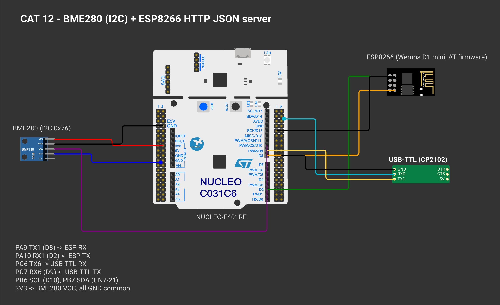

# EXPERIMENT DETAILS

**EXP:** CONTINUOUS ASSESSMENT 13

**DATE:** 23/10/2026

**NAME OF EXP:** BME280 Sensor Interfacing Using I²C and Bosch Sensor API, ESP8266 HTTP, Node Analytics

**HARDWARE SETUP / PLATFORM:** NUCLEO-F401RE (STM32F401RET6, Cortex-M4F, 84 MHz) + BME280 + Wemos D1 mini + USB-to-TTL — STM32CubeMX + Keil MDK-ARM (STM32CubeIDE project also included), STM32 HAL, Bosch BME280 Sensor API v3.5.1, Node-RED

---

## TASK 2 : Raw HTTP Response with BME280 Data

### 1. Circuit Diagram

| Nucleo | Connected to |
|---|---|
| PB6 I2C1_SCL / PB7 I2C1_SDA | BME280 SCL / SDA (100 kHz) |
| 3V3 / GND | BME280 VCC / GND, SDO → GND (address 0x76) |
| PA9 USART1_TX / PA10 USART1_RX | Wemos RX / TX (115200, RX interrupt) |
| PC6 USART6_TX / PC7 USART6_RX | USB-to-TTL (debug, 115200) |



*Drawn on [Wokwi](https://wokwi.com). To open and edit it: start a new project on wokwi.com, paste [`wokwi/diagram.json`](wokwi/diagram.json) into its diagram.json tab, and add the `wokwi/*.chip.json` files (if any) with **New file**. The AT89S52, USB-TTL, ULN2003, USBasp and ST-LINK boards are custom chips (pin names added as labels). The ESP-01 part stands in for the Wemos D1 mini and the BMP180 module for the BME280 (same AT firmware / same 4-pin I²C header); the Nucleo-64 graphic is labelled as the F401RE.*


### 2. Core Logic / Pseudocode / Code Base

**Working Principle:**

In this experiment, the STM32 acts as an IoT web service by reading environmental data from the BME280 and serving structured JSON over HTTP via the ESP8266 modem. The ESP8266 connects to Wi-Fi and establishes a multi-connection TCP server on port 80 utilizing our shared AT command driver (`esp_at.c`). Sensor polling runs every 2 seconds paced by `HAL_GetTick()`, ensuring regular data collection without blocking program flow. When a client performs an HTTP `GET /` request, the firmware synthesizes a JSON payload containing the latest compensated temperature, relative humidity, and barometric pressure values. The response packet is constructed with standard HTTP/1.1 headers, an exact `Content-Length` reflecting the JSON payload length, and a CORS header (`Access-Control-Allow-Origin: *`) to enable cross-origin browser requests. The HTTP frame is dispatched across the active link using `AT+CIPSEND`, after which `AT+CIPCLOSE` cleanly terminates the TCP connection. Requests are dispatched sequentially with bounded timeout protection.

```
HTTP/1.1 200 OK
Content-Type: application/json
Content-Length: <calculated>
Access-Control-Allow-Origin: *
Connection: close

{"status":"success","temperature":28.45,"humidity":62.30,"pressure":1008.72}
```

**Pseudocode:**

1. Initialize the BME280 sensor over I²C using the Bosch Sensor API.
2. Configure the ESP8266 in station mode, connect to the local Wi-Fi router, start the TCP server on port 80, and output the node's IP address on the debug console.
3. In the main scheduling loop:
   a. Periodically check and parse unsolicited result codes from the modem.
   b. If a client connects and requests `/`, construct the JSON payload and transmit the formatted HTTP 200 response with `http_reply()`.
   c. If an unknown route is requested, return an HTTP 404 Not Found.
4. Every 2 seconds, trigger a BME280 read to refresh cached sensor telemetry.
5. Automatically detect `WIFI DISCONNECT` events, reconnect to Wi-Fi, and re-establish the port 80 listener.

**Code Base:**

- Project files: `CAT13B_BME280_HTTP_JSON_Server.ioc` (CubeMX configuration), `MDK-ARM/CAT13B_BME280_HTTP_JSON_Server.uvprojx` (Keil MDK), `.project` / `.cproject` (STM32CubeIDE); application code in `Core/Src/main.c`.
- `build_json()`, `http_reply()`, `handle_request()`, `server_start()`

**Expected Output:**

```
{"status":"success","temperature":28.45,"humidity":62.30,"pressure":1008.72}
```

### 3. Inference

The STM32 constructs a valid raw HTTP response containing a well-formed JSON body and a calculated Content-Length header, serving sensor metrics directly to web clients.

---

## NEXT STEP : Node-RED Statistics

### 1. Circuit Diagram

| Nucleo | Connected to |
|---|---|
| PB6 I2C1_SCL / PB7 I2C1_SDA | BME280 SCL / SDA (100 kHz) |
| 3V3 / GND | BME280 VCC / GND, SDO → GND (address 0x76) |
| PA9 USART1_TX / PA10 USART1_RX | Wemos RX / TX (115200, RX interrupt) |
| PC6 USART6_TX / PC7 USART6_RX | USB-to-TTL (debug, 115200) |


*Drawn on [Wokwi](https://wokwi.com). To open and edit it: start a new project on wokwi.com, paste [`wokwi/diagram.json`](wokwi/diagram.json) into its diagram.json tab, and add the `wokwi/*.chip.json` files (if any) with **New file**. The AT89S52, USB-TTL, ULN2003, USBasp and ST-LINK boards are custom chips (pin names added as labels). The ESP-01 part stands in for the Wemos D1 mini and the BMP180 module for the BME280 (same AT firmware / same 4-pin I²C header); the Nucleo-64 graphic is labelled as the F401RE.*


### 2. Core Logic / Pseudocode / Code Base

**Working Principle:**

To perform downstream telemetry analytics, we ingest the STM32's JSON endpoint into a Node-RED flow (`NodeRED_CAT13_HTTP_Statistics_flow.json`). An **inject** node triggers an **http request** node every 5 seconds to poll `http://<STM32_IP>/`. The received JSON object is parsed and routed into a custom JavaScript **function** node. The function tracks cumulative statistical context (minimum, maximum, sample count, and cumulative sum) across all three environmental channels (temperature, humidity, and atmospheric pressure). The computed minimums, maximums, and running averages are formatted into a structured text report and piped to a **debug** node. A secondary manual inject node is wired to reset the stored analytics context upon request.

**Pseudocode:**

1. Open Node-RED, import `NodeRED_CAT13_HTTP_Statistics_flow.json`, and enter the assigned IP address of the STM32 node in the HTTP request configuration.
2. Click Deploy to start the automated polling flow.
3. Observe incoming sensor packets in the Debug sidebar, and inspect the dynamically calculated min/max/average summary table every 5 seconds.

**Code Base:**

- `NodeRED_CAT13_HTTP_Statistics_flow.json`

**Expected Output:**

```
Parameter            Minimum  Maximum  Average
Temperature (°C)       27.91    29.02    28.46
Humidity (%RH)          59.8     64.2    62.15
Pressure (hPa)       1007.84  1009.31  1008.56
```

### 3. Inference

Node-RED seamlessly ingests the HTTP/JSON feed from the STM32 node and computes running summary statistics in real time, validating that the embedded node can serve live data directly to upstream analytics dashboards.
