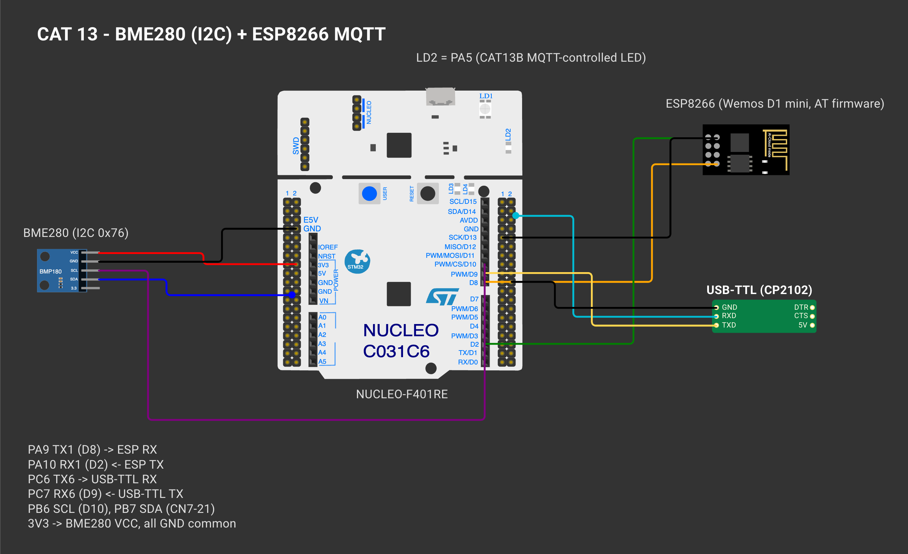

# EXPERIMENT DETAILS

**EXP:** CONTINUOUS ASSESSMENT 14

**DATE:** 27/10/2026

**NAME OF EXP:** BME280 Sensor Interfacing Using I²C and MQTT using Custom Built ESP8266 API

**HARDWARE SETUP / PLATFORM:** NUCLEO-F401RE (STM32F401RET6, Cortex-M4F, 84 MHz) + BME280 + Wemos D1 mini — STM32CubeMX + Keil MDK-ARM (STM32CubeIDE project also included), STM32 HAL, ESPLib API (reworked implementation), Node-RED, broker.emqx.io

---

## TASK 1 : MQTT Interface Wrappers (Publish Test)

### 1. Circuit Diagram

Same wiring as CAT 13; CAT14B also uses LD2 (PA5). Broker **broker.emqx.io:1883**.



*Drawn on [Wokwi](https://wokwi.com). To open and edit it: start a new project on wokwi.com, paste [`wokwi/diagram.json`](wokwi/diagram.json) into its diagram.json tab, and add the `wokwi/*.chip.json` files (if any) with **New file**. The AT89S52, USB-TTL, ULN2003, USBasp and ST-LINK boards are custom chips (pin names added as labels). The ESP-01 part stands in for the Wemos D1 mini and the BMP180 module for the BME280 (same AT firmware / same 4-pin I²C header); the Nucleo-64 graphic is labelled as the F401RE.*


### 2. Core Logic / Pseudocode / Code Base

**Working Principle:**

This experiment connects the STM32 to an MQTT broker over the internet using our custom-engineered ESPLib driver on the ESP8266. On boot, the library connects to the local Wi-Fi router, establishes a TCP socket to the public broker `broker.emqx.io` on port 1883, and transmits an MQTT CONNECT packet (specifying protocol level 4 "MQTT", 120-second keep-alive timer, clean session flag, and a unique client identifier `stm32-snigamanth-test`). The client awaits a CONNACK response and confirms that connection return code is 0x00 (Connection Accepted) before progressing; if an error or timeout occurs, it retries every 5 seconds. Once associated, the main loop publishes a formatted test message (`hello #n from STM32 Nucleo`) to the topic `snigamanth/stm32/test` at 1-second intervals using QoS 0.

**Pseudocode:**

1. Initialize the board and invoke `mqtt_start()`:
   a. Call `ESP8266_Init()` and `ESP8266_wifiConnect()` to join the Wi-Fi network.
   b. Call `ESP8266_portConnect("TCP", "broker.emqx.io", "1883")` to establish the transport socket.
   c. Issue `MQTT_connectBroker()` and verify that CONNACK is accepted.
2. In the periodic loop:
   a. Format the payload string `"hello #%d from STM32 Nucleo"`.
   b. Dispatch the message via `MQTT_publishTopic("snigamanth/stm32/test", payload, QoS0)`.
   c. Print the published topic and payload to the debug UART console.
   d. Wait 1 second before publishing the next sequence number.

**Code Base:**

- Project files: `CAT14A_MQTT_Publish_Test.ioc` (CubeMX configuration), `MDK-ARM/CAT14A_MQTT_Publish_Test.uvprojx` (Keil MDK), `.project` / `.cproject` (STM32CubeIDE); application code in `Core/Src/main.c`.
- `mqtt_start()`, `dbg()`

**Expected Output:**

```
MQTT connected (CONNACK accepted) as stm32-snigamanth-test
PUB snigamanth/stm32/test : hello #1 from STM32 Nucleo
```

**Supporting notes:**

| ESPLib function | What it sends |
|---|---|
| `ESP8266_Init(StationMode, huart1)` | `AT`, `AT+CWMODE=1` |
| `ESP8266_wifiConnect()` | `AT+CWQAP`, `AT+CWJAP` |
| `ESP8266_portConnect("TCP", broker, "1883")` | `AT+CIPSTART` |
| `MQTT_connectBroker()` | CONNECT 0x10, "MQTT", level 4, clean session, keep-alive, client ID |
| `MQTT_publishTopic()` | PUBLISH 0x30, topic length, topic, payload |
| `MQTT_subscribeTopic()` | SUBSCRIBE 0x82 |

**Reworked library.** `ESPLib.h` keeps the course function names, so the lab-sheet code compiles unchanged, but `ESPLib.c` + `mqtt_packet.c` are a new implementation:

| Problem in the original | Now |
|---|---|
| RX interrupt aborted during every send, so packets arriving meanwhile were lost | RX interrupt armed once and never aborted; 1 KB ring buffer |
| Packet end guessed from 100 ms of UART silence; `colonIndex` could be used uninitialised (SUBACK / PINGRESP have no `:` structure) | `+IPD,<len>:` framing removed, then a byte-wise MQTT parser using the packet type and Remaining Length |
| 1-byte Remaining Length only, lengths and destination sizes not checked, strings not always terminated | Remaining Length up to 4 bytes, every length validated before copying, output always NUL-terminated, oversized packets skipped |
| CONNACK / SUBACK never checked; `do {} while` loops could hang forever | CONNECT waits for CONNACK = accepted, SUBSCRIBE for SUBACK ≠ 0x80; every wait has a timeout and returns `funcOk` / `funcErr` |

Additional driver safeguards: PINGREQ packets require a matching PINGRESP from the broker (triggering a reconnect if unacknowledged), topics exceeding internal storage limits are rejected and tracked, and runtime error counters log any dropped packets or buffer overflows.

The client is **QoS 0 only**: publish/subscribe calls asking for QoS 1/2 return `funcErr`, a SUBACK must grant QoS 0, and incoming QoS 1/2 messages (which would need PUBACK) are dropped and counted. UNSUBSCRIBE waits for the matching UNSUBACK.

If the UART ring buffer ever overflows, the buffered bytes are discarded, the parser is reset and both the TCP link and the MQTT session are marked down, so the board does a full reconnect instead of parsing a broken stream. A malformed `+IPD` frame takes the same full-recovery path, and if HAL ever refuses to re-arm UART reception the library retries from the main loop. CONNACK is also checked for the Session Present rules, and topics with wildcards are rejected.

Tested on the PC: `make -C tests` (54 parser checks + 56 ESPLib checks, including fault injection against a simulated ESP8266, including both `AT+CIPSEND` reply styles, packets split across and combined in TCP chunks, wrong ACK ids, a silent broker and an overflow in the middle of a packet).

### 3. Inference

MQTT runs on top of the ESP8266 TCP link; the STM32 only has to frame the packets.
