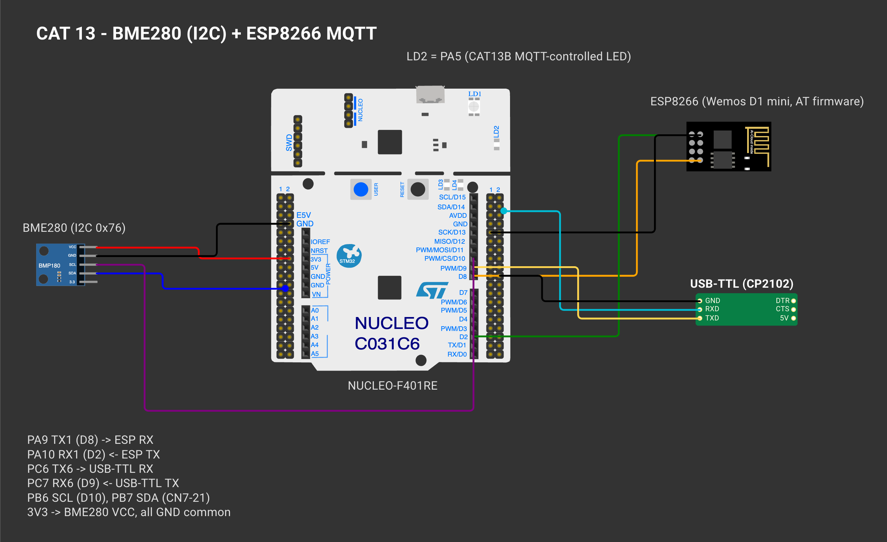

# EXPERIMENT DETAILS

**EXP:** CONTINUOUS ASSESSMENT 14

**DATE:** 27/10/2026

**NAME OF EXP:** BME280 Sensor Interfacing Using I²C and MQTT using Custom Built ESP8266 API

**HARDWARE SETUP / PLATFORM:** NUCLEO-F401RE (STM32F401RET6, Cortex-M4F, 84 MHz) + BME280 + Wemos D1 mini — STM32CubeMX + Keil MDK-ARM (STM32CubeIDE project also included), STM32 HAL, ESPLib API (reworked implementation), Node-RED, broker.emqx.io

---

## TASK 2 : MQTT Subscribe – LED Control

### 1. Circuit Diagram

Same wiring as CAT 13; CAT14B also uses LD2 (PA5). Broker **broker.emqx.io:1883**.

*Drawn on [Wokwi](https://wokwi.com). To open and edit it: start a new project on wokwi.com, paste [`wokwi/diagram.json`](wokwi/diagram.json) into its diagram.json tab, and add the `wokwi/*.chip.json` files (if any) with **New file**. The AT89S52, USB-TTL, ULN2003, USBasp and ST-LINK boards are custom chips (pin names added as labels). The ESP-01 part stands in for the Wemos D1 mini and the BMP180 module for the BME280 (same AT firmware / same 4-pin I²C header); the Nucleo-64 graphic is labelled as the F401RE.*

### 2. Core Logic / Pseudocode / Code Base

**Working Principle:**

This task demonstrates inbound remote control over MQTT by configuring the STM32 as an MQTT subscriber. Once connection is established (`CONNACK` validated), the client issues a SUBSCRIBE packet for topic `snigamanth/stm32/led` and validates the returned `SUBACK` confirmation packet. The polling function `MQTTDataHandler()` parses the continuous incoming UART byte stream and signals `1` when a fully formed, verified PUBLISH packet has arrived. The payload is checked in `handle_message()`: strictly matched string tokens `ON`, `OFF`, and `TOGGLE` control the active state of LED LD2 (PA5); unrecognized payloads are discarded. To maintain an uninterrupted TCP session, `MQTT_pingReq()` is dispatched every 60 seconds; if the broker fails to acknowledge with a PINGRESP, the driver terminates the link, reconnects, and automatically restores its subscription. (`MQTTTimer()` remains hooked into `SysTick_Handler` to satisfy course lab-sheet templates, though internal timing is now handled directly by our non-blocking drivers.)

> **Security note:** broker.emqx.io is an open public testing broker, meaning any client on the internet aware of the topic name can publish commands to it. For production or secure deployments, use an authenticated private broker: configuring `MQTT_USERNAME` and `MQTT_PASSWORD` inside `wifi_secrets.h` causes our client to transmit authentication credentials inside the CONNECT packet.

**Pseudocode:**

1. Initialize LD2 (PA5), connect to Wi-Fi and the broker via `mqtt_start()`, and issue `MQTT_subscribeTopic("snigamanth/stm32/led")`, confirming the SUBACK packet.
2. In the main scheduling loop:
   a. Call `MQTTDataHandler()`. When an incoming message arrives, print the topic and payload, and execute `handle_message()`.
   b. If payload equals `"ON"`, illuminate LD2; if `"OFF"`, extinguish LD2; if `"TOGGLE"`, invert LD2.
   c. Every 60 seconds, transmit `MQTT_pingReq()` to refresh the keep-alive timer.
   d. If the connection drops or the ping times out, reconnect to the broker and resubscribe.

**Code Base:**

- Project files: `CAT14B_MQTT_Subscribe_LED_Control.ioc` (CubeMX configuration), `MDK-ARM/CAT14B_MQTT_Subscribe_LED_Control.uvprojx` (Keil MDK), `.project` / `.cproject` (STM32CubeIDE); application code in `Core/Src/main.c`.
- `subscribe_commands()` — SUBSCRIBE + SUBACK check; reconnect + resubscribe in the main loop
- `handle_message()`

**Supporting notes:**

| ESPLib function | What it sends |
|---|---|
| `ESP8266_Init(StationMode, huart1)` | `AT`, `AT+CWMODE=1` |
| `ESP8266_wifiConnect()` | `AT+CWQAP`, `AT+CWJAP` |
| `ESP8266_portConnect("TCP", broker, "1883")` | `AT+CIPSTART` |
| `MQTT_connectBroker()` | CONNECT 0x10, "MQTT", level 4, clean session, keep-alive, client ID |
| `MQTT_publishTopic()` | PUBLISH 0x30, topic length, topic, payload |
| `MQTT_subscribeTopic()` | SUBSCRIBE 0x82 |

**Reworked library.** `ESPLib.h` keeps the course function names, so the lab-sheet code compiles unchanged, but `ESPLib.c` + `mqtt_packet.c` are a new implementation:

| Problem in the original | Now |
|---|---|
| RX interrupt aborted during every send, so packets arriving meanwhile were lost | RX interrupt armed once and never aborted; 1 KB ring buffer |
| Packet end guessed from 100 ms of UART silence; `colonIndex` could be used uninitialised (SUBACK / PINGRESP have no `:` structure) | `+IPD,<len>:` framing removed, then a byte-wise MQTT parser using the packet type and Remaining Length |
| 1-byte Remaining Length only, lengths and destination sizes not checked, strings not always terminated | Remaining Length up to 4 bytes, every length validated before copying, output always NUL-terminated, oversized packets skipped |
| CONNACK / SUBACK never checked; `do {} while` loops could hang forever | CONNECT waits for CONNACK = accepted, SUBSCRIBE for SUBACK ≠ 0x80; every wait has a timeout and returns `funcOk` / `funcErr` |

Additional driver safeguards: PINGREQ packets require a matching PINGRESP from the broker (triggering a reconnect if unacknowledged), topics exceeding internal storage limits are rejected and tracked, and runtime error counters log any dropped packets or buffer overflows.

The client is **QoS 0 only**: publish/subscribe calls asking for QoS 1/2 return `funcErr`, a SUBACK must grant QoS 0, and incoming QoS 1/2 messages (which would need PUBACK) are dropped and counted. UNSUBSCRIBE waits for the matching UNSUBACK.

If the UART ring buffer ever overflows, the buffered bytes are discarded, the parser is reset and both the TCP link and the MQTT session are marked down, so the board does a full reconnect instead of parsing a broken stream. A malformed `+IPD` frame takes the same full-recovery path, and if HAL ever refuses to re-arm UART reception the library retries from the main loop. CONNACK is also checked for the Session Present rules, and topics with wildcards are rejected.

Tested on the PC: `make -C tests` (54 parser checks + 56 ESPLib checks, including fault injection against a simulated ESP8266, including both `AT+CIPSEND` reply styles, packets split across and combined in TCP chunks, wrong ACK ids, a silent broker and an overflow in the middle of a packet).

### 3. Inference

The same library supports the reverse direction, so Node-RED or any client can control the board.
