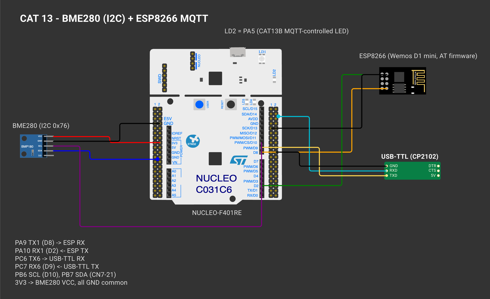

# EXPERIMENT DETAILS

**EXP:** CONTINUOUS ASSESSMENT 14

**DATE:** 27/10/2026

**NAME OF EXP:** BME280 Sensor Interfacing Using I²C and MQTT using Custom Built ESP8266 API

**HARDWARE SETUP / PLATFORM:** NUCLEO-F401RE (STM32F401RET6, Cortex-M4F, 84 MHz) + BME280 + Wemos D1 mini — STM32CubeMX + Keil MDK-ARM (STM32CubeIDE project also included), STM32 HAL, ESPLib API (reworked implementation), Node-RED, broker.emqx.io

---

## TASK 3 : BME280 JSON Telemetry over MQTT with Node-RED Dashboard

### 1. Circuit Diagram

Same wiring as CAT 13; CAT14B also uses LD2 (PA5). Broker **broker.emqx.io:1883**.



*Drawn on [Wokwi](https://wokwi.com). To open and edit it: start a new project on wokwi.com, paste [`wokwi/diagram.json`](wokwi/diagram.json) into its diagram.json tab, and add the `wokwi/*.chip.json` files (if any) with **New file**. The AT89S52, USB-TTL, ULN2003, USBasp and ST-LINK boards are custom chips (pin names added as labels). The ESP-01 part stands in for the Wemos D1 mini and the BMP180 module for the BME280 (same AT firmware / same 4-pin I²C header); the Nucleo-64 graphic is labelled as the F401RE.*


### 2. Core Logic / Pseudocode / Code Base

**Working Principle:**

This capstone task brings together sensor acquisition and internet messaging into a complete IoT telemetry node. The STM32 initializes the Bosch BME280 environmental sensor over I²C (configured with 2× oversampling, normal operating mode, and IIR filter disabled for immediate responsiveness). Using our custom ESPLib library, the STM32 joins the local Wi-Fi network and establishes an authenticated MQTT session with `broker.emqx.io`. Every 2 seconds (governed by non-blocking `HAL_GetTick()` pacing), the firmware fetches compensated temperature, humidity, and barometric pressure data. The numbers are formatted into a JSON string using fixed-point integer routines (`build_json()` and `fmt_2dp()`), yielding:
`{"status":"success","temperature":28.45,"humidity":62.30,"pressure":1008.72}`.
The JSON payload is then published to `snigamanth/stm32/bme280` at QoS 0, and the transmission is logged to the local PuTTY debug console.

**Pseudocode:**

1. Initialize the BME280 sensor via I²C with profile settings (2× oversampling, normal mode).
2. Connect to the Wi-Fi network and establish the MQTT session to `broker.emqx.io` with `mqtt_start()`.
3. In the continuous loop:
   a. Sample environmental data via `bme_read()`.
   b. Construct the JSON telemetry string using `build_json()`.
   c. Call `MQTT_publishTopic("snigamanth/stm32/bme280", json_buf, QoS0)`.
   d. Print the publication event to the serial debug monitor.
   e. Wait 2 seconds before the next transmission.

**Code Base:**

- Project files: `CAT14C_BME280_MQTT_NodeRED.ioc` (CubeMX configuration), `MDK-ARM/CAT14C_BME280_MQTT_NodeRED.uvprojx` (Keil MDK), `.project` / `.cproject` (STM32CubeIDE); application code in `Core/Src/main.c`.
- `build_json()`, `bme_setup()`, `bme_read()`, `fmt_2dp()`

**Expected Output:**

```
PUB snigamanth/stm32/bme280 {"status":"success","temperature":28.45,"humidity":62.30,"pressure":1008.72}
```

**Supporting notes:**

| ESPLib function | What it sends |
|---|---|
| `ESP8266_Init(StationMode, huart1)` | `AT`, `AT+CWMODE=1` |
| `ESP8266_wifiConnect()` | `AT+CWQAP`, `AT+CWJAP` |
| `ESP8266_portConnect("TCP", broker, "1883")` | `AT+CIPSTART` |
| `MQTT_connectBroker()` | CONNECT 0x10, "MQTT", level 4, clean session, keep-alive, client ID |
| `MQTT_publishTopic()` | PUBLISH 0x30, topic length, topic, payload |
| `MQTT_subscribeTopic()` | SUBSCRIBE 0x82 |

**Reworked library.** `ESPLib.h` keeps the course function names, so the lab-sheet code compiles unchanged, but `ESPLib.c` + `mqtt_packet.c` are a new implementation:

| Problem in the original | Now |
|---|---|
| RX interrupt aborted during every send, so packets arriving meanwhile were lost | RX interrupt armed once and never aborted; 1 KB ring buffer |
| Packet end guessed from 100 ms of UART silence; `colonIndex` could be used uninitialised (SUBACK / PINGRESP have no `:` structure) | `+IPD,<len>:` framing removed, then a byte-wise MQTT parser using the packet type and Remaining Length |
| 1-byte Remaining Length only, lengths and destination sizes not checked, strings not always terminated | Remaining Length up to 4 bytes, every length validated before copying, output always NUL-terminated, oversized packets skipped |
| CONNACK / SUBACK never checked; `do {} while` loops could hang forever | CONNECT waits for CONNACK = accepted, SUBSCRIBE for SUBACK ≠ 0x80; every wait has a timeout and returns `funcOk` / `funcErr` |

Additional driver safeguards: PINGREQ packets require a matching PINGRESP from the broker (triggering a reconnect if unacknowledged), topics exceeding internal storage limits are rejected and tracked, and runtime error counters log any dropped packets or buffer overflows.

The client is **QoS 0 only**: publish/subscribe calls asking for QoS 1/2 return `funcErr`, a SUBACK must grant QoS 0, and incoming QoS 1/2 messages (which would need PUBACK) are dropped and counted. UNSUBSCRIBE waits for the matching UNSUBACK.

If the UART ring buffer ever overflows, the buffered bytes are discarded, the parser is reset and both the TCP link and the MQTT session are marked down, so the board does a full reconnect instead of parsing a broken stream. A malformed `+IPD` frame takes the same full-recovery path, and if HAL ever refuses to re-arm UART reception the library retries from the main loop. CONNACK is also checked for the Session Present rules, and topics with wildcards are rejected.

Tested on the PC: `make -C tests` (54 parser checks + 56 ESPLib checks, including fault injection against a simulated ESP8266, including both `AT+CIPSEND` reply styles, packets split across and combined in TCP chunks, wrong ACK ids, a silent broker and an overflow in the middle of a packet).

### 3. Inference

Telemetry data seamlessly reaches any connected MQTT subscriber on the network; the embedded node functions as an independent publisher decoupled from specific consumers.

---

## NEXT STEP : Node-RED

### 1. Circuit Diagram

Same wiring as CAT 13; CAT14B also uses LD2 (PA5). Broker **broker.emqx.io:1883**.


*Drawn on [Wokwi](https://wokwi.com). To open and edit it: start a new project on wokwi.com, paste [`wokwi/diagram.json`](wokwi/diagram.json) into its diagram.json tab, and add the `wokwi/*.chip.json` files (if any) with **New file**. The AT89S52, USB-TTL, ULN2003, USBasp and ST-LINK boards are custom chips (pin names added as labels). The ESP-01 part stands in for the Wemos D1 mini and the BMP180 module for the BME280 (same AT firmware / same 4-pin I²C header); the Nucleo-64 graphic is labelled as the F401RE.*


### 2. Core Logic / Pseudocode / Code Base

**Working Principle:**

To visualize live telemetry and interact with the node remotely, we implement two Node-RED flows:
1. `NodeRED_CAT14_MQTT_flow.json`: an **mqtt in** node (Network palette) subscribes to `snigamanth/stm32/bme280` on `broker.emqx.io:1883`, parses the incoming JSON, and routes temperature, humidity, and pressure to separate debug displays. A function node computes running minimum, maximum, and average statistics, while inject nodes publish control strings (`ON`, `OFF`, `TOGGLE`) to `snigamanth/stm32/led` through an **mqtt out** node to control the CAT13B firmware.
2. `NodeRED_CAT14_Dashboard_flow.json`: creates a real-time web dashboard using `node-red-dashboard`. The flow feeds incoming data into three visual radial gauges (for temperature, humidity, and pressure) along with a rolling historical trend chart accessible at `http://localhost:1880/ui`.

**Pseudocode:**

1. In the Node-RED web interface, navigate to Menu → Import, select either `NodeRED_CAT14_MQTT_flow.json` or `NodeRED_CAT14_Dashboard_flow.json`, and click Deploy.
2. In the Debug panel, watch live telemetry objects stream in every 2 seconds.
3. Open the UI dashboard tab (`/ui`) to observe radial gauges and multi-channel trend graphs updating dynamically.

**Code Base:**

- `NodeRED_CAT14_MQTT_flow.json`
- `NodeRED_CAT14_Dashboard_flow.json`

**Supporting notes:**

| ESPLib function | What it sends |
|---|---|
| `ESP8266_Init(StationMode, huart1)` | `AT`, `AT+CWMODE=1` |
| `ESP8266_wifiConnect()` | `AT+CWQAP`, `AT+CWJAP` |
| `ESP8266_portConnect("TCP", broker, "1883")` | `AT+CIPSTART` |
| `MQTT_connectBroker()` | CONNECT 0x10, "MQTT", level 4, clean session, keep-alive, client ID |
| `MQTT_publishTopic()` | PUBLISH 0x30, topic length, topic, payload |
| `MQTT_subscribeTopic()` | SUBSCRIBE 0x82 |

**Reworked library.** `ESPLib.h` keeps the course function names, so the lab-sheet code compiles unchanged, but `ESPLib.c` + `mqtt_packet.c` are a new implementation:

| Problem in the original | Now |
|---|---|
| RX interrupt aborted during every send, so packets arriving meanwhile were lost | RX interrupt armed once and never aborted; 1 KB ring buffer |
| Packet end guessed from 100 ms of UART silence; `colonIndex` could be used uninitialised (SUBACK / PINGRESP have no `:` structure) | `+IPD,<len>:` framing removed, then a byte-wise MQTT parser using the packet type and Remaining Length |
| 1-byte Remaining Length only, lengths and destination sizes not checked, strings not always terminated | Remaining Length up to 4 bytes, every length validated before copying, output always NUL-terminated, oversized packets skipped |
| CONNACK / SUBACK never checked; `do {} while` loops could hang forever | CONNECT waits for CONNACK = accepted, SUBSCRIBE for SUBACK ≠ 0x80; every wait has a timeout and returns `funcOk` / `funcErr` |

Additional driver safeguards: PINGREQ packets require a matching PINGRESP from the broker (triggering a reconnect if unacknowledged), topics exceeding internal storage limits are rejected and tracked, and runtime error counters log any dropped packets or buffer overflows.

The client is **QoS 0 only**: publish/subscribe calls asking for QoS 1/2 return `funcErr`, a SUBACK must grant QoS 0, and incoming QoS 1/2 messages (which would need PUBACK) are dropped and counted. UNSUBSCRIBE waits for the matching UNSUBACK.

If the UART ring buffer ever overflows, the buffered bytes are discarded, the parser is reset and both the TCP link and the MQTT session are marked down, so the board does a full reconnect instead of parsing a broken stream. A malformed `+IPD` frame takes the same full-recovery path, and if HAL ever refuses to re-arm UART reception the library retries from the main loop. CONNACK is also checked for the Session Present rules, and topics with wildcards are rejected.

Tested on the PC: `make -C tests` (54 parser checks + 56 ESPLib checks, including fault injection against a simulated ESP8266, including both `AT+CIPSEND` reply styles, packets split across and combined in TCP chunks, wrong ACK ids, a silent broker and an overflow in the middle of a packet).

### 3. Inference

Node-RED acts as a dynamic IoT visualizer and command gateway, parsing live JSON streams into real-time gauges and transmitting control commands back to the hardware node.
