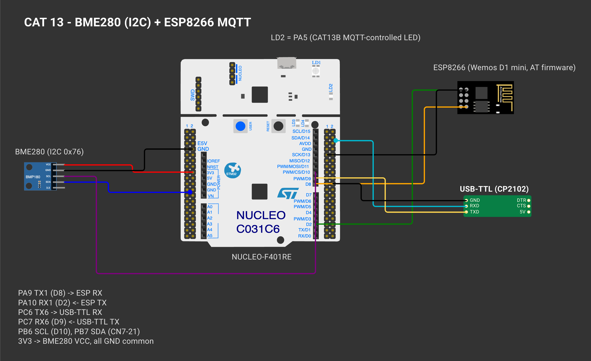
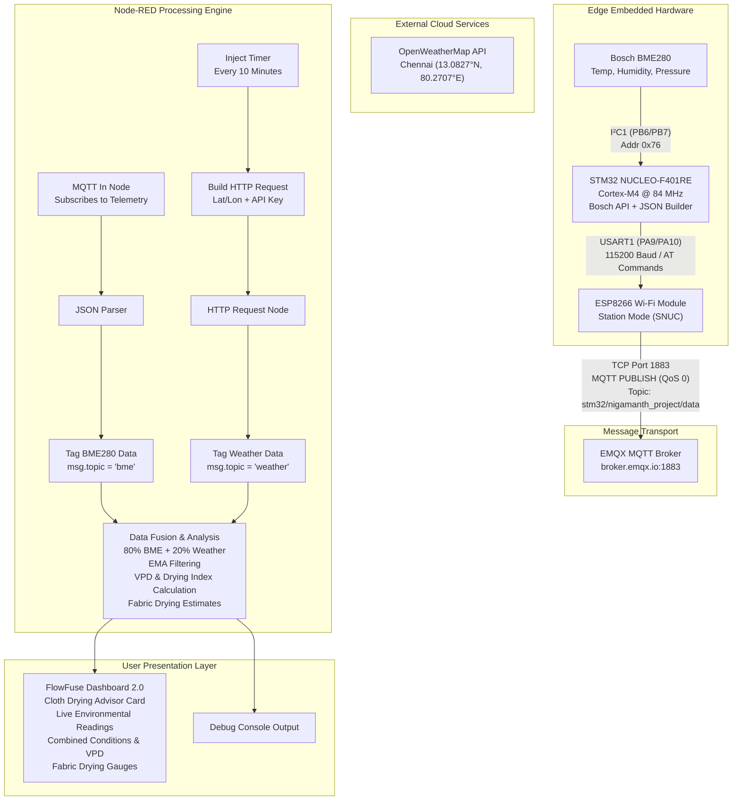
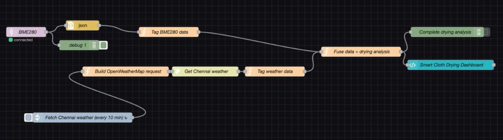
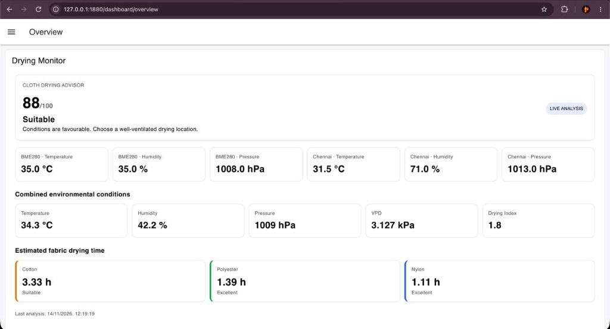
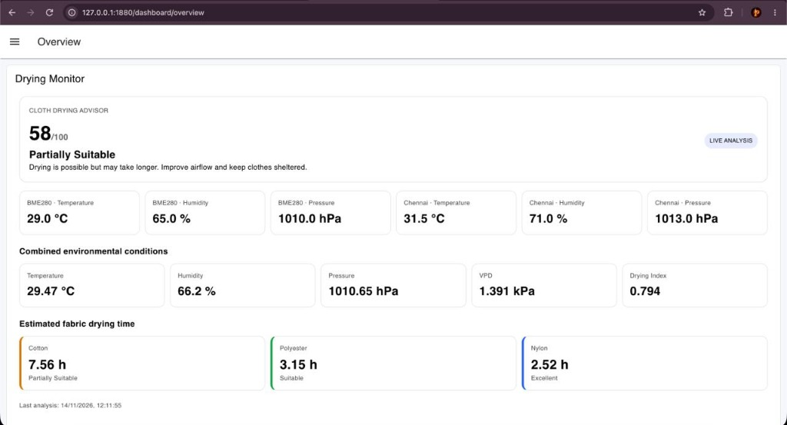
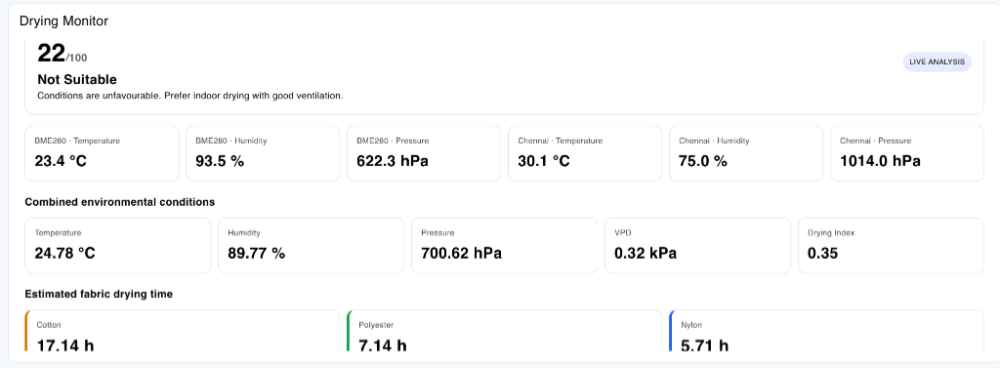
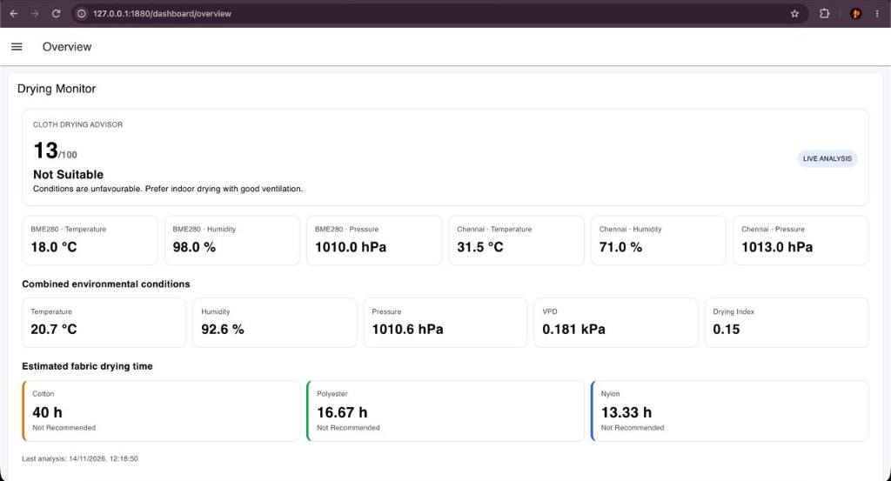

# EXPERIMENT DETAILS

**EXP:** CONTINUOUS ASSESSMENT 15 (Final IoT Project)

**DATE:** 14/11/2026

**NAME OF EXP:** Smart Cloth Drying System

**HARDWARE SETUP / PLATFORM:** STM32 NUCLEO-F401RE (ARM Cortex-M4), Bosch BME280 Environmental Sensor (I²C), ESP8266 Wi-Fi Module (Wemos D1 mini, AT firmware via USART1), Node-RED FlowFuse Dashboard 2.0, OpenWeatherMap API

---

## TASK 1 : Smart Cloth Drying Advisor

### 1. Circuit Diagram



#### Hardware Pin Configuration

| Subsystem / Peripheral | MCU Pin | Connected Hardware Pin | Protocol / Function | Notes |
|---|---|---|---|---|
| **BME280 Sensor** | `PB6` | BME280 SCL | I²C1 SCL (Clock) | 100 kHz standard mode, internal pull-up |
| **BME280 Sensor** | `PB7` | BME280 SDA | I²C1 SDA (Data) | Primary address `0x76` (`0xEC` 8-bit shifted) |
| **BME280 Power** | `+3.3V` | BME280 VCC | Power Supply | Regulated 3.3 V from NUCLEO board |
| **ESP8266 Wi-Fi** | `PA9` | ESP8266 RX | USART1 TX | 115200 baud, 8-N-1 |
| **ESP8266 Wi-Fi** | `PA10` | ESP8266 TX | USART1 RX | 115200 baud, 8-N-1 |
| **ESP8266 Power** | `+3.3V` / `5V` | ESP8266 VCC | Power Supply | Common VCC with adequate decoupling |
| **Serial Debug** | `PC6` | USB-TTL RXD | USART6 TX | Optional diagnostic serial stream |
| **Serial Debug** | `PC7` | USB-TTL TXD | USART6 RX | Optional diagnostic serial stream |
| **Common Ground** | `GND` | Common GND | Ground Reference | Common ground shared across all components |

---

### 2. Core Logic

#### A. Project Overview and Motivation

Drying clothes outdoors or on home balconies is heavily dependent on ambient atmospheric conditions. Traditional human estimation relies solely on whether it feels "warm" or "sunny", often overlooking relative humidity, air saturation, and regional precipitation risks. Hanging clothes in high-humidity or near-dewpoint conditions results in delayed drying, musty mildew odors, or unexpected wetting from sudden rain showers.

The **Smart Cloth Drying System** addresses this problem by acting as an intelligent IoT-based cloth drying advisor. It combines:
1. **Local Microclimate Telemetry**: Ambient temperature, relative humidity, and barometric pressure sampled directly at the drying location by an on-site Bosch BME280 sensor interfaced to an STM32 NUCLEO-F401RE.
2. **City-Wide Macro-Meteorological Data**: Live weather observations and precipitation reports retrieved from the OpenWeatherMap API for Chennai (Latitude: `13.0827`, Longitude: `80.2707`).
3. **Multi-Source Environmental Data Fusion & Filtering**: Weighted fusion (80% local microclimate + 20% macro-weather) followed by Exponential Moving Average (EMA) smoothing.
4. **Thermodynamic Evaporative Analysis**: Computation of Saturation Vapour Pressure (SVP), Actual Vapour Pressure (AVP), and Vapour Pressure Deficit (VPD) to determine the true moisture-holding capacity of the air.
5. **Fabric-Specific Drying Estimation & Advisories**: Mathematical drying index calculation, composite suitability scoring (0–100), rain-override safeguards, and drying time projections across cotton, polyester, and nylon fabrics displayed on an interactive Node-RED FlowFuse Dashboard.

---

#### B. System Architecture

The end-to-end IoT pipeline connects embedded sensing, edge Wi-Fi transmission, cloud MQTT messaging, meteorological REST APIs, backend stream processing, and responsive web visualization:



---

#### C. Working Principle

The operational workflow runs across two synchronized pipelines:

1. **Hardware Telemetry Loop (Every 2 Seconds)**:
   - The STM32 initializes I²C1, USART1, the BME280 sensor, and the ESP8266 Wi-Fi module upon power-up.
   - The ESP8266 joins the local network (`SNUC`) and opens a TCP socket to `broker.emqx.io:1883`, completing the MQTT handshake with Client ID `STM32_BME280_Publisher`.
   - Every 2 seconds, the STM32 triggers the BME280, reads raw uncompensated data, applies the Bosch factory calibration coefficients, and extracts temperature ($^\circ\text{C}$), barometric pressure ($\text{hPa}$), and relative humidity ($\%$).
   - The telemetry is packed into a compact JSON string and published via `MQTT_publishTopic` to `stm32/nigamanth_project/data`.

2. **Macro-Meteorological Ingestion (Every 10 Minutes)**:
   - Node-RED triggers an HTTP GET request to OpenWeatherMap querying current weather metrics for Chennai.
   - The response payload provides ambient temperature, humidity, pressure, wind speed, and rain precipitation volumes ($\text{mm/hour}$).
   - The data is tagged with `msg.topic = "weather"` and stored in the flow context.

3. **Data Fusion and Atmospheric Analysis**:
   - The `Fuse data + drying analysis` node verifies the arrival of both BME280 and weather feeds.
   - It performs an 80/20 weighted data fusion, giving primary weight to the physical drying microclimate while using regional meteorological data for calibration and rain verification.
   - The combined parameters are smoothed through an Exponential Moving Average (EMA) filter.
   - The thermodynamic state of the atmosphere is resolved: Saturation Vapour Pressure ($SVP$), Actual Vapour Pressure ($AVP$), and Vapour Pressure Deficit ($VPD$).
   - A non-linear Drying Index is computed from the $VPD$.
   - A weighted Suitability Score (0–100) is generated. If active rainfall is reported in the weather feed, an emergency override sets suitability to `"Not Suitable"`.
   - Fabric-specific drying times (Cotton, Polyester, Nylon) are estimated based on fiber moisture regain characteristics.

4. **Dashboard Presentation**:
   - Formatted results are pushed to the FlowFuse Dashboard 2.0 template, rendering live score badges, status pills, environmental cards, and individual fabric progress indicators.

---

#### D. Mathematical Calculations and Algorithms

##### 1. Environmental Data Fusion
The ambient drying microclimate directly surrounding hung fabrics is dominated by immediate local air flow and temperature, but regional air mass trends provide baseline stability. The fusion model weights local sensor telemetry at 80% and city weather data at 20%:

$$T_{\text{raw}} = 0.8 \cdot T_{\text{BME}} + 0.2 \cdot T_{\text{Weather}}$$

$$RH_{\text{raw}} = 0.8 \cdot RH_{\text{BME}} + 0.2 \cdot RH_{\text{Weather}}$$

$$P_{\text{raw}} = 0.8 \cdot P_{\text{BME}} + 0.2 \cdot P_{\text{Weather}}$$

##### 2. Exponential Moving Average (EMA) Filtering
To eliminate high-frequency sensor noise and sudden transient spikes while preserving true environmental trends:

$$X_{\text{filtered}}(t) = \alpha \cdot X_{\text{raw}}(t) + (1 - \alpha) \cdot X_{\text{filtered}}(t - 1)$$

*In the Node-RED implementation, $\alpha$ is configured to $1.0$ during independent scenario evaluation to allow instantaneous verification of discrete test cases. In continuous 24/7 deployment, $\alpha = 0.8$ provides optimal noise rejection.*

##### 3. Vapour Pressure Deficit (VPD)
Evaporation rate from damp cloth fibers is driven not merely by relative humidity or temperature alone, but by the **Vapour Pressure Deficit** ($VPD$)—the physical difference between the moisture pressure the air could hold at saturation and the moisture pressure actually present.

First, Saturation Vapour Pressure ($SVP$) in kilopascals ($\text{kPa}$) is calculated using the Magnus-Tetens formulation:

$$SVP = 0.6108 \cdot \exp\left(\frac{17.27 \cdot T_{\text{filtered}}}{T_{\text{filtered}} + 237.3}\right)$$

Next, Actual Vapour Pressure ($AVP$) is determined from relative humidity:

$$AVP = SVP \times \frac{RH_{\text{filtered}}}{100}$$

Finally, the Vapour Pressure Deficit ($VPD$) is obtained:

$$VPD = \max\left(0,\, SVP - AVP\right) \quad [\text{kPa}]$$

*A higher $VPD$ indicates high atmospheric moisture deficit and rapid evaporation; a low $VPD$ (approaching 0) indicates saturated, humid air where water molecules cannot evaporate.*

##### 4. Drying Index
The drying index scales $VPD$ non-linearly to represent evaporative efficiency across standard domestic conditions:

$$\text{DryingIndex} = \text{clamp}\left(0.15,\, 1.8,\, \left(\frac{VPD}{1.7}\right)^{1.15}\right)$$

Boundaries are clamped between $0.15$ (stagnant/humid air with minimal evaporation) and $1.8$ (hot, dry air with rapid evaporation).

##### 5. Drying Suitability Score
The overall suitability score ($0 - 100$) evaluates three contributing factors:

$$\text{clamp}(x, \min, \max) = \max(\min, \min(\max, x))$$

- **Temperature Component** ($S_{\text{temp}}$, baseline 15 °C to 35 °C):
  $$S_{\text{temp}} = \text{clamp}\left(\frac{T - 15}{20} \times 100,\, 0,\, 100\right)$$

- **Humidity Component** ($S_{\text{hum}}$, penalizes humidity above 30% up to 90%):
  $$S_{\text{hum}} = \text{clamp}\left(\frac{90 - RH}{60} \times 100,\, 0,\, 100\right)$$

- **VPD Component** ($S_{\text{vpd}}$, saturated at 1.5 kPa):
  $$S_{\text{vpd}} = \text{clamp}\left(\frac{VPD}{1.5} \times 100,\, 0,\, 100\right)$$

- **Weighted Aggregate Suitability Score**:
  $$\text{SuitabilityScore} = \text{round}\left(0.4 \cdot S_{\text{temp}} + 0.5 \cdot S_{\text{hum}} + 0.1 \cdot S_{\text{vpd}}\right)$$

##### 6. Rule-Based Classification and Rain Safeguard
- **Suitable** ($\text{Score} \ge 75$): Favourable drying conditions; outdoor drying recommended.
- **Partially Suitable** ($45 \le \text{Score} < 75$): Drying is possible but prolonged; sheltered outdoor drying advised.
- **Not Suitable** ($\text{Score} < 45$): Slow or zero drying; indoor drying recommended.
- **Rain Override**: If OpenWeatherMap reports active precipitation (`rainMmPerHour > 0`), suitability is immediately forced to `"Not Suitable"` with the warning: *"Rain is currently reported in Chennai. Avoid outdoor drying."*

##### 7. Fabric-Specific Drying Time Estimates
Different textile fibers retain moisture differently due to cellular structure and moisture regain constants. An empirical inverse relationship models the drying duration:

$$t_{\text{fabric}} = \frac{K_{\text{fabric}}}{\text{DryingIndex}} \quad [\text{hours}]$$

Where:
- **Cotton** ($K_{\text{cotton}} = 6.0$): Hydrophilic cellulose fibers with high water absorption.
- **Polyester** ($K_{\text{polyester}} = 2.5$): Hydrophobic synthetic fibers with low moisture retention.
- **Nylon** ($K_{\text{nylon}} = 2.0$): Lightweight synthetic polymers with rapid surface desorption.

*Classification for each fabric:*
- $t < 3\text{ h}$: **Excellent**
- $3 \le t \le 6\text{ h}$: **Suitable**
- $6 < t \le 10\text{ h}$: **Partially Suitable**
- $t > 10\text{ h}$: **Not Recommended**

*(These values represent mathematical estimates derived from the project's empirical atmospheric model rather than laboratory-guaranteed drying times).*

---

#### E. Firmware Codebase Overview

```text
STM32/CAT15/
├── Core/
│   ├── Inc/
│   │   ├── bme280.h                 <- Bosch Sensortec BME280 driver header
│   │   ├── bme280_defs.h            <- BME280 register definitions and calibration structs
│   │   ├── ESPLib.h                 <- ESP8266 AT & MQTT communication library header
│   │   ├── main.h                   <- Pin definitions, clock prototypes, HAL headers
│   │   ├── stm32f4xx_hal_conf.h     <- HAL peripheral modules configuration
│   │   └── stm32f4xx_it.h           <- Interrupt handler declarations
│   └── Src/
│       ├── bme280.c                 <- Bosch Sensortec BME280 compensation API
│       ├── ESPLib.c                 <- AT command parser, TCP socket & MQTT publisher
│       ├── main.c                   <- Main application entry, sensor reading, JSON pack, loop
│       ├── stm32f4xx_hal_msp.c      <- MSP initialization: I2C1 (PB6/PB7) & USART1 (PA9/PA10)
│       ├── stm32f4xx_it.c           <- SysTick and hardware exception handlers
│       └── system_stm32f4xx.c       <- System clock tree and vector table configuration
├── Drivers/
│   ├── CMSIS/                       <- ARM Cortex-M4 CMSIS core headers
│   └── STM32F4xx_HAL_Driver/        <- STMicroelectronics Hardware Abstraction Layer drivers
├── MDK-ARM/
│   ├── Final_project.uvprojx        <- Keil µVision 5 project file
│   ├── startup_stm32f401xe.s        <- ARM Cortex-M4 vector table and assembly startup
│   └── Final_project/
│       └── Final_project.hex        <- Pre-compiled production firmware binary
├── wokwi/
│   ├── diagram.json                 <- Interactive Wokwi circuit simulation wiring
│   └── usbttl.chip.json             <- Custom USB-TTL simulation block definition
├── circuit.png                      <- Complete hardware wiring schematic
├── nodered_flow.png                 <- Complete Node-RED pipeline screenshot
├── nodered_project.json             <- Exported Node-RED flow JSON
├── dashboard_favourable.png         <- Dashboard screenshot: Favourable / Suitable conditions
├── dashboard_partially_suitable.png <- Dashboard screenshot: Partially Suitable conditions
├── dashboard_unfavourable.png       <- Dashboard screenshot: Unfavourable conditions
└── dashboard_severe_unfavourable.png<- Dashboard screenshot: Severe high-humidity conditions
```

##### Primary Code Responsibilities
- **`main.c`**: Initializes clock to 84 MHz, runs sensor calibration, connects Wi-Fi/MQTT, formats telemetry, and issues periodic MQTT publish packets.
- **`bme280.c`**: Interfaces with the sensor over I²C to read raw ADC pressure, temperature, and humidity bursts; executes 32-bit integer and floating-point compensation equations using factory OTP trimming parameters.
- **`ESPLib.c`**: Manages the ESP8266 serial state machine over USART1. Sends `AT+CWJAP` commands to associate with the access point, establishes a TCP socket (`AT+CIPSTART`), formats MQTT `CONNECT` headers, and serializes MQTT `PUBLISH` packets.

---

#### F. MQTT Communication

- **MQTT Broker**: `broker.emqx.io` (Public EMQX test broker).
- **Transport & Port**: TCP, Port `1883` (Unencrypted standard MQTT port).
- **Client Identifier**: `STM32_BME280_Publisher` (Clean session enabled, 500 s keepalive).
- **Topic**: `stm32/nigamanth_project/data`
- **Quality of Service (QoS)**: QoS 0 (At most once delivery).
- **Payload Format**: Standard compact JSON object:
  ```json
  {"temperature":35.00,"pressure_hpa":1008.00,"humidity":35.00}
  ```
  *Technical Note on Key Compatibility: The firmware formats the barometric pressure using the key `pressure_hpa`. The Node-RED flow is designed to seamlessly accept both `pressure` and `pressure_hpa` (`p.pressure ?? p.pressure_hpa`), ensuring full compatibility between real hardware broadcasts and synthetic test inputs.*

---

#### G. Node-RED Flow Pipeline



The backend workflow consists of 10 primary nodes:
1. **`BME280` (`mqtt in`)**: Subscribes to `stm32/nigamanth_project/data` on `broker.emqx.io:1883`.
2. **`json`**: Deserializes the raw MQTT string payload into a native JavaScript object.
3. **`Tag BME280 data` (`function`)**: Validates that numeric readings are finite, confirms humidity is within 0–100%, and tags `msg.topic = "bme"`.
4. **`Fetch Chennai weather (every 10 min)` (`inject`)**: Automatically triggers every 600 seconds (and 1 second after startup).
5. **`Build OpenWeatherMap request` (`function`)**: Formats the target query URL using coordinates `lat=13.0827` and `lon=80.2707`, metric units, and the user's API key.
6. **`Get Chennai weather` (`http request`)**: Executes the HTTP GET request and returns parsed JSON.
7. **`Tag weather data` (`function`)**: Tags the incoming response with `msg.topic = "weather"`.
8. **`Fuse data + drying analysis` (`function`)**: Merges both context inputs, executes the 80/20 data fusion, computes $SVP$, $AVP$, $VPD$, and the Drying Index, calculates fabric times, and builds the composite UI payload.
9. **`Smart Cloth Drying Dashboard` (`ui-template`)**: Renders the FlowFuse Dashboard 2.0 interface.
10. **`Complete drying analysis` (`debug`)**: Streams complete analysis objects to the sidebar debug tab.

---

#### H. Dashboard Visualization and Verified Test Cases

The dashboard is built using modern FlowFuse Dashboard 2.0 components (`ui-template`, `ui-group`, `ui-page`). It features a responsive layout with 4 functional card grids:
- **Cloth Drying Advisor**: Prominently highlights the 0–100 suitability score, qualitative verdict, animated status pill (`LIVE ANALYSIS` or `RAIN REPORTED`), and descriptive user guidance.
- **Individual Environmental Readings**: Side-by-side comparison of local BME280 readings vs. regional Chennai weather data.
- **Combined Environmental Conditions**: Fused temperature, humidity, pressure, Vapour Pressure Deficit ($VPD$), and calculated Drying Index.
- **Estimated Fabric Drying Time**: Dedicated color-coded cards for Cotton (amber), Polyester (green), and Nylon (blue) displaying estimated hours and suitability ratings.

##### Test Case 1: Favourable / Suitable Drying Conditions



- **Observed Metrics**:
  - BME280 Sensor: $35.0^\circ\text{C}$, $35.0\%$, $1008.0\text{ hPa}$
  - Chennai Weather: $31.5^\circ\text{C}$, $71.0\%$, $1013.0\text{ hPa}$
  - Fused Atmosphere: $34.3^\circ\text{C}$, $42.2\%$, $1009.0\text{ hPa}$
  - Atmospheric Analysis: $VPD = 3.127\text{ kPa}$, $\text{Drying Index} = 1.8$
- **System Verdict**: **Score 88 / 100 — Suitable**
- **User Advice**: *"Conditions are favourable. Choose a well-ventilated drying location."*
- **Fabric Projections**:
  - Cotton: **3.33 h** (*Suitable*)
  - Polyester: **1.39 h** (*Excellent*)
  - Nylon: **1.11 h** (*Excellent*)

---

##### Test Case 2: Partially Suitable Conditions



- **Observed Metrics**:
  - BME280 Sensor: $29.0^\circ\text{C}$, $65.0\%$, $1010.0\text{ hPa}$
  - Chennai Weather: $31.5^\circ\text{C}$, $71.0\%$, $1013.0\text{ hPa}$
  - Fused Atmosphere: $29.47^\circ\text{C}$, $66.2\%$, $1010.65\text{ hPa}$
  - Atmospheric Analysis: $VPD = 1.391\text{ kPa}$, $\text{Drying Index} = 0.794$
- **System Verdict**: **Score 58 / 100 — Partially Suitable**
- **User Advice**: *"Drying is possible but may take longer. Improve airflow and keep clothes sheltered."*
- **Fabric Projections**:
  - Cotton: **7.56 h** (*Partially Suitable*)
  - Polyester: **3.15 h** (*Suitable*)
  - Nylon: **2.52 h** (*Excellent*)

---

##### Test Case 3: Unfavourable Conditions



- **Observed Metrics**:
  - BME280 Sensor: $23.4^\circ\text{C}$, $93.5\%$, $622.3\text{ hPa}$
  - Chennai Weather: $30.1^\circ\text{C}$, $75.0\%$, $1014.0\text{ hPa}$
  - Fused Atmosphere: $24.78^\circ\text{C}$, $89.77\%$, $700.62\text{ hPa}$
  - Atmospheric Analysis: $VPD = 0.320\text{ kPa}$, $\text{Drying Index} = 0.35$
- **System Verdict**: **Score 22 / 100 — Not Suitable**
- **User Advice**: *"Conditions are unfavourable. Prefer indoor drying with good ventilation."*
- **Fabric Projections**:
  - Cotton: **17.14 h** (*Not Recommended*)
  - Polyester: **7.14 h** (*Partially Suitable*)
  - Nylon: **5.71 h** (*Suitable*)

---

##### Test Case 4: Severe High-Humidity / Unfavourable Conditions



- **Observed Metrics**:
  - BME280 Sensor: $18.0^\circ\text{C}$, $98.0\%$, $1010.0\text{ hPa}$
  - Chennai Weather: $31.5^\circ\text{C}$, $71.0\%$, $1013.0\text{ hPa}$
  - Fused Atmosphere: $20.70^\circ\text{C}$, $92.6\%$, $1010.6\text{ hPa}$
  - Atmospheric Analysis: $VPD = 0.181\text{ kPa}$, $\text{Drying Index} = 0.15$
- **System Verdict**: **Score 13 / 100 — Not Suitable**
- **User Advice**: *"Conditions are unfavourable. Prefer indoor drying with good ventilation."*
- **Fabric Projections**:
  - Cotton: **40.00 h** (*Not Recommended*)
  - Polyester: **16.67 h** (*Not Recommended*)
  - Nylon: **13.33 h** (*Not Recommended*)

---

### 3. Inference

1. **Microclimate vs. Macroclimate Fusion**:
   Relying exclusively on macro-level weather forecasts is insufficient for household IoT applications because local balcony shading, micro-ventilation, and thermal boundaries differ significantly from regional averages. Conversely, relying solely on local sensors leaves the system blind to incoming precipitation. Combining 80% local BME280 telemetry with 20% regional OpenWeatherMap data provides both hyper-local precision and macro-weather awareness.

2. **Thermodynamic Significance of VPD**:
   Relative humidity ($RH$) alone is an incomplete metric for evaporation. At 20 °C and 70% RH, $VPD$ is only $0.70\text{ kPa}$, leading to very slow evaporation; at 35 °C and 70% RH, $VPD$ rises to $1.69\text{ kPa}$, driving rapid drying despite the identical relative humidity. Computing Vapour Pressure Deficit via the Magnus-Tetens formula gives the system a physically grounded model of evaporative potential.

3. **Fiber-Specific Dynamic Modeling**:
   Different textiles exhibit distinct drying dynamics. Synthetic fibers (nylon and polyester) dry up to 3 to 4 times faster than natural cellulose cotton under identical atmospheric conditions. Providing fabric-specific estimates and recommendations offers actionable guidance to users rather than a single generic drying verdict.

4. **IoT Architecture and System Robustness**:
   The project demonstrates a production-grade IoT architecture: STM32 bare-metal register initialization and Bosch API sensor acquisition, non-blocking serial communication with an ESP8266 co-processor, lightweight MQTT message broker transport, cloud REST integration, and responsive FlowFuse web dashboard presentation. The resulting system is resilient, automated, and practical for real-world smart home deployments.

