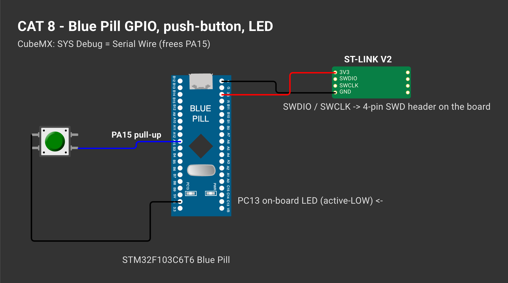

# EXPERIMENT DETAILS

**EXP:** CONTINUOUS ASSESSMENT 8

**DATE:** 18/09/2026

**NAME OF EXP:** STM32 GPIO Bring-Up and Switch-Controlled LED

**HARDWARE SETUP / PLATFORM:** Blue Pill STM32F103C6T6 (Cortex-M3, 72 MHz) + push-button — STM32CubeMX + Keil MDK-ARM (STM32CubeIDE project also included), STM32 HAL

---

## TASK 8A : GPIO Input/Output

### 1. Circuit Diagram

| Pin | CubeMX setting | Connected to |
|---|---|---|
| PC13 | GPIO_Output, push-pull | on-board LED (active-LOW) |
| PA15 | GPIO_Input, pull-up | push-button → GND |
| PA13 / PA14 | SYS: Debug = Serial Wire | ST-LINK (also frees PA15 from JTAG) |
| RCC | HSE crystal → PLL ×9 | 72 MHz |

*Drawn on [Wokwi](https://wokwi.com). To open and edit it: start a new project on wokwi.com, paste [`wokwi/diagram.json`](wokwi/diagram.json) into its diagram.json tab, and add the `wokwi/*.chip.json` files (if any) with **New file**. The AT89S52, USB-TTL, ULN2003, USBasp and ST-LINK boards are custom chips (pin names added as labels). The ESP-01 part stands in for the Wemos D1 mini and the BMP180 module for the BME280 (same AT firmware / same 4-pin I²C header); the Nucleo-64 graphic is labelled as the F401RE.*

### 2. Core Logic / Pseudocode / Code Base

**Working Principle:**

In this initial bring-up on the STM32F103 "Blue Pill" board, we configure general-purpose I/O pins using STM32CubeMX and the HAL library. Pin PC13 drives the on-board user LED in push-pull output mode. Because the LED cathode connects to PC13 and the anode to 3.3 V, it operates in active-low logic: driving PC13 LOW illuminates the LED, while driving it HIGH turns it off. Push-button input is configured on PA15 with an internal pull-up resistor enabled. By default, PA15 is assigned to JTAG JTDI; selecting "Serial Wire" debug mode in CubeMX (SYS) remaps JTAG, liberating PA15 for standard GPIO. The switch is wired between PA15 and ground, so releasing the button leaves PA15 pulled HIGH (logic 1), while pressing it shorts the pin to GND (logic 0). The polling loop continually samples PA15 via `HAL_GPIO_ReadPin()` and writes the inverted logic level to PC13 using `HAL_GPIO_WritePin()`, so the LED directly mirrors the physical button state.

**Pseudocode:**

1. Initialize the HAL library (`HAL_Init()`), set up system clocks to 72 MHz using HSE and the PLL, and initialize GPIO peripheral clocks.
2. Ensure the user LED begins in the OFF state (`PC13 = HIGH`).
3. Inside the infinite loop:
   a. Read the raw digital state of PA15 directly with `HAL_GPIO_ReadPin(GPIOA, GPIO_PIN_15)`.
   b. If the pin is LOW (button pressed), drive PC13 LOW (LED ON) via `HAL_GPIO_WritePin(GPIOC, GPIO_PIN_13, GPIO_PIN_RESET)`; otherwise drive PC13 HIGH (LED OFF).
4. Repeat continuously.

**Code Base:**

- Project files: `CAT08A_GPIO_Input_Output.ioc` (CubeMX configuration), `MDK-ARM/CAT08A_GPIO_Input_Output.uvprojx` (Keil MDK), `.project` / `.cproject` (STM32CubeIDE); application code in `Core/Src/main.c`.
- Direct HAL GPIO calls: `HAL_GPIO_ReadPin(GPIOA, GPIO_PIN_15)` and `HAL_GPIO_WritePin(GPIOC, GPIO_PIN_13, ...)` with active-low logic (RESET = ON, SET = OFF).

### 3. Inference

The on-board LED mirrors the push-button state directly, verifying the internal pull-up resistor on PA15 and the active-low output configuration on PC13.
