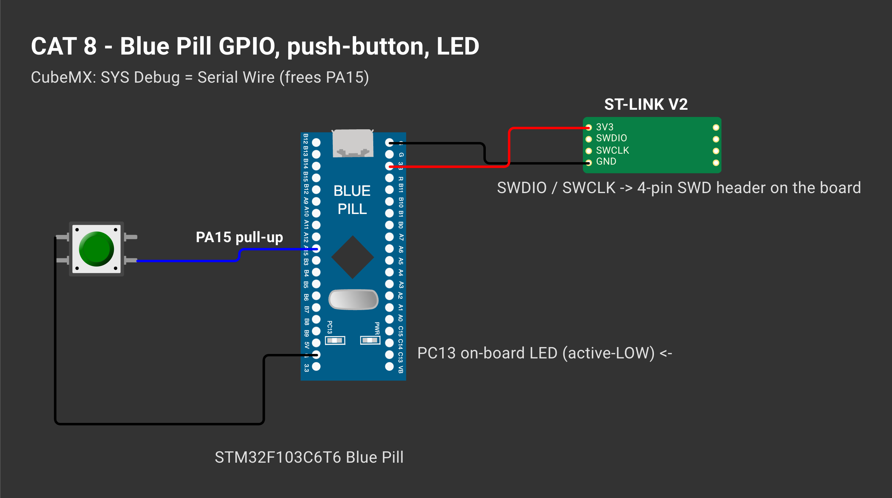

# EXPERIMENT DETAILS

**EXP:** CONTINUOUS ASSESSMENT 8

**DATE:** 18/09/2026

**NAME OF EXP:** STM32 GPIO Bring-Up and Switch-Controlled LED

**HARDWARE SETUP / PLATFORM:** Blue Pill STM32F103C6T6 (Cortex-M3, 72 MHz) + push-button — STM32CubeMX + Keil MDK-ARM (STM32CubeIDE project also included), STM32 HAL

---

## TASK 8B : Event-Based Control

### 1. Circuit Diagram

| Pin | CubeMX setting | Connected to |
|---|---|---|
| PC13 | GPIO_Output, push-pull | on-board LED (active-LOW) |
| PA15 | GPIO_Input, pull-up | push-button → GND |
| PA13 / PA14 | SYS: Debug = Serial Wire | ST-LINK (also frees PA15 from JTAG) |
| RCC | HSE crystal → PLL ×9 | 72 MHz |

*Drawn on [Wokwi](https://wokwi.com). To open and edit it: start a new project on wokwi.com, paste [`wokwi/diagram.json`](wokwi/diagram.json) into its diagram.json tab, and add the `wokwi/*.chip.json` files (if any) with **New file**. The AT89S52, USB-TTL, ULN2003, USBasp and ST-LINK boards are custom chips (pin names added as labels). The ESP-01 part stands in for the Wemos D1 mini and the BMP180 module for the BME280 (same AT firmware / same 4-pin I²C header); the Nucleo-64 graphic is labelled as the F401RE.*

### 2. Core Logic / Pseudocode / Code Base

**Working Principle:**

Mechanical switch contacts physically chatter for several milliseconds upon closure and release, which a high-speed 72 MHz Cortex-M3 processor would easily misinterpret as multiple rapid presses. To resolve this, we implement a non-blocking software debouncer using millisecond timestamps from `HAL_GetTick()`. Button state is encapsulated in a `debounce_t` structure storing the current verified state, the last raw sample, and the timestamp of the latest transition. Within `debounce_update()`, any change in the raw input resets the stability clock. Only after the input remains steady for 25 continuous milliseconds does the routine update its latched state and return a transitional event (`BTN_PRESS_EDGE` or `BTN_RELEASE_EDGE`). The LED on PC13 is toggled strictly upon receiving `BTN_PRESS_EDGE`, and an event counter (`toggle_count`) is incremented for verification in the IDE's Live Expressions window.

**Pseudocode:**

1. In each cycle of `main()`, read the raw digital state of PA15 and fetch the current time via `HAL_GetTick()`.
2. Supply these values to `debounce_update()`.
3. If the input state has changed, record the transition timestamp.
4. Once the raw line remains unchanged for $\ge 25$ ms and differs from the stored state, accept the new state and return the detected edge.
5. On `BTN_PRESS_EDGE`, toggle the PC13 LED using `HAL_GPIO_TogglePin()` and increment `toggle_count`.

**Code Base:**

- Project files: `CAT08B_Event_Toggle_Debounce.ioc` (CubeMX configuration), `MDK-ARM/CAT08B_Event_Toggle_Debounce.uvprojx` (Keil MDK), `.project` / `.cproject` (STM32CubeIDE); application code in `Core/Src/main.c`.
- `debounce_t` (stable, last_raw, last_change)
- `debounce_update()` → `BTN_PRESS_EDGE` / `BTN_RELEASE_EDGE`
- `HAL_GPIO_TogglePin()`; `toggle_count` for Live Expressions

### 3. Inference

Each distinct button press toggles the LED exactly once. Switch bounce is filtered purely in software using non-blocking timestamp comparisons without halting CPU execution.
