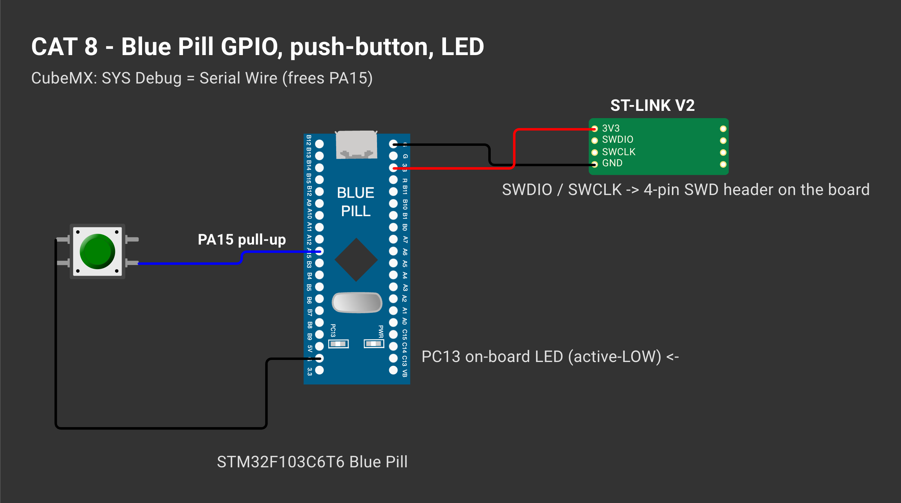

# EXPERIMENT DETAILS

**EXP:** CONTINUOUS ASSESSMENT 8

**DATE:** 18/09/2026

**NAME OF EXP:** STM32 GPIO Bring-Up and Switch-Controlled LED

**HARDWARE SETUP / PLATFORM:** Blue Pill STM32F103C6T6 (Cortex-M3, 72 MHz) + push-button — STM32CubeMX + Keil MDK-ARM (STM32CubeIDE project also included), STM32 HAL

---

## TASK 8C : Short Press vs Long Press

### 1. Circuit Diagram

| Pin | CubeMX setting | Connected to |
|---|---|---|
| PC13 | GPIO_Output, push-pull | on-board LED (active-LOW) |
| PA15 | GPIO_Input, pull-up | push-button → GND |
| PA13 / PA14 | SYS: Debug = Serial Wire | ST-LINK (also frees PA15 from JTAG) |
| RCC | HSE crystal → PLL ×9 | 72 MHz |

*Drawn on [Wokwi](https://wokwi.com). To open and edit it: start a new project on wokwi.com, paste [`wokwi/diagram.json`](wokwi/diagram.json) into its diagram.json tab, and add the `wokwi/*.chip.json` files (if any) with **New file**. The AT89S52, USB-TTL, ULN2003, USBasp and ST-LINK boards are custom chips (pin names added as labels). The ESP-01 part stands in for the Wemos D1 mini and the BMP180 module for the BME280 (same AT firmware / same 4-pin I²C header); the Nucleo-64 graphic is labelled as the F401RE.*

### 2. Core Logic / Pseudocode / Code Base

**Working Principle:**

This task extends event handling by distinguishing between short and long button presses to trigger different operational modes without blocking. When `debounce_update()` detects a valid press edge (returns `1`), the firmware records the system timestamp in `press_start_ms = now`. The user continues holding the button while the main loop executes continuously. Upon release (returns `2`), the held duration is calculated: `last_press_ms = now - press_start_ms`. If the duration is $\ge 1000$ ms, it is classified as a long press and activates continuous blinking mode (`blinking = 1`). If the duration is $< 1000$ ms (short press), the behavior depends on the current state: if blinking is active, it halts blinking mode and turns the LED off; otherwise, it toggles the normal LED state (`led_on = !led_on`). Classification occurs strictly **upon button release**, meaning long-press blinking activates when the button is let go rather than mid-hold. When blinking mode is active, the LED toggles every 200 ms using non-blocking timestamp comparisons (`(now - last_blink_ms) >= 200`).

| Action | Response |
|---|---|
| Short | toggle LED |
| Long | continuous blinking (200 ms) |
| Short while blinking | stop blinking |
| Long again | blink again |

**Pseudocode:**

1. In each pass of `main()`, poll `debounce_update(&button, button_raw_pressed(), now)`.
2. When a debounced press edge occurs (`event == 1`), record `press_start_ms = now`.
3. When the corresponding release edge arrives (`event == 2`), calculate `last_press_ms = now - press_start_ms`:
   a. If `last_press_ms >= 1000` ms (Long Press): enable blinking mode (`blinking = 1; last_blink_ms = now;`).
   b. If `last_press_ms < 1000` ms (Short Press):
      - If already blinking: exit blinking mode (`blinking = 0; led_on = 0; led_write(0);`).
      - Otherwise: toggle normal state (`led_on = !led_on; led_write(led_on);`).
4. If `blinking == 1` and `(now - last_blink_ms) >= 200`: refresh `last_blink_ms = now` and toggle PC13 via `HAL_GPIO_TogglePin(GPIOC, GPIO_PIN_13)`.

**Code Base:**

- Project files: `CAT08C_Short_vs_Long_Press.ioc` (CubeMX configuration), `MDK-ARM/CAT08C_Short_vs_Long_Press.uvprojx` (Keil MDK), `.project` / `.cproject` (STM32CubeIDE); application code in `Core/Src/main.c`.
- `debounce_update()` returning numeric event codes (1 = press, 2 = release, 0 = idle)
- `HAL_GetTick()` for both press timing and 200 ms blink interval — zero `HAL_Delay()` blocking calls

### 3. Inference

Using elapsed timestamps rather than blocking delay loops allows the STM32 to accurately measure press durations while concurrently running non-blocking LED blinking routines.
