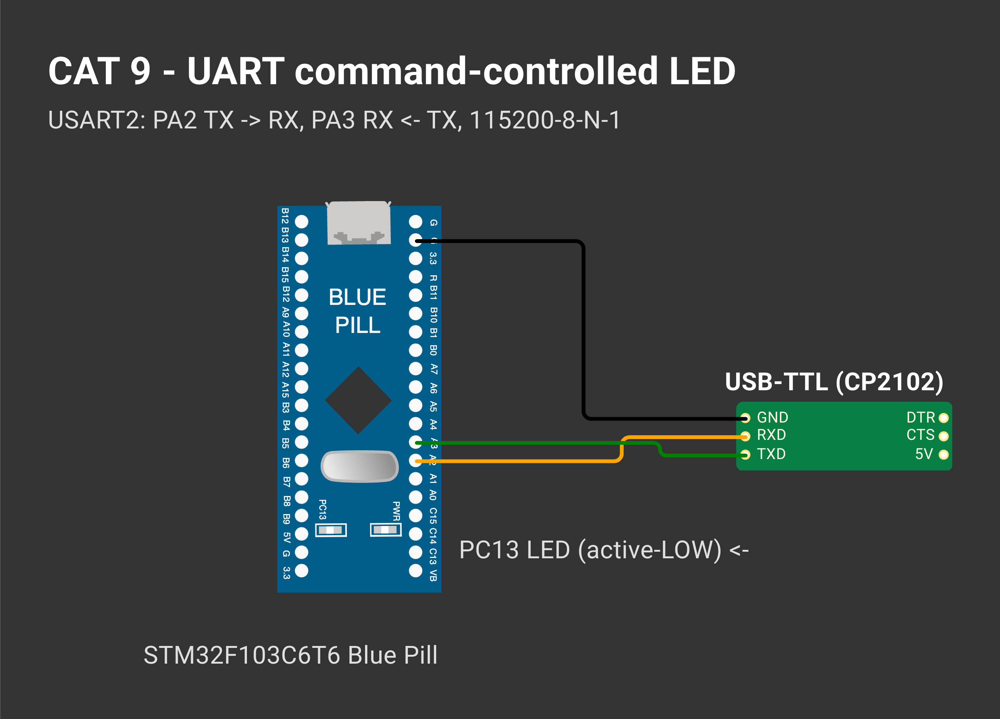

# EXPERIMENT DETAILS

**EXP:** CONTINUOUS ASSESSMENT 9

**DATE:** 28/09/2026

**NAME OF EXP:** STM32 UART Command Controlled LED

**HARDWARE SETUP / PLATFORM:** Blue Pill STM32F103C6T6 (Cortex-M3, 72 MHz) + USB-to-TTL + PuTTY — STM32CubeMX + Keil MDK-ARM (STM32CubeIDE project also included), STM32 HAL, PuTTY

---

## TASK 9A : Basic UART Communication

### 1. Circuit Diagram

| STM32 | USB-to-TTL |
|---|---|
| PA2 USART2_TX | RX |
| PA3 USART2_RX | TX |
| GND | GND |

USART2 asynchronous, **115200-8-N-1**. LED on PC13.



*Drawn on [Wokwi](https://wokwi.com). To open and edit it: start a new project on wokwi.com, paste [`wokwi/diagram.json`](wokwi/diagram.json) into its diagram.json tab, and add the `wokwi/*.chip.json` files (if any) with **New file**. The AT89S52, USB-TTL, ULN2003, USBasp and ST-LINK boards are custom chips (pin names added as labels). The ESP-01 part stands in for the Wemos D1 mini and the BMP180 module for the BME280 (same AT firmware / same 4-pin I²C header); the Nucleo-64 graphic is labelled as the F401RE.*

### 2. Core Logic / Pseudocode / Code Base

**Working Principle:**

This task establishes serial communication between the STM32F103 and a host PC using USART2 operating asynchronously at 115200 baud (8 data bits, no parity, 1 stop bit: 115200-8-N-1). USART2 TX (PA2) connects to the USB-to-TTL converter's RX pin, and USART2 RX (PA3) connects to TX, sharing a common ground. To prevent the polling loop from freezing when no keystrokes are present, `HAL_UART_Receive()` is called with a brief 10 ms timeout. When a character is successfully received, the program immediately echoes it back to the terminal (translating Carriage Return `\r` into `\r\n` for proper terminal line spacing) and records the current timestamp. If no serial input arrives for 1000 continuous milliseconds (monitored via `HAL_GetTick()`), the firmware transmits a periodic heartbeat beacon character `'A'`.

**Pseudocode:**

1. Initialize USART2 at 115200-8-N-1 and transmit a startup banner string.
2. Attempt to read a single byte using `HAL_UART_Receive(&huart2, &rx, 1, 10)`.
3. If a character is received (`HAL_OK`):
   a. Transmit it back to the terminal (transmitting `\r\n` when `\r` is received).
   b. Reset the inactivity timer with `HAL_GetTick()`.
4. If the call timed out and 1000 ms have elapsed without input:
   a. Transmit `'A'` to the terminal.
   b. Refresh the inactivity timer.
5. Repeat indefinitely.

**Code Base:**

- Project files: `CAT09A_Basic_UART_Communication.ioc` (CubeMX configuration), `MDK-ARM/CAT09A_Basic_UART_Communication.uvprojx` (Keil MDK), `.project` / `.cproject` (STM32CubeIDE); application code in `Core/Src/main.c`.
- `uart_send_str()`, `uart_send_char()`

**Expected Output:**

```
CAT9A - STM32 Blue Pill UART ready (115200-8-N-1)
AAAAhelloAAA
```

### 3. Inference

Both transmission and reception operate reliably at matching baud rates and frame settings. Short-timeout polling provides immediate keystroke echo without preventing timed background tasks.
