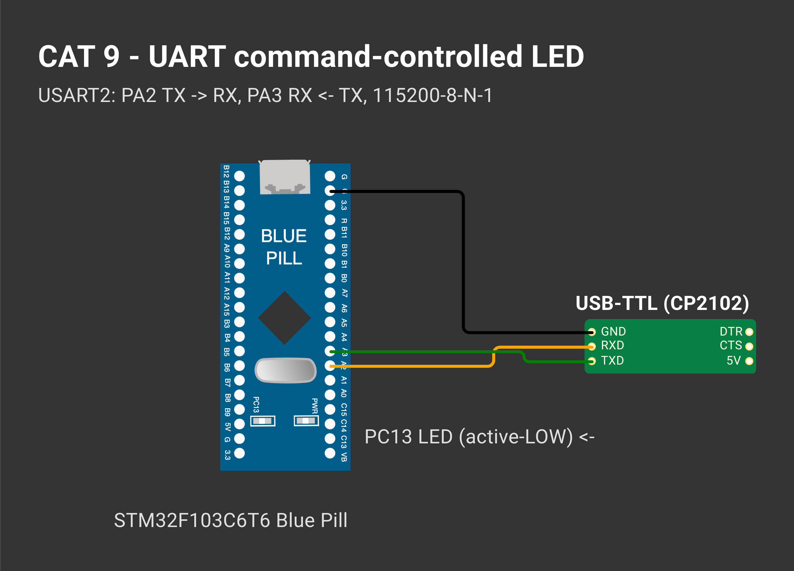

# EXPERIMENT DETAILS

**EXP:** CONTINUOUS ASSESSMENT 9

**DATE:** 28/09/2026

**NAME OF EXP:** STM32 UART Command Controlled LED

**HARDWARE SETUP / PLATFORM:** Blue Pill STM32F103C6T6 (Cortex-M3, 72 MHz) + USB-to-TTL + PuTTY — STM32CubeMX + Keil MDK-ARM (STM32CubeIDE project also included), STM32 HAL, PuTTY

---

## TASK 9B : String-Based Application Logic

### 1. Circuit Diagram

| STM32 | USB-to-TTL |
|---|---|
| PA2 USART2_TX | RX |
| PA3 USART2_RX | TX |
| GND | GND |

USART2 asynchronous, **115200-8-N-1**. LED on PC13.



*Drawn on [Wokwi](https://wokwi.com). To open and edit it: start a new project on wokwi.com, paste [`wokwi/diagram.json`](wokwi/diagram.json) into its diagram.json tab, and add the `wokwi/*.chip.json` files (if any) with **New file**. The AT89S52, USB-TTL, ULN2003, USBasp and ST-LINK boards are custom chips (pin names added as labels). The ESP-01 part stands in for the Wemos D1 mini and the BMP180 module for the BME280 (same AT firmware / same 4-pin I²C header); the Nucleo-64 graphic is labelled as the F401RE.*

### 2. Core Logic / Pseudocode / Code Base

**Working Principle:**

This experiment builds an interactive command-line interface (CLI) on top of USART2 to control hardware on the Blue Pill board. Incoming ASCII characters are received via polling, echoed locally to PuTTY, and accumulated into a line buffer. Pressing Backspace (`\b` or ASCII 127) deletes the previous character from the buffer and sends backspace-space-backspace to erase it visually in PuTTY. When the user hits Enter (`\r` or `\n`), the collected string is null-terminated and processed. The helper function `normalise()` strips leading and trailing whitespace and converts the command into uppercase characters, making parsing case-insensitive. The parsed string is compared using `strcmp()` against supported command tokens: `LED ON`, `LED OFF`, and `LED TOGGLE` actuate pin PC13; `STATUS` queries current LED state; `HELP` displays supported commands; and `CRLF TEST` executes a diagnostic sequence demonstrating how terminals treat standalone `\r`, `\n`, and combined `\r\n` characters.

| Command | Action |
|---|---|
| `LED ON` / `LED OFF` / `LED TOGGLE` | drive PC13 |
| `STATUS` | report state |
| `CRLF TEST` | send the CR/LF test strings |
| `HELP` | list commands |

| String | PuTTY result |
|---|---|
| `"HELLO\r\n"` | new line |
| `"HELLO\r"` | back to start, next text overwrites |
| `"HELLO\n"` | down one line, same column |
| `"HELLO\r\nWORLD\r\n"` | two lines |

**Pseudocode:**

1. Initialize peripherals, turn the user LED OFF, and display the interactive command prompt (`> `).
2. Read incoming characters from USART2 with a short timeout.
3. If a backspace character is detected: if buffer is non-empty, decrement index and send `\b \b` to visually remove it in the terminal.
4. If Carriage Return or Line Feed is detected:
   a. If the line buffer contains text, null-terminate it.
   b. Send `\r\n`, run `normalise()` to trim and uppercase the line, and execute `handle_command()`.
   c. Clear the line buffer and reprint the prompt.
5. Otherwise, append valid printable characters to the buffer, echo them back to PuTTY, and guard against line buffer overflow.

**Code Base:**

- Project files: `CAT09B_String_Command_LED.ioc` (CubeMX configuration), `MDK-ARM/CAT09B_String_Command_LED.uvprojx` (Keil MDK), `.project` / `.cproject` (STM32CubeIDE); application code in `Core/Src/main.c`.
- `normalise()` — trims whitespace and converts to uppercase
- `handle_command()`, `crlf_demo()`, `led_apply()`
- Line buffering (`cmd_buf[33]`), backspace visual erasing (`"\b \b"`), and bell character (`\a`) on buffer overflow.

**Expected Output:**

```
> led on
OK: LED is ON
> blink
ERR: unknown command 'BLINK' (type HELP)
```

### 3. Inference

Line-based text accumulation and parsing effectively transforms raw UART bytes into a robust command-line interface on top of the STM32 HAL.
